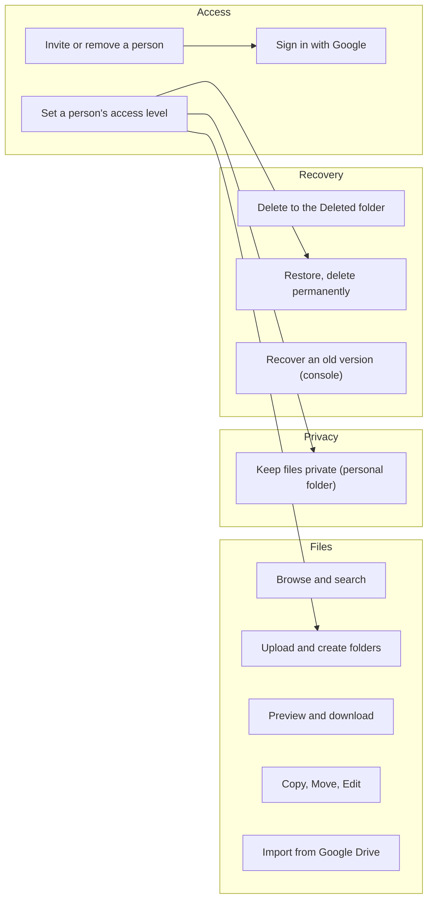
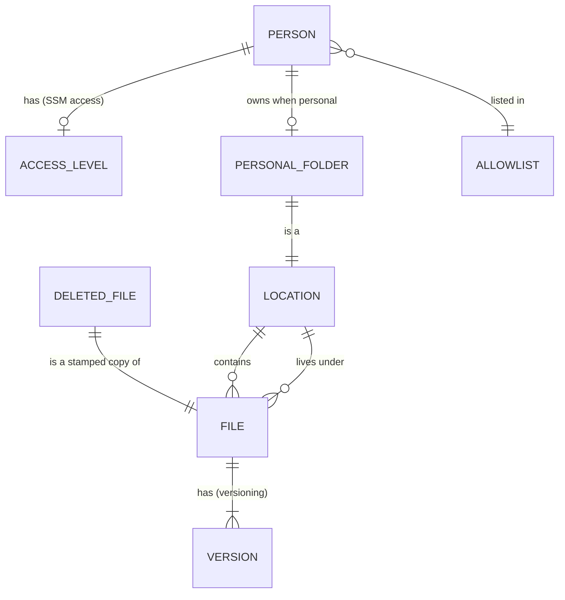
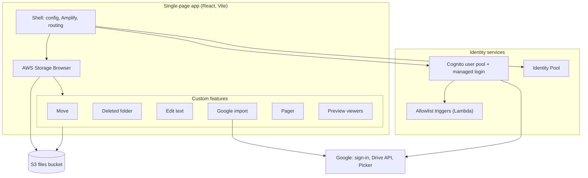
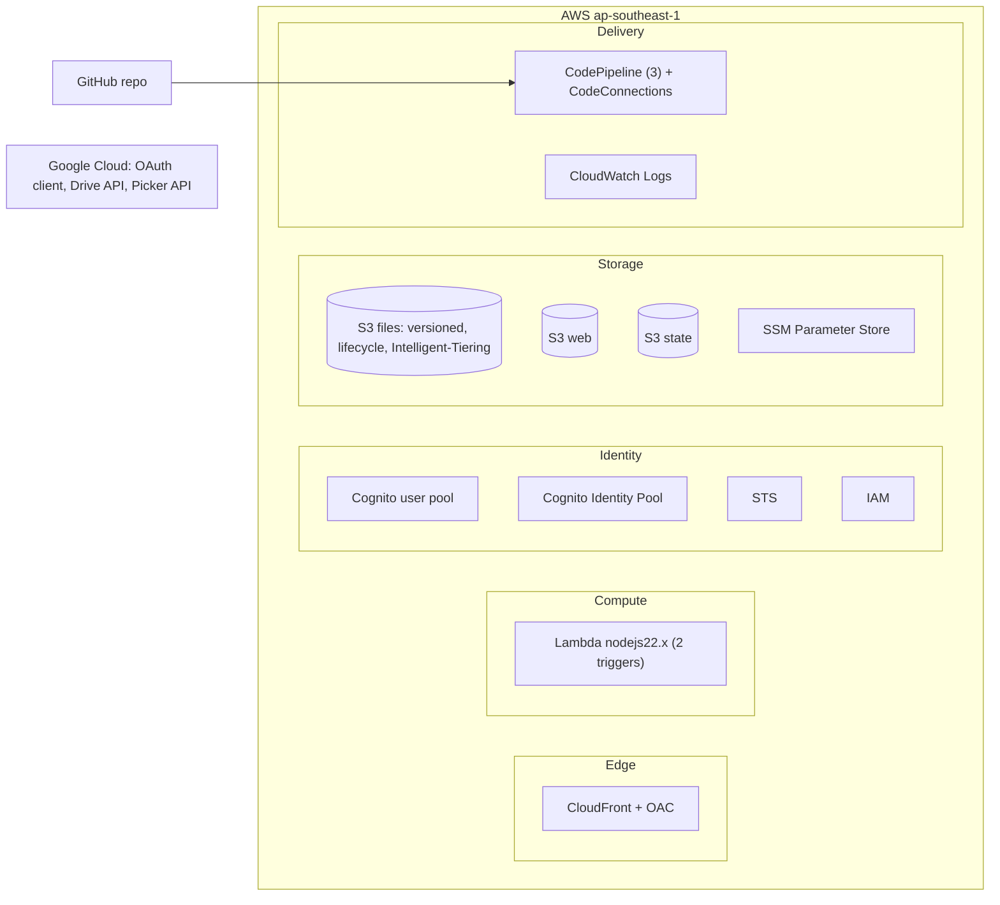
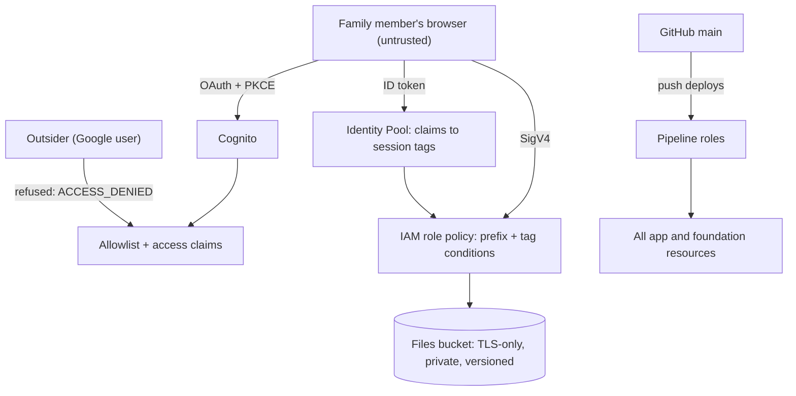

# Architecture Definition Document

Family Drive's architecture in TOGAF's terms, scaled to a small family system: the structure and
deliverables of TOGAF, without enterprise process. It has three companions:
- [architecture-requirements.md](architecture-requirements.md): the Architecture Requirements Specification;
- [architecture-contract.md](architecture-contract.md): how changes must conform;
- [system-design.md](system-design.md): the detailed design one level below.

Decisions are recorded in [`docs/adr/`](../adr/) and linked here, not restated.

- **Version:** 1.0, 14 November 2026, describing `main` after #30 and #33.
- **Architecture authority:** the repository owner.

## 1. Scope, goals and constraints

**Scope.** A private file store for one family: a web app (installable on phones), its AWS
infrastructure, its deployment pipelines, and its use of Google for sign-in and Drive import.
Out of scope: other families or tenants, public sharing links, offline use, native apps.

**Goals.**
1. The family keeps its files in one place it controls, with a familiar Drive-like experience.
2. Only invited people get in; each person can be given more or less access.
3. A mistake is recoverable for 30 days.
4. It costs a few dollars a month and needs no server to run, patch or pay for while idle.
5. One person can operate it, with everything deployed from the repository.

**Constraints.**
- No backend and no database ([ADR 0001](../adr/0001-no-backend-browser-talks-to-s3.md)).
- AWS in `ap-southeast-1`; Google as the only identity provider.
- A small budget: no paid backup, monitoring or WAF (#54, #56 won't fix).
- A third-party file UI (AWS Storage Browser) rather than a hand-built one ([ADR 0002](../adr/0002-storage-browser-without-amplify-backend.md)).

## 2. Architecture principles

| # | Principle | Rationale | Implication | ADR |
|---|---|---|---|---|
| P1 | **No backend, no database** | Nothing to run, patch or pay for while idle | Features run in the browser or as S3-native rules; long work runs in the tab | [0001](../adr/0001-no-backend-browser-talks-to-s3.md) |
| P2 | **S3 is the only source of truth** | One place for data and metadata | No app metadata store; state is keys, names and S3 properties | [0001](../adr/0001-no-backend-browser-talks-to-s3.md) |
| P3 | **IAM is the security boundary** | The browser holds real credentials | Every permission is an IAM condition; the UI only hides | [0009](../adr/0009-personal-folders-keyed-by-email.md), [0010](../adr/0010-per-person-access-levels-in-ssm.md) |
| P4 | **Configuration, not admin screens** | Changes are rare and made by the owner | Allowlist and access levels are SSM values applied by the pipeline | [0003](../adr/0003-allowlist-in-cognito-triggers.md), [0010](../adr/0010-per-person-access-levels-in-ssm.md) |
| P5 | **Retained data, disposable app** | Rebuilding the app must never risk the files | Two Terraform stacks; the app finds the foundation by name | [0004](../adr/0004-retained-foundation-and-disposable-app-stack.md) |
| P6 | **Recover mistakes, don't prevent every action** | A family trusts each other | Versioning and the Deleted folder instead of fine-grained roles | [0006](../adr/0006-everyone-can-delete-versioning-is-the-safety-net.md), [0011](../adr/0011-delete-moves-to-a-deleted-folder.md) |
| P7 | **Everything as code, deployed by pipeline** | One operator, repeatable rebuilds | Terraform for all infrastructure; least-privilege pipeline roles | [0004](../adr/0004-retained-foundation-and-disposable-app-stack.md) |
| P8 | **Cheapest option that never blocks a read** | Small budget, unpredictable access | Intelligent-Tiering without archive tiers; lifecycle rules over code | [0012](../adr/0012-deleted-folder-auto-empties-after-30-days.md), [0013](../adr/0013-files-in-intelligent-tiering-without-archive-tiers.md) |

## 3. Business architecture

### Actors and roles

| Actor | Role | Defined by |
|---|---|---|
| Family member (reader) | Browse, preview and download the shared drive | allowlist; no entry in `access`, or `"global": "read"` |
| Family member (writer) | Also upload, organise, edit, delete and import in the shared drive | `"global": "write"` |
| Folder owner | Has a private folder | `"personal": true` |
| Trash manager | Restores and permanently removes deleted files | `"trash": true` |
| Owner / operator | Invites people, sets access, deploys, recovers from the console | AWS account and repository owner |
| Outsider | A Google user not invited | refused at sign-in |

### Capabilities

### Business rules

- Only allowlisted, Google-verified emails get in ([ADR 0003](../adr/0003-allowlist-in-cognito-triggers.md)).
- Everyone signed in can read the shared drive; writing there is per person ([ADR 0010](../adr/0010-per-person-access-levels-in-ssm.md)).
- A personal folder is visible only to its owner in the app ([ADR 0009](../adr/0009-personal-folders-keyed-by-email.md)).
- Move and Google import never overwrite a file; Restore never puts a file over another.
- Delete in the app moves to `Deleted/`; files there are removed after 30 days ([ADR 0011](../adr/0011-delete-moves-to-a-deleted-folder.md), [0012](../adr/0012-deleted-folder-auto-empties-after-30-days.md)).
- Saving an edited text file is last-write-wins; versioning is the undo (#45).

**Baseline = target** for the business domain: the capabilities above all exist. The UI refresh (#13)
changes how they look, not what they are.

## 4. Data architecture

### Data entities

| Entity | Stored as | Owner | Retention |
|---|---|---|---|
| File | S3 object under `Global/` or `Personal/<email>/` | the family | until deleted; old versions 30 days |
| Version | S3 object version | S3 | noncurrent 30 days (1 day under `Deleted/`) |
| Deleted file | object under `Deleted/…` with a stamped name | trash managers | 30 days |
| Location | a prefix (`Global/`, `Personal/<email>/`, `Deleted/`) | IAM policy | permanent |
| Person, allowlist | SSM `/family-drive/allowed_emails` | owner | until edited |
| Access level | SSM `/family-drive/access` (JSON) | owner | until edited |
| App configuration | SSM parameters → `config.json` | owner / Terraform | per deploy |
| Infrastructure state | S3 `family-drive-tfstate-<account>` | pipelines | all versions kept |

**Metadata:** only what S3 returns (key, size, last modified, content type, storage class). The
Deleted folder's original path is encoded in the key, not in object metadata (ADR 0011).

**Detail:** [storage-and-retention.md](../features/storage-and-retention.md) (layout, versioning,
lifecycle, classes), [system-design.md §4](system-design.md#4-data-design) (config flow).

**Baseline = target**, except: the access-level data is validated twice in different languages (#41),
and the config contract from Terraform to the SPA has drifting key lists (#42, not yet decided).

## 5. Application architecture

### Application / data matrix

| Application component | Global/ | Personal/ | Deleted/ | SSM | Google |
|---|---|---|---|---|---|
| Storage Browser (list, upload, download, copy, create folder) | R/W | R/W (own) | R | | |
| Move, Edit | R/W | R/W (own) | | | |
| Deleted folder | W (restore) / delete | W (restore, own) / delete | R/W/purge | | |
| Pager count | R (list) | R (list, own) | R (list) | | |
| Preview viewers | R | R (own) | R | | |
| Google import | W | W (own) | | | R (Drive) |
| Allowlist triggers | | | | R (via env) | |

**Baseline:** each feature wires itself into `Drive.tsx` by hand and keeps its own S3 port and fake.
**Target** (architecture review, #38–#40): one Location policy module (#38), one drive-storage seam
with S3 and in-memory adapters (#39), and a Storage Browser feature seam so `Drive.tsx` takes a list of
features (#40). The UI follows a Google Drive-style layout (#13). Detail: [system-design.md §1](system-design.md#1-components).

## 6. Technology architecture

### Technology / application matrix

| Technology | Used by | Version / setting |
|---|---|---|
| React 19, Vite 8, TypeScript | SPA | Node ≥ 22.12 to build |
| AWS Amplify JS v6, Storage Browser (`@aws-amplify/ui-react-storage` 3.x) | SPA | client library only, no Amplify backend |
| `@aws-sdk/client-s3` (lazy) | Deleted folder, Edit | version APIs Amplify lacks |
| `react-pdf` (PDF.js), `react-markdown` + `remark-gfm` | Preview | lazy PDF |
| Lambda `nodejs22.x` | Triggers | esbuild bundles |
| Terraform ≥ 1.10, AWS provider ~> 6.0 | Both stacks | S3 backend with lockfile |
| CodePipeline V2, Commands action | Deploy | Terraform 1.16.6 installed per run |
| Google Identity Services, Picker, Drive API v3 | Sign-in, import | `drive.readonly` |

**Baseline = target**, except: production still trusts `http://localhost:5173` (#57) and the pipeline
roles need tightening (#52, #53, #58).

## 7. Security architecture

### Trust boundaries and controls

| Layer | Control | Where |
|---|---|---|
| Identity | Google-only sign-in, verified email, allowlist on every token issue | `infra/auth.tf`, `functions/allowlist/` |
| Authorisation | Role policy with `s3:prefix` and `aws:PrincipalTag/{email,global_access,personal,trash}`; fails closed | `infra/identity.tf` |
| Session | 60-minute tokens, 1-hour credentials, 30-day refresh, server-side token check | `infra/auth.tf`, `infra/identity.tf` |
| Data | SSE-S3, TLS-only bucket policies, public access blocked, versioning | `infra/foundation/` |
| Application | No rendering of file content as code (Markdown without HTML, PDF.js without scripts); React escaping; managed security headers | `web/src/preview/`, `infra/web.tf` |
| Third party | Google token in memory only, sent only to Google; API key restricted | `web/src/googleImport/` |
| Delivery | Least-privilege pipeline policies; lockfiles and `npm ci`; pinned Terraform | `ci/iam/`, `ci/` |

### Baseline and target

**Baseline:** as reviewed in the [security assessment](../security/assessment-2026-11.md): nothing
exploitable by an outsider; the widest boundary is the pipelines.

**Target:**
- protected `main` and gated pipelines (#52);
- a permissions boundary on pipeline-created roles (#53);
- a Content Security Policy (#55);
- no localhost trust in production (#57);
- small hardening (#58).

**Accepted, not targeted:** no independent backup (#54) and no detection or alarms (#56), for cost.

## 8. Gap analysis

| Domain | Baseline | Target | Gap closed by |
|---|---|---|---|
| Business | All capabilities in place | Same, Drive-style experience | #13 |
| Data | Access levels validated in TS and HCL separately; config key lists differ | One validator; one config contract | #41; #42 (undecided) |
| Application | Hand wiring in `Drive.tsx`; four storage ports; scattered permission rules | Location policy, storage seam, feature seam | #38, #39 (needs a decision), #40 |
| Technology | Production trusts localhost; broad pipeline `Resource: "*"` | Dev origin only in dev; scoped pipeline policies | #57, #58 |
| Security | Unprotected `main`; pipeline escalation; no CSP | Protected and gated; boundary; CSP | #52, #53, #55 |
| Documentation | Setup spread through `deployment.md` | Step-by-step setup guide | #19 |

## 9. Architecture decisions

| ADR | Decision |
|---|---|
| [0001](../adr/0001-no-backend-browser-talks-to-s3.md) | No backend: the browser talks to S3 directly |
| [0002](../adr/0002-storage-browser-without-amplify-backend.md) | Storage Browser on Terraform-made Cognito, without Amplify's backend tooling |
| [0003](../adr/0003-allowlist-in-cognito-triggers.md) | The allowlist is enforced by Cognito triggers |
| [0004](../adr/0004-retained-foundation-and-disposable-app-stack.md) | Retained foundation stack, disposable app stack |
| [0005](../adr/0005-fixed-cognito-domain.md) | Fixed Cognito domain |
| [0006](../adr/0006-everyone-can-delete-versioning-is-the-safety-net.md) | Versioning is the safety net (superseded for permissions by 0010) |
| [0007](../adr/0007-pwa-without-offline-cache.md) | Installable, no offline cache |
| [0008](../adr/0008-google-drive-import-scope.md) | Google import uses `drive.readonly` |
| [0009](../adr/0009-personal-folders-keyed-by-email.md) | Personal folders keyed by email, enforced by principal tags |
| [0010](../adr/0010-per-person-access-levels-in-ssm.md) | Per-person access levels in SSM, enforced by session tags |
| [0011](../adr/0011-delete-moves-to-a-deleted-folder.md) | Delete moves to a Deleted folder |
| [0012](../adr/0012-deleted-folder-auto-empties-after-30-days.md) | The Deleted folder empties itself after 30 days |
| [0013](../adr/0013-files-in-intelligent-tiering-without-archive-tiers.md) | Intelligent-Tiering without archive tiers |

## 10. Risks and mitigations

| Risk | Impact | Mitigation | Status |
|---|---|---|---|
| A push to `main` (or a compromised GitHub account) changes AWS | Account takeover, data loss | Branch protection, pipeline approval, permissions boundary | #52, #53 open |
| Files lost with no second copy | Family photos gone | Versioning (30 days), `Deleted/`, `prevent_destroy` | Accepted (#54) |
| Unnoticed misuse or cost spike | Late discovery | Manual checks; incident steps in the security assessment | Accepted (#56) |
| XSS steals the 30-day refresh token | Ongoing access to files | Careful viewers; CSP | #55 open |
| A Storage Browser upgrade breaks custom parts | Broken layout or actions | Pinned behaviour notes, playground re-check, feature seam | CLAUDE.md, #40 |
| Google changes the import scope rules or Testing limits | Import stops | ADR 0008 notes the switch-back path | Watch |
| Lambda runtime or dependency end of life | Deploys or sign-in break | Track deprecation dates and CVEs | Manual (#22 won't fix) |
