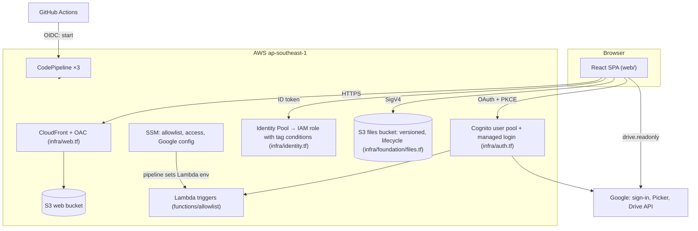

# Family Drive baseline

**Version:** 1.0.0 · **Status:** Accepted · **Date:** 2026-11-28 · **Previous:** none
**Based on:** brief 1.0.0; `main` at `073e297` plus the onboarding commit `ddf32ed` (merged as #96)

## Changes from (none)
- First baseline. One repo (`personal-storage`, its own workspace). Checked against brief 1.0.0.

## Summary

Family Drive is a React SPA on CloudFront that signs in through Cognito (Google only) and then talks **directly to S3** with temporary IAM credentials. There is no backend and no database. The code is healthy: 277 unit tests pass, lint and type-check are clean, `npm audit` finds nothing, and both Terraform stacks validate. The last deploy succeeded on 2026-11-28. The weak points are operational, not code: no backup copy, no cost or usage signal, a CSP that only reports, and version recovery that only the owner can do in the console. Brief measures M1 and M3 can't be measured today.

How evidence is cited: `path:line`, a command and its output (run 2026-11-28), or **not found**.

## 1. Purpose and boundaries

- **Does:** stores the family's files in one private S3 bucket, with a Drive-like web UI, sign-in with Google, per-person access levels, a Deleted folder and Google Drive import (`AGENTS.md` "What this is"; [ADD §1](../architecture-definition.md)).
- **Owns:** the files bucket (`infra/foundation/files.tf`), the allowlist and access levels in SSM (`infra/foundation/ssm.tf:33`, `:49`), the Cognito user pool and Identity Pool (`infra/auth.tf`, `infra/identity.tf`), the CloudFront site (`infra/web.tf`), and three CodePipelines (`ci/`).
- **Called by:** family members' browsers only. No other system calls it. It calls Cognito, STS and S3 (AWS), and Google sign-in, Picker and Drive API v3.

## 2. Structure

| Part | Path | Files (tracked) | Role |
|---|---|---|---|
| Web SPA | `web/src/` | 86 | React app; Storage Browser plus our features |
| Unit tests | `web/test/` | 22 | vitest, jsdom |
| Cognito triggers | `functions/allowlist/` | 12 | `preSignUp`, `preTokenGeneration`; pure rules in `src/allowlist.ts` |
| App stack | `infra/*.tf` | 9 | disposable: Cognito, IAM, CloudFront, CORS, Lambdas |
| Foundation stack | `infra/foundation/` | 9 | retained (`prevent_destroy`): files and state buckets, SSM, permissions boundary, TLS |
| Pipelines | `ci/`, `ci/iam/`, `.github/workflows/` | 16 | GitHub Actions starts CodePipeline over OIDC |
| Scripts | `scripts/` | 2 | `write-config.sh`, `deploy.sh` |

**Web module dependencies:** `pages/Drive.tsx` builds the drive from the feature list in `web/src/features.ts` (upload, edit, Google import, move, pager, preview, trash). `web/src/driveHost/DriveView.tsx` wires them into AWS Storage Browser. Every feature reads permissions from `web/src/locationPolicy.ts` (169 lines) and reaches S3 through the `DriveStorage` seam (`web/src/storage/driveStorage.ts`, with `s3Storage.ts` and `memoryStorage.ts` adapters). This follows the refactors #38–#40.

## 3. Stack

| Item | Version | Evidence |
|---|---|---|
| Node (local) | 26.x used for checks; CI and Lambdas need ≥ 22.12 / `nodejs22.x` | `AGENTS.md` Commands |
| React | ^19.3.1 | `web/package.json` |
| AWS Amplify JS / Storage Browser | `aws-amplify` ^6.22.2, `@aws-amplify/ui-react-storage` ^3.18.4 | `web/package.json` |
| `@aws-sdk/client-s3` | 3.1155.0 pinned (latest 3.1179.0) | `npm outdated` |
| Vite / vitest / TypeScript | 8.3.5 / 5.1.0 / ^7.0.2 | `web/package.json`, `npm outdated` |
| `react-pdf`, `react-markdown` | 11.0.0, ^10.1.0 | `web/package.json` |
| oxlint | 1.93.0 (latest 1.95.0) | `npm outdated` |
| Terraform / AWS provider | ≥ 1.10 / ~> 6.0 (pipeline installs 1.16.6) | `infra/versions.tf:2-8` |

**How old:** everything is within one minor version of latest except `jsdom` (26.1.0, latest 29.x; Dependabot PR #88 open). Three Dependabot PRs are open (#86, #87, #88). The `random` provider is kept only to clean old state (`infra/versions.tf:14-18`).

## 4. Data

| Store | What | Personal or secret | Evidence |
|---|---|---|---|
| S3 files bucket | `Global/`, `Personal/<email>/`, `Deleted/` | Family files: **personal** | `infra/foundation/files.tf` |
| Versions | noncurrent kept 30 days; 1 day under `Deleted/` | personal | `files.tf:56-62`, `:82-83` |
| Deleted folder | expires after `deleted_retention_days` | personal | `files.tf:78-79` |
| Storage class | Intelligent-Tiering at day 0 on `Global/` and `Personal/`, no archive tiers | | `files.tf:122-123`, ADR 0013 |
| SSM | allowlist (emails), access levels (JSON), Google client ID, API key, project number, custom domain | emails **personal**; `google_client_secret` is a **SecureString** | `infra/foundation/ssm.tf:10-129`, `:23` |
| Lambda environment | `ALLOWED_EMAILS` copied from SSM at apply time | personal | `infra/auth.tf:66-68`, `:86-88` |
| Terraform state | S3, versioned, `prevent_destroy` | contains resource IDs | `infra/foundation/state.tf:7`, `:28-31` |
| Browser | Cognito tokens and Identity Pool data in `localStorage` | **secret** (30-day refresh token) | `web/src/session.ts:4-5` |

**Schemas and migrations:** none. State is S3 keys and object properties only (ADR 0001). **Volume stored today:** not found (needs the S3 console or Storage Lens; brief Q4).

## 5. Interfaces

| Interface | Direction | Evidence |
|---|---|---|
| S3 REST (SigV4, CORS) | SPA → files bucket | `web/src/storage/s3Storage.ts`, `infra/storage.tf` |
| Cognito managed login, OAuth code + PKCE | SPA → Cognito → Google | `infra/auth.tf` |
| Identity Pool, claims to session tags | SPA → Cognito Identity → STS | `infra/identity.tf` |
| Google Identity Services, Picker, Drive API v3 (`drive.readonly`) | SPA → Google | `web/src/googleImport/google.ts`, `driveClient.ts`, ADR 0008 |
| `config.json` | Terraform outputs → SPA | `scripts/write-config.sh`, `web/src/config.ts`; contract still open (#42) |
| Exposed APIs or events | none | not found: no API Gateway, no event bus |

## 6. Build, test and run

Commands are in `repos.yaml` and `AGENTS.md`. Results on 2026-11-28:

| Check | Result |
|---|---|
| `functions/allowlist`: typecheck, test, lint, build | pass: 3 files, **30 tests**; lint clean; `dist/preSignUp.js` 1.7 kB |
| `web`: test | pass: 20 files, **247 tests**, 11 skipped (the manual S3 adapter suite, `web/test/driveStorage.s3.test.ts:23`, runs only with a real bucket) |
| `web`: lint, build | lint clean; build passes with a Vite warning: main chunk **1.1 MB** (`index-*.js`), PDF chunk 631 kB |
| `npm audit --omit=dev` | 0 vulnerabilities in both packages |
| `terraform fmt -check -recursive infra`; `validate` on both stacks | pass |
| Run locally | `npm run dev` with `web/public/config.json`; `/playground.html?view=drive` needs no AWS |

## 7. Delivery

- **Pull-request checks:** `.github/workflows/ci.yml` with no AWS access. Last three runs succeeded (`gh run list --workflow ci.yml`).
- **Deploy:** `deploy.yml` on push to `main` (docs and Markdown ignored). After approval in a GitHub Environment, it starts the foundation pipeline (only when `infra/foundation/**` changed) and then the app pipeline (`ci/pipeline.sh`). It signs in to AWS over OIDC; no AWS key is stored in GitHub (ADR 0017).
- **Recent history:** four deploy runs failed on 2026-11-27 (e.g. run 45990902945: `Terraform-Apply … bash ci/pipeline.sh … exit status 1`) while ADR 0017 was being rolled out (#94, #95). The last two runs succeeded, the latest on 2026-11-28 at `073e297`.
- **Environments:** one, production (`https://drive.linhwas.dev`, which answers `HTTP/2 200`).
- **Rollback:** manual. Run `deploy.yml` with an older commit of `main` (`deploy.yml` header). There is no automated rollback, and the foundation stack has no rollback beyond Terraform state versions.
- **Destroy:** `destroy.yml`, manual, app stack only.

## 8. Security and operations

| Area | Today | Evidence |
|---|---|---|
| Authentication | Google only, verified email, allowlist on every sign-in and refresh | `functions/allowlist/src/`, ADR 0003 |
| Authorisation | IAM role with prefix and principal-tag conditions; fails closed | `infra/identity.tf`, ADR 0009, 0010 |
| Sessions | ID and access tokens 60 min, refresh token 30 days | `infra/auth.tf:197-203` |
| Pipeline privilege | permissions boundary on created roles | `infra/foundation_inputs.tf:80`, `infra/identity.tf:42`, `infra/auth.tf:29` |
| Remaining wildcards | some `Resource: "*"` statements in pipeline policies | `ci/iam/app-pipeline-policy.json:180`, `foundation-pipeline-policy.json:64`, `app-pipeline-identity-policy.json:11,34,185,194` |
| Data at rest and in transit | public access blocked; SSE-S3; TLS only | `infra/foundation/files.tf:23`, `infra/web.tf:18`, [security assessment](../../security/assessment-2026-11.md) |
| CSP | **report-only** in production | `curl -sI https://drive.linhwas.dev/` returns `content-security-policy-report-only: …`; `infra/variables.tf:30-34` (`csp_enforce` default `false`) |
| Secrets | SSM SecureString; nothing in the repository; OIDC instead of keys | `infra/foundation/ssm.tf:23`, ADR 0017 |
| Logging | trigger Lambdas only, 14-day retention | `infra/auth.tf:48-55` |
| Monitoring and alerts | **not found**: no CloudTrail, alarms, AWS Budgets or access logs in either stack | `grep -rn "cloudtrail\|aws_budgets\|metric_alarm" infra`: no matches |
| Backups | **none** outside the bucket (versioning 30 days only) | ADR 0018, #97 |
| Running cost | not found (needs Cost Explorer) | |

## 9. Debt and risks

Risks are numbered `R1…` and keep their numbers in later versions.

| ID | Risk or debt | Evidence | Cost of leaving it |
|---|---|---|---|
| R1 | **No backup copy:** losing the bucket or the account, or noticing a mistake after 30 days, loses files for good | §8 Backups; ADR 0018 | Low chance, total loss of an archive the family can't recreate. Accepted within the $2 budget |
| R2 | **No cost or misuse signal:** a cost spike or a leaked credential would be noticed late | §8 Monitoring | A month's bill before anyone notices; brief M1 can't be checked |
| R3 | **CSP only reports** while a 30-day refresh token sits in `localStorage` | §8 CSP; `web/src/session.ts:4` | One XSS bug gives 30 days of access to the files |
| R4 | **Version recovery is console-only** (FR-24): only the owner can undo an overwrite | ARS FR-24; no version UI in `web/src/` | Every recovery goes through the owner; blocks brief M2 |
| R5 | **No per-person usage signal:** nothing records who signed in or used the drive | §8 Logging (errors only), NFR-P3 | Brief M3 (≥ 2 active a month) can't be measured |
| R6 | **Storage Browser coupling:** a third-party UI wired to custom features, on caret ranges | `web/package.json`; ADD §10 | An upgrade can break layout or actions; caught only by the playground and the manual checklist |
| R7 | **Architecture docs drift:** ADD and ARS are version 1.0 of 14 Nov; ADD §9 lists ADRs up to 0013, not 0014–0018 | `docs/architecture/architecture-definition.md` §9 | Agents and reviewers read stale principles; the Architecture Contract checks against them |
| R8 | **Config contract drift** between Terraform outputs and the SPA | #42 open, undecided | A renamed output breaks sign-in at deploy time |
| R9 | **Large main bundle** (1.1 MB) loaded on phones | §6 build warning | Slower first load on mobile, which is the primary user (brief §2) |
| R10 | **New deploy path** (ADR 0017) has a short track record: 4 failures on its first day; rollback is manual | §7 | A failed deploy waits for the owner |
| R11 | **Google consent screen in Testing:** import works only for listed test users | ARS C-2 | Someone can't import until the owner adds them |
| R12 | **Long work runs in the tab** (imports, emptying Deleted) and stops if it closes | ARS C-8 | Half-done imports on phones that sleep |
| R13 | **Allowlist in the Lambda environment** (4 KB) | `infra/auth.tf:66-68`, ARS C-7 | None at 10 people; matters only if the family grows a lot |

Small debt: leftover `random` provider (`infra/versions.tf:14-18`); three open Dependabot PRs, one a major `jsdom` bump.

## 10. Shortfalls against brief 1.0.0

These are the first gap candidates for `product-target`.

| Brief item | Today | Shortfall | Risk |
|---|---|---|---|
| Scope: budget alert; M1 cost ≤ $2 with an alert | no AWS Budgets; cost not visible from the repository | **Missing** | R2 |
| Scope: CSP enforced | report-only | **Missing** (one variable, after checking reports) | R3 |
| Scope: version recovery in the app; M2 | console only | **Missing** | R4 |
| M3: ≥ 2 active members a month | no usage signal | **Can't be measured** | R5 |
| Quality 1: durability | versioning and Deleted folder only | Accepted gap (ADR 0018, #97) | R1 |
| Primary user on a phone | 1.1 MB main bundle; iOS home-screen app signs in separately (ARS NFR-B2) | Partial | R9 |
| Usage is mostly archive (brief §2) | every file stays instantly readable in Intelligent-Tiering without archive tiers (ADR 0013) | Open: whether cheaper archive classes fit; needs stored volume (brief Q4) | — |
