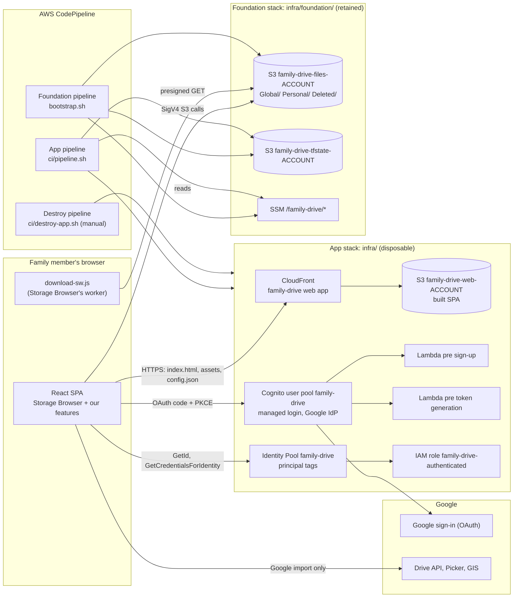
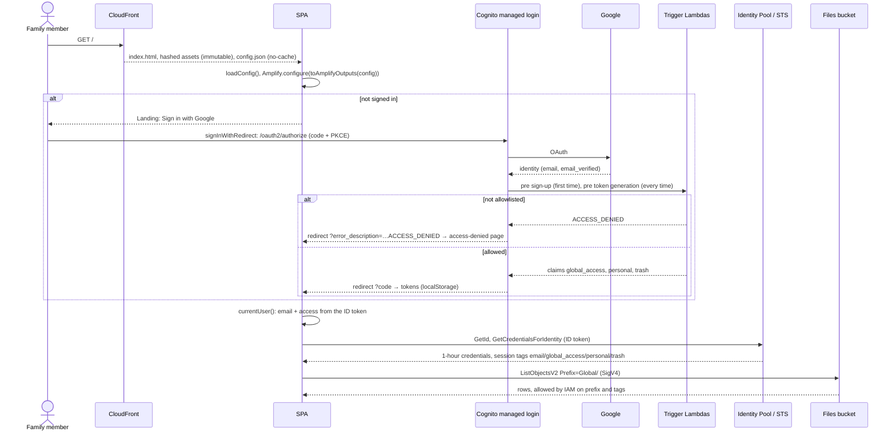
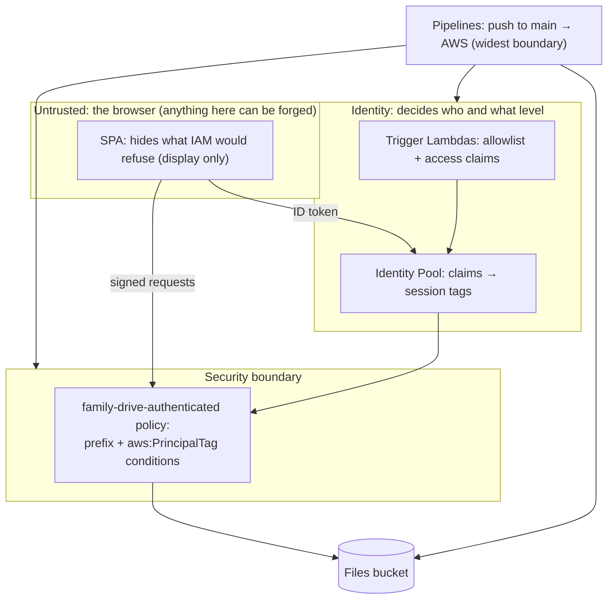
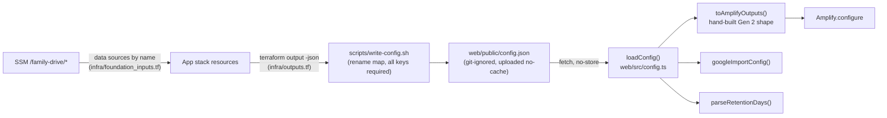

# System design

How Family Drive works, for someone changing its code or infrastructure. It sits below the
architecture documents ([architecture-definition.md](architecture-definition.md)) and above the
per-feature docs in [`docs/features/`](../features/), which hold each feature's own flows, IAM
statements and failure messages. This document keeps what cuts across features: the components,
the request path, trust boundaries, data and configuration, and deployment. Decisions are in
[`docs/adr/`](../adr/); conventions for working in the code are in [CLAUDE.md](../../CLAUDE.md).

## 1. Components



There is **no API layer and no database** ([ADR 0001](../adr/0001-no-backend-browser-talks-to-s3.md)):
the browser talks to Cognito, the Identity Pool, S3 and Google directly, and S3 is the only source
of truth.

### Component catalogue

| Component | Implemented in | Stack | Detail |
|---|---|---|---|
| SPA shell: config, Amplify setup, routing to landing / access denied / drive | `web/src/main.tsx`, `App.tsx`, `config.ts`, `pages/Landing.tsx`, `pages/AccessDenied.tsx` | web | [auth-and-access.md](../features/auth-and-access.md) |
| Sign-out, email and access from the ID token | `web/src/session.ts`, `access.ts`, `authErrors.ts` | web | [auth-and-access.md](../features/auth-and-access.md) |
| Drive screen, Storage Browser setup, top bar | `web/src/pages/Drive.tsx` | web | [global-drive.md](../features/global-drive.md) |
| Locations and Home (Global, own folder, Deleted) | `web/src/config.ts` (`driveLocation`, `personalLocation`, `deletedLocation`, `listDriveLocations`) | web | [personal-folders.md](../features/personal-folders.md) |
| Pager with folder totals | `web/src/pagination/` | web | [global-drive.md](../features/global-drive.md) |
| Move | `web/src/move/` | web | [global-drive.md](../features/global-drive.md) |
| Delete → `Deleted/`, Restore, Delete permanently, Empty | `web/src/trash/` | web | [deleted-folder.md](../features/deleted-folder.md) |
| Edit `.txt` files | `web/src/edit/` | web | [global-drive.md](../features/global-drive.md) |
| File preview | `web/src/preview/` | web | [file-preview.md](../features/file-preview.md) |
| Import from Google Drive | `web/src/googleImport/` | web | [google-import.md](../features/google-import.md) |
| Dev playground (mock S3/Google, not deployed) | `web/playground.html`, `web/src/playground/` | web | each feature doc's Testing section |
| PWA manifest and icons | `web/public/manifest.webmanifest`, `web/public/icons/`, `web/index.html` | web | [ADR 0007](../adr/0007-pwa-without-offline-cache.md) |
| Allowlist and access-level triggers | `functions/allowlist/src/` | `infra/` | [auth-and-access.md](../features/auth-and-access.md) |
| User pool, Google IdP, domain, app client, triggers | `infra/auth.tf` | `infra/` | [auth-and-access.md](../features/auth-and-access.md) |
| Identity Pool, authenticated role and policy, tag mapping | `infra/identity.tf` | `infra/` | [auth-and-access.md](../features/auth-and-access.md) |
| CloudFront, OAC, web bucket | `infra/web.tf` | `infra/` | [global-drive.md](../features/global-drive.md) |
| Files bucket CORS | `infra/storage.tf` | `infra/` | [global-drive.md](../features/global-drive.md) |
| Foundation lookups and input validation | `infra/foundation_inputs.tf` | `infra/` | §4 below |
| Files bucket, lifecycle, TLS-only policies | `infra/foundation/files.tf`, `tls.tf` | foundation | [storage-and-retention.md](../features/storage-and-retention.md) |
| State bucket | `infra/foundation/state.tf` | foundation | [storage-and-retention.md](../features/storage-and-retention.md) |
| SSM parameters | `infra/foundation/ssm.tf` | foundation | §4 below |
| Config into the SPA | `scripts/write-config.sh` | scripts | §4 below |
| Build and upload of the SPA | `scripts/deploy.sh` | scripts | §5 below |
| Pipelines | `ci/pipeline.sh`, `ci/app-env.sh`, `ci/tf-init.sh`, `ci/destroy-app.sh`, `infra/foundation/bootstrap.sh` | CI | §5 below |
| Pipeline permissions | `ci/iam/app-pipeline-policy.json`, `ci/iam/foundation-pipeline-policy.json` | CI | §5 below |

## 2. Request path

From opening the site to the first file listing:



### Where every flow's diagram lives

| Flow | Diagram |
|---|---|
| Sign-in and allowlist check, denial, `ACCESS_DENIED` handling | [auth-and-access.md §4](../features/auth-and-access.md#4-flows) |
| Credential exchange | [auth-and-access.md: Getting AWS credentials](../features/auth-and-access.md#getting-aws-credentials-and-calling-s3) |
| Token refresh and allowlist removal | [auth-and-access.md: Token refresh](../features/auth-and-access.md#token-refresh-and-removal-from-the-allowlist) |
| List and folder count, upload, download, Copy, Move, Edit | [global-drive.md §4](../features/global-drive.md#4-flows) |
| Preview, including the PDF fetch | [file-preview.md §4](../features/file-preview.md#4-flows) |
| Personal folder access and denial | [personal-folders.md §4](../features/personal-folders.md#4-flows) |
| Delete, Restore, Delete permanently, Empty, auto-empty | [deleted-folder.md §4](../features/deleted-folder.md#4-flows) |
| Google Drive import (choose, copy, cancel) | [google-import.md §4](../features/google-import.md#4-flows) |
| Changing storage rules, recovering a version | [storage-and-retention.md §4](../features/storage-and-retention.md#4-flows) |
| Config into the SPA, deployment | §4 and §5 below |

## 3. Security design

### Trust boundaries



- **The browser is untrusted.** It holds real AWS credentials, so the UI's hiding of buttons is
  cosmetic; the IAM policy decides ([ADR 0010](../adr/0010-per-person-access-levels-in-ssm.md)).
- **Who gets in:** the allowlist, checked by both Cognito triggers, requiring a verified email
  ([ADR 0003](../adr/0003-allowlist-in-cognito-triggers.md)).
- **What they can do:** the authenticated role's statements use `s3:prefix` and
  `aws:PrincipalTag/email`, `global_access`, `personal`, `trash`. A missing tag fails closed (read-only
  `Global/`). Full table: [auth-and-access.md §3](../features/auth-and-access.md#the-authenticated-roles-statements).
- **Personal folders** are keyed by the `email` tag ([ADR 0009](../adr/0009-personal-folders-keyed-by-email.md)).
- **Deleted folder:** writers may write into their part of `Deleted/`; only `trash` reads or purges it
  ([ADR 0011](../adr/0011-delete-moves-to-a-deleted-folder.md)).
- **Transport and hosting:** HTTPS everywhere; the foundation buckets deny non-TLS requests; the web
  bucket is private behind CloudFront OAC; CloudFront adds the managed security headers.
- **CORS** on the files bucket allows the site's origin and `http://localhost:5173` (#57).
- **Untrusted file content:** previews never run it (Markdown without HTML, PDF.js without scripts,
  SVG as ``); downloads come from the S3 origin, never the app's
  ([file-preview.md §3](../features/file-preview.md#3-access-control)).
- **Google:** a separate `drive.readonly` token, kept in memory, sent only to Google
  ([ADR 0008](../adr/0008-google-drive-import-scope.md)).
- **Risks and accepted risks:** [security assessment, November 2026](../security/assessment-2026-11.md).

## 4. Data design

### S3 key layout

```
family-drive-files-<account>/
├── Global/<folders>/<name>                         shared drive
├── Personal/<email lower-case>/<folders>/<name>    one per person with "personal"
└── Deleted/
    ├── Global/<folders>/<name> (deleted <stamp> <tag>).<ext>
    └── Personal/<email>/<folders>/<name> (deleted <stamp> <tag>).<ext>
```

Folders are prefixes, with zero-byte `name/` placeholders for empty ones. No application metadata:
names, sizes, dates and content types are what S3 returns. Versioning, lifecycle and storage classes:
[storage-and-retention.md](../features/storage-and-retention.md).

### Configuration data

| Data | Lives in | Owner | Read by |
|---|---|---|---|
| Allowlist | SSM `/family-drive/allowed_emails` (`StringList`) | owner, by hand | app plan → Lambda env `ALLOWED_EMAILS` |
| Access levels | SSM `/family-drive/access` (`String`, JSON) | owner, by hand | app plan (validated) → Lambda env `ACCESS_LEVELS` |
| Google OAuth client ID / secret | SSM (`String` / `SecureString`) | owner, by hand | app plan → Cognito Google IdP; the ID also → `config.json` |
| Google API key, project number | SSM (`String`) | owner, by hand | app plan → outputs → `config.json` |
| Deleted retention | SSM `/family-drive/deleted_retention_days` | Terraform (foundation variable) | app plan → `config.json` |
| Terraform state | `family-drive-tfstate-<account>`: `foundation/`, `family-drive/` | pipelines | pipelines |

Hand-set parameters are created with a `CHANGE_ME` placeholder and `ignore_changes`; the app plan
stops while the required ones are still placeholders or invalid (`terraform_data.foundation_inputs_check`).

### Config flow into the SPA



`config.json` is never committed or hard-coded; the OAuth redirect URIs it implies (`origin + "/"`)
must match the app client's callback URLs in `infra/auth.tf`. A rework of this path is discussed in #42.

## 5. Deployment design

### Two stacks

| | Foundation `infra/foundation/` | App `infra/` |
|---|---|---|
| Holds | files bucket, state bucket, SSM parameters | Cognito, Lambdas, Identity Pool, role, CloudFront, web bucket, files bucket CORS |
| Lifetime | retained: every resource `prevent_destroy` | disposable: destroy and rebuild freely |
| State | `s3://family-drive-tfstate-<account>/foundation/terraform.tfstate` | `…/family-drive/terraform.tfstate` |
| Applied by | `bootstrap.sh` (foundation pipeline, `AUTO_APPROVE=1`) | `ci/pipeline.sh` (app pipeline) |
| Finds the other | n/a | **by name**, through data sources (`aws_s3_bucket.files`, `aws_ssm_parameter.*`), never remote state |

[ADR 0004](../adr/0004-retained-foundation-and-disposable-app-stack.md). Rebuilding the app stack
keeps the files, settings and Cognito domain (`family-drive-<account>`, [ADR 0005](../adr/0005-fixed-cognito-domain.md)),
but creates new users and identity IDs (harmless: folders are keyed by email) and a new CloudFront URL.

### Pipelines

| Pipeline | Trigger | Runs |
|---|---|---|
| Foundation | push to `main` touching `infra/foundation/**` | `terraform fmt -check`, `bootstrap.sh`: init (or first-run local state then migrate), import existing parameters and buckets, apply |
| App deploy | push to `main` excluding `infra/foundation/**` | `ci/pipeline.sh` (below) |
| App destroy | manual, after an approval | `ci/destroy-app.sh`: build Lambdas, init, `terraform destroy` of `infra/` only |

`ci/pipeline.sh`, in order:
1. `ci/app-env.sh`: check Terraform and Node ≥ 22.12; `npm ci`, test and build the Lambdas (Terraform zips `dist/*.js`).
2. `npm ci` and test the web app.
3. `terraform fmt -check`, `ci/tf-init.sh` (backend bucket from the account ID), `plan`, `apply`.
4. `scripts/deploy.sh` (with `WEB_DEPS_INSTALLED=1`): `write-config.sh`, `vite build`, upload, invalidate.

Each pipeline's role has a least-privilege inline policy from `ci/iam/`; adding a new AWS resource type
means adding its actions there and re-attaching the policy **before** pushing. The pipelines don't update
their own roles. Their known weaknesses (unprotected `main`, role escalation) are #52 and #53.

### Caching on deploy

| Files | `Cache-Control` | Why |
|---|---|---|
| Hashed assets (`assets/*`, the PDF.js worker `.mjs` as `text/javascript`) | `public,max-age=31536000,immutable` | names change on every build |
| `index.html`, `config.json`, `amplify-storage-download/download-sw.js` | `no-cache` | entry points: browsers revalidate and pick up new builds and config |
| `manifest.webmanifest` (`application/manifest+json`), `icons/*` | `no-cache` | fixed names |

Old assets are removed only after the new entry points are up, then `/*` is invalidated. There is
deliberately no app service worker or offline cache ([ADR 0007](../adr/0007-pwa-without-offline-cache.md)).

## 6. Limits and failure modes

| Area | Limit or failure | Detail |
|---|---|---|
| Sign-in | removed person keeps access up to ~2 h (60 min tokens + 1 h credentials) | [auth-and-access.md §7](../features/auth-and-access.md#7-limits-and-failure-modes) |
| Credentials | 1 hour, refreshed by Amplify; refresh token 30 days | same |
| Listing | 100 rows per page; folder total from one LIST per 1,000 objects; fallback pager | [global-drive.md](../features/global-drive.md#opening-a-folder-and-counting-it) |
| Copy, Move, Delete, Restore | single `CopyObject`: files over 5 GB can't be moved or deleted from the app | [global-drive.md §7](../features/global-drive.md#7-limits-and-failure-modes) |
| Upload | multipart over 5 MiB; 160 GB per file | same |
| Preview | 50 MB for every type; presigned URLs at most 1 h | [file-preview.md §7](../features/file-preview.md#7-limits-and-failure-modes) |
| Edit | `.txt`, UTF-8, 1 MB; last write wins | [global-drive.md](../features/global-drive.md#edit-a-text-file) |
| Google import | runs in the tab (closing it stops it; re-run skips what's done); 500 MB per file; 3 at a time; Google token ~1 h | [google-import.md §7](../features/google-import.md#7-limits-and-failure-modes) |
| Recovery | 30 days of versions; `Deleted/` 30 days; no independent backup (accepted) | [storage-and-retention.md §7](../features/storage-and-retention.md#7-limits-and-failure-modes) |
| Lambda env | 4 KB for the allowlist and access levels | [auth-and-access.md](../features/auth-and-access.md#limits-and-quotas) |
| Deploy | SSM placeholders or invalid `access` stop the plan before any change | [deployment.md Troubleshooting](../deployment.md#troubleshooting) |
