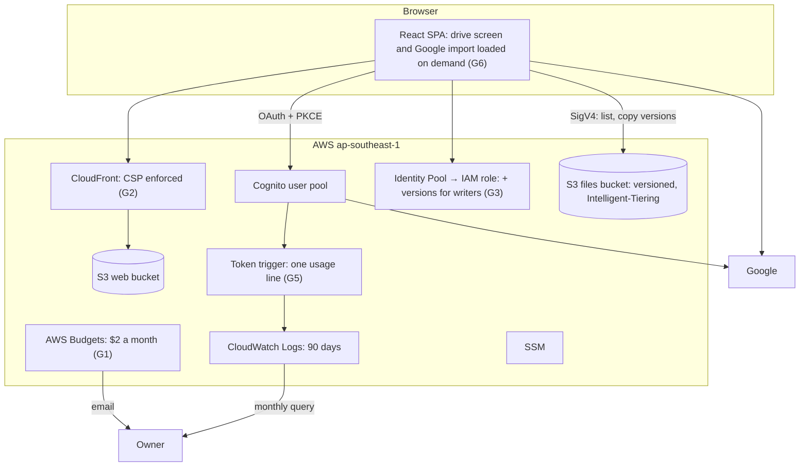

# Family Drive target

**Version:** 1.0.0 · **Status:** Accepted · **Date:** 2026-11-28 · **Previous:** none
**Based on:** brief 1.0.0, baseline 1.0.0

## Changes from (none)
- First target. Horizon: the brief's next release, a hardening and trust release within $2 a month. Eight gaps (G1–G8); eight baseline risks accepted with reasons. Decisions in ADR 0019 and 0020; ADR 0013 and 0018 confirmed.

## 1. Principles

Principles P1–P8 in [architecture definition §2](../architecture-definition.md#2-architecture-principles) stay as they are. Two are added from the brief:

| # | Principle | Trade-off it settles | From |
|---|---|---|---|
| P9 | **The $2 a month ceiling is hard** | Cost beats durability when they conflict: no backup copy, no paid monitoring | brief §5, §6; [ADR 0018](../../adr/0018-no-backup-copy-within-a-two-dollar-budget.md) |
| P10 | **Measure with what AWS gives for free** | Measures M1–M3 come from AWS Budgets and logs the product already writes, not from a new service | brief §4; [ADR 0019](../../adr/0019-usage-line-in-the-token-trigger.md) |

Quality order within P9 (brief §6): durability, then privacy and security, then cost.

## 2. Target by section

Everything not named here stays as in baseline 1.0.0.

### Structure

Unchanged: one repo, the same parts. The web app gains one feature in `web/src/features.ts`, **Versions** (G4), behind the existing feature seam and `DriveStorage` seam. The drive screen and Google import are loaded on demand (G6).

### Stack

Unchanged. No new dependency is needed for any gap: version APIs come from `@aws-sdk/client-s3`, already loaded lazily for the Deleted folder and Edit.

### Data

| Change | Where | Gap |
|---|---|---|
| Writers list and read earlier versions in locations they can write | `infra/identity.tf` | G3 |
| One usage line per token issue; pre token generation log group kept 90 days (was 14) | `functions/allowlist/src/preTokenGeneration.ts`, `infra/auth.tf` | G5 |
| Budget alert email address | new SSM parameter in `infra/foundation/ssm.tf` (value set by the owner, never committed) | G1 |

**Storage classes unchanged.** Intelligent-Tiering without archive tiers ([ADR 0013](../../adr/0013-files-in-intelligent-tiering-without-archive-tiers.md)) already moves files nobody opens to Archive Instant Access after 90 days, about 68% cheaper than Standard, and keeps every read instant. The Deep Archive tier would break preview and download and need a restore flow, which needs a backend (P1). Revisit only if the stored volume (brief Q4) shows storage alone near $2.

### Interfaces

Unchanged, except the SPA uses `ListObjectVersions` and `CopyObject` with a source version on `Global/` and `Personal/<email>/` (G3, G4). The config contract from Terraform to the SPA gets one checked list of keys (G7, #42).

### Delivery

Unchanged. The foundation pipeline policy (`ci/iam/foundation-pipeline-policy.json`) gains the AWS Budgets actions for G1.

### Security and operations

| Area | Baseline 1.0.0 | Target | Gap |
|---|---|---|---|
| CSP | report-only | **enforced** (`csp_enforce = true`) after a manual check of every feature, desktop and phone | G2 |
| Cost signal | none | AWS Budgets: $2 a month, email at 100% actual and 100% forecast | G1 |
| Usage signal | none | one log line per token issue; monthly Logs Insights query in `docs/deployment.md` | G5 |
| Recovery | versions in the console only (owner) | writers restore versions in the app ([ADR 0020](../../adr/0020-writers-restore-earlier-versions.md)) | G3, G4 |
| Logging rule NFR-P3 | errors only | errors plus one usage line with the email; never tokens or file names | G5 |
| Backups, CloudTrail, alarms | none | none (P9) | accepted |

### Container view

## 3. Decisions

| # | Decision | Record |
|---|---|---|
| D1 | Count active people from one log line per token issue, kept 90 days, rather than CloudTrail data events or Cognito's paid sign-in activity | [ADR 0019](../../adr/0019-usage-line-in-the-token-trigger.md) |
| D2 | Writers restore earlier versions where they can write; no `DeleteObjectVersion` for them | [ADR 0020](../../adr/0020-writers-restore-earlier-versions.md) |
| D3 | Keep Intelligent-Tiering without archive tiers for an archive-style drive | [ADR 0013](../../adr/0013-files-in-intelligent-tiering-without-archive-tiers.md), confirmed |
| D4 | No backup copy within $2 a month | [ADR 0018](../../adr/0018-no-backup-copy-within-a-two-dollar-budget.md), confirmed; #97 |
| D5 | The budget alert is Terraform in the foundation stack, not a console setting (P7) | this document, G1 |
| D6 | The CSP is enforced after a manual check; there is no report endpoint, and setting `csp_enforce = false` again is the rollback | this document, G2 |
| D7 | The TOGAF documents stay; their gap analysis points at the current target instead of keeping its own | this document, G8 |

## 4. Gaps

Sizes use the factory's scale. The product's factory policy takes `XS` and `S` tickets.

| Id | Baseline → target | Repo | Size | Depends on | Risk | One-way door |
|---|---|---|---|---|---|---|
| G1 | No cost signal → AWS Budgets budget of $2 a month in `infra/foundation/`, emailing an address from a new SSM parameter at 100% actual and forecast; Budgets actions in the foundation pipeline policy; setup guide and `deployment.md` updated | personal-storage | S | — | R2 | No |
| G2 | CSP report-only → enforced: check every feature in production with the console open (desktop and phone), fix violations, set `csp_enforce = true`; update `system-design.md` and the security assessment's S4 status | personal-storage | XS | — | R3 | No |
| G3 | Versions only in the console → IAM `ListBucketVersions` and `GetObjectVersion` for writers (ADR 0020); `DriveStorage` gains list and restore of versions, in the S3 and in-memory adapters; Location policy capability and table test | personal-storage | S | — | R4 | No |
| G4 | No version UI → **Versions** in the ⋮ menu: list a file's versions (date, size), restore one; playground support; `global-drive.md` and `personal-folders.md` updated; FR-24 met in the app | personal-storage | S | G3 | R4 | No |
| G5 | No usage signal → one usage line per token issue (ADR 0019), with tests; pre token generation log retention 90 days; Logs Insights query in `deployment.md`; NFR-P3 reworded | personal-storage | S | — | R5 | No |
| G6 | 1.1 MB main chunk → drive screen and Google import loaded on demand; main chunk under 500 kB in `vite build` | personal-storage | S | — | R9 | No |
| G7 | Config keys drift → one checked list of config keys shared by `write-config.sh` and `web/src/config.ts`, decided in #42 | personal-storage | S | — | R8 | No |
| G8 | Architecture docs 1.0 → definition and requirements 1.1: ADRs 0014–0020 listed, P9 and P10 added, definition §8 points to the current target, FR-24 and NFR-P3 updated after G4 and G5 | personal-storage | XS | G4, G5 for the final wording | R7 | No |

Not a gap: the three open Dependabot PRs (#86–#88) are routine upkeep. The leftover `random` provider (`infra/versions.tf:14-18`) is removed when the owner next confirms the old state entry is gone; it needs AWS access, so it is left to the owner.

## 5. Baseline risks and brief shortfalls

| Baseline risk or shortfall | Outcome |
|---|---|
| R1 no backup copy | **Accepted:** P9, ADR 0018, revisit in #97 |
| R2 no cost or misuse signal | G1 for cost. Misuse detection (CloudTrail, alarms) **accepted** under P9 |
| R3 CSP report-only | G2 |
| R4 version recovery console-only | G3, G4 |
| R5 no usage signal | G5 |
| R6 Storage Browser coupling | **Accepted:** the feature seam (#40) and the playground already contain an upgrade's damage |
| R7 architecture docs drift | G8 |
| R8 config contract drift | G7 |
| R9 large main bundle | G6 |
| R10 new deploy path | **Accepted:** it has worked since its first day, and rollback by re-running an older commit is documented |
| R11 Google consent screen in Testing | **Accepted:** 10 people, the owner adds them; publishing needs Google's verification for the restricted `drive.readonly` scope |
| R12 long work stops with the tab | **Accepted:** fixing it needs a backend (P1) |
| R13 allowlist in the 4 KB Lambda environment | **Accepted:** fits 10 people with room to spare |
| Shortfall: iPhone home-screen app signs in separately | **Accepted:** iOS gives a home-screen app its own storage |
| Shortfall: archive-style use vs ADR 0013 | **Settled:** D3, keep ADR 0013 |
| Brief Q4: volume stored | Still open with the owner; it only matters for #97 and D3 |
