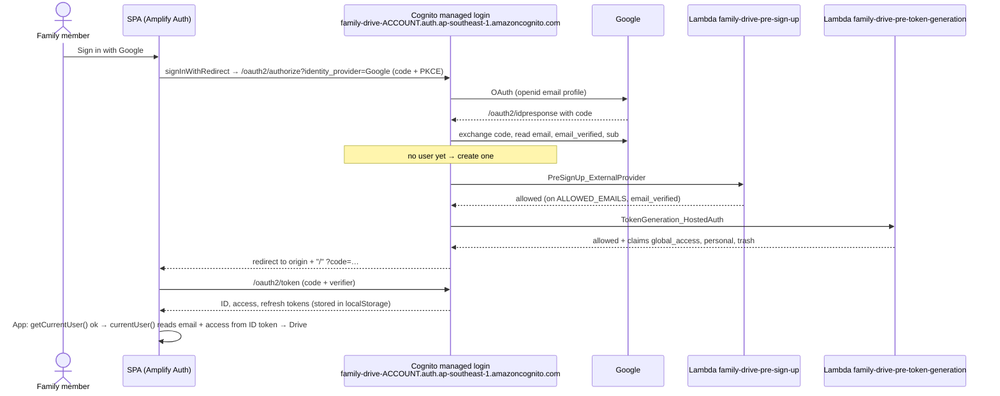
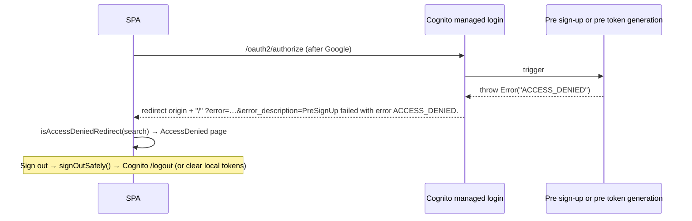
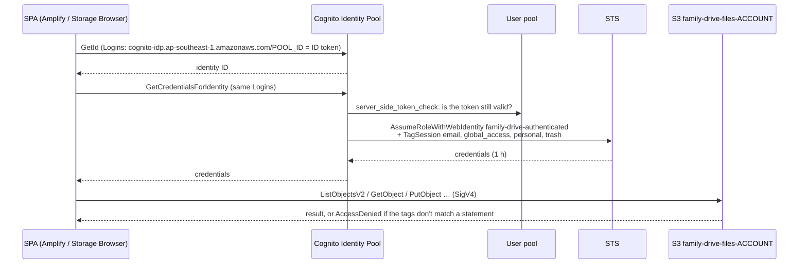

# Sign-in, allowlist and access levels

How a family member gets into Family Drive, who is let in, and what each person may do once
inside. This is the technical reference for someone changing this code or infrastructure. For
setting the values on a real deployment, see the [setup guide](../guides/setup-from-scratch.md) (steps 5, 6 and 8) and
[deployment.md](../deployment.md) (Day-to-day, Troubleshooting).

Keep this file in step with the code: change it in the same PR as any change to sign-in, the
allowlist or access levels.

## 1. Purpose and user-facing behaviour

- The landing page has one button, **Sign in with Google**. There is no username/password and
  no self sign-up form.
- Only Google accounts whose email is on the **allowlist** get in. Anyone else comes back to
  "You don't have access to this drive." with a **Sign out** link.
- Once in, the top bar shows the person's email and **Sign out**.
- Each person has an **access level**. It is three independent settings:

  | Setting | Values | What the person sees and can do |
  |---|---|---|
  | `global` | `read` / `write` | `read`: browse, preview and download the shared drive (`Global/`). `write`: also upload, create folders, delete (to `Deleted/`), move and import from Google Drive there. |
  | `personal` | `true` / `false` | `true`: Home lists their own private folder `Personal/<email>/`, fully writable by them. |
  | `trash` | `true` / `false` | `true`: Home lists the `Deleted/` folder, where they restore, delete permanently and empty it. |

  An allowlisted person with no entry gets `read`, no personal folder and no Deleted folder.
- Removing someone from the allowlist, or changing their access level, takes effect at their
  next token refresh or sign-in: within about 2 hours, or at once if they sign out and in again.

## 2. S3 layout

Sign-in itself stores nothing in S3. Access levels decide which prefixes of the files bucket
`family-drive-files-<account>` a person can reach:

| Prefix | Who can reach it |
|---|---|
| `Global/` | Everyone signed in: list and read. Writers (`global_access` = `write`): also write and delete. |
| `Personal/<email>/` | Only the person whose `email` tag is `<email>`, and only with `personal` = `yes`. |
| `Deleted/Global/`, `Deleted/Personal/<email>/` | Writers of the matching source prefix may put objects (Delete moves files here) but not list or read. |
| `Deleted/` | Only `trash` = `yes`: list, read, delete, every version. |
| Anything else (bucket root, other people's folders) | Nobody, from the app. |

`<email>` is lower case: `personalPrefix()` lower-cases it, and IAM compares it
case-sensitively with the raw claim, which Google sends in lower case
([ADR 0009](../adr/0009-personal-folders-keyed-by-email.md)).

Versioning, lifecycle and storage classes for these prefixes belong to the shared drive,
personal folder and Deleted folder docs.

## 3. Access control

### Where each check happens

| Check | Enforced by | Code |
|---|---|---|
| Only Google, no native sign-up | User pool (`allow_admin_create_user_only`, client `supported_identity_providers = ["Google"]`) and pre sign-up (`PreSignUp_ExternalProvider` only) | `infra/auth.tf`, `functions/allowlist/src/preSignUp.ts` |
| Email on the allowlist and verified | Pre sign-up (first sign-in) and pre token generation (every sign-in and refresh) | `functions/allowlist/src/allowlist.ts` |
| Access level → claims | Pre token generation | `functions/allowlist/src/access.ts`, `preTokenGeneration.ts` |
| Claims → session tags | Identity Pool principal tag mapping | `aws_cognito_identity_pool_provider_principal_tag.email` in `infra/identity.tf` |
| What each tag allows in S3 | IAM policy on the authenticated role | `aws_iam_role_policy.authenticated` in `infra/identity.tf` |
| What the UI shows | SPA reads the same claims | `web/src/access.ts`, `web/src/config.ts` |

The **IAM policy is the security boundary**. The browser holds real AWS credentials, so anything
the UI hides could still be sent by hand; IAM refuses it.

### ID-token claims and principal tags

The pre token generation trigger (`lambda_version = "V1_0"`, which can only change the ID
token) adds three string claims. The Identity Pool passes them, plus `email`, to STS as session
tags (`use_defaults = false`, so nothing else is tagged):

| Claim → tag | Values | Set by |
|---|---|---|
| `email` | the Google email | Google, through the IdP attribute mapping `email = "email"` |
| `global_access` | `read` / `write` | `accessClaims()` |
| `personal` | `yes` / `no` | `accessClaims()` (booleans become strings: tag values are strings) |
| `trash` | `yes` / `no` | `accessClaims()` |

A missing or unexpected tag fails every condition that tests it, so the fallback is read-only
`Global/`.

### The authenticated role's statements

`aws_iam_role_policy.authenticated` (inline policy `drive-access` on `family-drive-authenticated`):

| Sid | Actions | Resource | Condition | Needed for |
|---|---|---|---|---|
| `ListDriveFolder` | `s3:ListBucket` | bucket | `s3:prefix` like `Global/`, `Global/*` | Listing the shared drive (everyone) |
| `ReadDriveObjects` | `s3:GetObject` | `Global/*` | none | Download and preview (everyone) |
| `WriteDriveObjects` | `s3:PutObject`, `s3:DeleteObject`, `s3:AbortMultipartUpload`, `s3:ListMultipartUploadParts` | `Global/*` | `aws:PrincipalTag/global_access` = `write` | Upload, create folder, Move, Delete's move to `Deleted/`, Google import |
| `ListOwnPersonalFolder` | `s3:ListBucket` | bucket | `s3:prefix` like `Personal/${aws:PrincipalTag/email}/`, `…/*`, and `personal` = `yes` | Listing your own folder |
| `ManageOwnPersonalObjects` | `s3:GetObject`, `s3:PutObject`, `s3:DeleteObject`, `s3:AbortMultipartUpload`, `s3:ListMultipartUploadParts` | `Personal/${aws:PrincipalTag/email}/*` | `personal` = `yes` | Everything in your own folder |
| `MoveSharedFilesToDeleted` | `s3:PutObject` | `Deleted/Global/*` | `global_access` = `write` | Delete in `Global/` (copy into `Deleted/`) |
| `MoveOwnPersonalFilesToDeleted` | `s3:PutObject` | `Deleted/Personal/${aws:PrincipalTag/email}/*` | `personal` = `yes` | Delete in your own folder |
| `ListDeletedFolder` | `s3:ListBucket`, `s3:ListBucketVersions` | bucket | `s3:prefix` like `Deleted/`, `Deleted/*`, and `trash` = `yes` | Showing `Deleted/`, finding every version to purge |
| `ManageDeletedObjects` | `s3:GetObject`, `s3:DeleteObject`, `s3:DeleteObjectVersion` | `Deleted/*` | `trash` = `yes` | Restore, Delete permanently, Empty Deleted |

`s3:PutObject` also covers `CreateMultipartUpload`, `UploadPart` and `CompleteMultipartUpload`,
and `CopyObject` needs `GetObject` on the source and `PutObject` on the destination. In
Terraform, `$${…}` keeps the IAM policy variable literal.

The role's trust policy (`data.aws_iam_policy_document.authenticated_assume`) lets only
`cognito-identity.amazonaws.com` call `sts:AssumeRoleWithWebIdentity` **and `sts:TagSession`**
(without `TagSession` the principal tags would be refused), with `cognito-identity.amazonaws.com:aud`
= this Identity Pool and `amr` containing `authenticated`. There is no unauthenticated role
(`allow_unauthenticated_identities = false`).

### What the UI hides versus what IAM enforces

| UI behaviour | Source | IAM rule that actually stops it |
|---|---|---|
| `Global/` gets Storage Browser permissions `["get", "list"]` without `write`, which hides Upload, Create folder, Delete, Copy, Move and Import there | `driveLocation()` in `web/src/config.ts` | `WriteDriveObjects` needs `global_access` = `write` |
| Top-bar Upload/Import hidden without a writable location | `showWriteButtons` in `web/src/pages/Drive.tsx` | same |
| Home lists `Personal/<email>/` only with `personal` | `listDriveLocations()` | `ListOwnPersonalFolder`, `ManageOwnPersonalObjects` |
| Home lists `Deleted/` only with `trash` | `listDriveLocations()` | `ListDeletedFolder`, `ManageDeletedObjects` |
| Home never lists other people's folders | `listDriveLocations()` (replaces the adapter's `listLocations`) | No statement allows `Personal/<someone else>/` |
| Restore refuses targets the person can't write | `canWriteFor()` in `web/src/trash/actions.ts` | the `Global/` and personal statements |

## 4. Flows

### First sign-in (allowed)



A returning user skips pre sign-up: Cognito already has the user, so only pre token generation
runs.

### Sign-in denied



Cognito wraps the thrown message in `error_description` ("PreSignUp failed with error
ACCESS_DENIED." or "PreTokenGeneration failed with error ACCESS_DENIED."). `authErrors.ts`
matches the substring `ACCESS_DENIED`, so **the Lambdas and `authErrors.ts` must keep that
string identical**.

### Getting AWS credentials and calling S3



Amplify (`fetchAuthSession`) caches the credentials and repeats this when they expire.

### Token refresh and removal from the allowlist

```mermaid
sequenceDiagram
    participant SPA as SPA (Amplify)
    participant UP as User pool
    participant PTG as Pre token generation
    participant CI as Identity Pool

    Note over SPA: ID token expires (60 min)
    SPA->>UP: InitiateAuth REFRESH_TOKEN_AUTH
    UP->>PTG: TokenGeneration_RefreshTokens
    alt still allowlisted
        PTG-->>UP: claims from current ACCESS_LEVELS
        UP-->>SPA: new ID token (new access level)
        SPA->>CI: new credentials with the new tags
    else removed
        PTG-->>UP: throw ACCESS_DENIED
        UP-->>SPA: NotAuthorizedException
        Note over SPA: S3 calls fail once the current credentials expire;<br/>signing in again lands on the access-denied page
    end
```

So the worst case after a change is: up to 60 minutes until the ID token expires, then up to
60 more minutes on credentials already issued. **About 2 hours.** Signing out and in applies a
new access level at once. Deleting the user in the user pool stops refresh at once and makes
`server_side_token_check` refuse the old ID token, but credentials already issued still last
up to an hour.

## 5. Code map

| Area | Files | Tests |
|---|---|---|
| Allowlist rules | `functions/allowlist/src/allowlist.ts` | `functions/allowlist/test/allowlist.test.ts` |
| Access-level parsing and claims | `functions/allowlist/src/access.ts` | `functions/allowlist/test/access.test.ts` |
| Trigger handlers | `functions/allowlist/src/preSignUp.ts`, `preTokenGeneration.ts` | `functions/allowlist/test/handlers.test.ts` |
| Lambda build | `functions/allowlist/package.json` (`npm run build` → `dist/*.js`) | |
| User pool, Google IdP, domain, app client, Lambdas | `infra/auth.tf` | `terraform validate` |
| Identity Pool, authenticated role, principal tags | `infra/identity.tf` | |
| SSM inputs, normalisation and preconditions | `infra/foundation_inputs.tf` | `terraform plan` stops on bad values |
| SSM parameters (placeholders) | `infra/foundation/ssm.tf` | |
| Config into the SPA | `infra/outputs.tf`, `scripts/write-config.sh`, `web/src/config.ts` (`loadConfig`, `toAmplifyOutputs`) | `web/test/config.test.ts` |
| App start, routing to landing/denied/drive | `web/src/App.tsx`, `web/src/pages/Landing.tsx`, `AccessDenied.tsx` | |
| Sign-out, email from the ID token | `web/src/session.ts` | `web/test/session.test.ts` |
| Access-denied redirect | `web/src/authErrors.ts` | `web/test/authErrors.test.ts` |
| Access claims in the SPA | `web/src/access.ts` | `web/test/access.test.ts` |
| Locations per access level | `web/src/config.ts` (`driveLocation`, `personalLocation`, `deletedLocation`, `listDriveLocations`) | `web/test/driveLocation.test.ts` |
| Pipeline | `ci/pipeline.sh`, `ci/iam/app-pipeline-policy.json` | |

`currentUser()` reads the email from the ID token rather than calling `fetchUserAttributes()`:
that would call Cognito `GetUser`, which needs the `aws.cognito.signin.user.admin` scope, and
granting it would also let people change their own email attribute.

## 6. Configuration

### SSM parameters (retained foundation, `infra/foundation/ssm.tf`)

All are created with `CHANGE_ME` and `ignore_changes` on the value: set them by hand
([setup guide step 6](../guides/setup-from-scratch.md#step-6-set-the-settings-in-ssm)).

| Parameter | Type | Used for |
|---|---|---|
| `/family-drive/google_client_id` | String | Google IdP `client_id`; also `config.json` `googleClientId` for Drive import |
| `/family-drive/google_client_secret` | SecureString | Google IdP `client_secret` (read `with_decryption`, never leaves Terraform/Cognito) |
| `/family-drive/allowed_emails` | StringList | Allowlist, comma-separated |
| `/family-drive/access` | **String** (JSON has commas) | Access levels, e.g. `{"a@x.com": {"global": "write", "personal": true, "trash": true}}` |

How they reach the Lambdas:

1. `infra/foundation_inputs.tf` reads them with `aws_ssm_parameter` data sources.
2. `local.allowed_emails` trims, lower-cases, drops empties and de-duplicates.
3. `local.access` lower-cases emails and fills missing flags with `false`.
4. The `terraform_data.foundation_inputs_check` preconditions stop the plan on: no emails, a
   non-email entry (including `CHANGE_ME`), `access` that isn't a JSON object, an entry without
   `global` = `read`/`write`, an unknown key, a non-boolean flag, an email listed twice in
   different case, an `access` email missing from the allowlist, or a Google client ID/secret
   still `CHANGE_ME`.
5. Lambda env: both get `ALLOWED_EMAILS` (`join(",", …)`); pre token generation also gets
   `ACCESS_LEVELS` (`jsonencode(local.access)`).

The Lambda's `parseAccess()` applies the same rules again and throws on a malformed value, so
nobody gets a token rather than someone getting the wrong one.

A change in SSM does nothing until the **app pipeline** re-applies `infra/`: the values are
baked into the Lambda environment.

### `config.json` keys (from Terraform outputs via `scripts/write-config.sh`)

`region`, `userPoolId`, `userPoolClientId`, `cognitoDomain`, `identityPoolId`. `toAmplifyOutputs()`
turns them into Amplify's `auth` block with `identity_providers: ["GOOGLE"]`, scopes
`openid email profile`, `response_type: "code"` and redirect URIs `origin + "/"`.

### Terraform variables

`project` (`family-drive`), `region` (`ap-southeast-1`), `dev_origin`
(`http://localhost:5173`, added to the callback and logout URLs and to CORS).

### Google Cloud

The OAuth client must list `https://family-drive-<account>.auth.ap-southeast-1.amazoncognito.com/oauth2/idpresponse`
as an authorised redirect URI ([setup guide step 8](../guides/setup-from-scratch.md#step-8-finish-google-sign-in)). The
domain is fixed per account so this survives rebuilding the app stack
([ADR 0005](../adr/0005-fixed-cognito-domain.md)). While the consent screen is in Testing, each
person must also be a Google **test user**.

## AWS

### Services and resources (all `ap-southeast-1`)

| Resource | Name | Terraform address | Stack |
|---|---|---|---|
| Cognito user pool | `family-drive` | `aws_cognito_user_pool.main` | `infra/` |
| Managed login domain | `family-drive-<account>` | `aws_cognito_user_pool_domain.main` | `infra/` |
| Google IdP | `Google` | `aws_cognito_identity_provider.google` | `infra/` |
| App client (public, no secret) | `family-drive-web` | `aws_cognito_user_pool_client.web` | `infra/` |
| Pre sign-up Lambda | `family-drive-pre-sign-up` | `aws_lambda_function.pre_sign_up` (+ role, log group, permission) | `infra/` |
| Pre token generation Lambda | `family-drive-pre-token-generation` | `aws_lambda_function.pre_token_generation` (+ role, log group, permission) | `infra/` |
| Lambda roles | `family-drive-pre-sign-up`, `family-drive-pre-token-generation` (only `AWSLambdaBasicExecutionRole`) | `aws_iam_role.pre_sign_up`, `.pre_token_generation` | `infra/` |
| Identity Pool | `family-drive` | `aws_cognito_identity_pool.main` | `infra/` |
| Principal tag mapping | for the user pool provider | `aws_cognito_identity_pool_provider_principal_tag.email` | `infra/` |
| Authenticated role | `family-drive-authenticated`, inline policy `drive-access` | `aws_iam_role.authenticated`, `aws_iam_role_policy.authenticated`, `aws_cognito_identity_pool_roles_attachment.main` | `infra/` |
| SSM parameters | `/family-drive/{google_client_id,google_client_secret,allowed_emails,access}` | `aws_ssm_parameter.*` | `infra/foundation/` (retained) |

The app stack is disposable ([ADR 0004](../adr/0004-retained-foundation-and-disposable-app-stack.md)).
Recreating it creates a new user pool (everyone signs in again, as new Cognito users) and a new
Identity Pool (new identity IDs), which is why personal folders are keyed by email.

### API calls

| Caller | Operation | Issued by |
|---|---|---|
| Browser | Cognito managed login `/oauth2/authorize`, `/oauth2/token`, `/logout` | Amplify `signInWithRedirect`, its redirect handler, `signOut` |
| Browser | `cognito-idp:InitiateAuth` (`REFRESH_TOKEN_AUTH`) | Amplify token refresh inside `fetchAuthSession` |
| Browser | `cognito-identity:GetId`, `GetCredentialsForIdentity` | Amplify `fetchAuthSession` |
| Cognito Identity | `sts:AssumeRoleWithWebIdentity` + `sts:TagSession` | AWS, on the browser's behalf |
| User pool | `lambda:InvokeFunction` on both triggers | AWS (allowed by `aws_lambda_permission`, `source_arn` = the pool) |
| Lambdas | none beyond writing CloudWatch Logs | |
| App pipeline | `ssm:GetParameter(s)` on `/family-drive/*`; Cognito, Cognito Identity, Lambda, IAM and Logs calls to manage the resources | Terraform in `ci/pipeline.sh` |

### IAM for the pipeline

Statements in `ci/iam/app-pipeline-policy.json` this feature needs: `ReadFoundationParams`,
`Cognito` (including `cognito-identity:SetPrincipalTagAttributeMap`/`GetPrincipalTagAttributeMap`
for the tag mapping), `Lambdas`, `LambdaLogGroups`, `DescribeLogGroups`, `AppRoles`,
`AttachOnlyLambdaBasicExecution`, `PassLambdaRoles` and `PassIdentityPoolRole` (not limited by
`iam:PassedToService`: Cognito Identity doesn't send it). The foundation pipeline's
`FoundationParameters` creates the SSM parameters.

### Service configuration as deployed

- **User pool:** `username_attributes = ["email"]`, `allow_admin_create_user_only = true`.
  Google IdP scopes `openid email profile`, mapping `email`, `email_verified`, `username = sub`.
- **App client:** no secret, `code` flow only, scopes `openid email profile`, Google only,
  `explicit_auth_flows = ["ALLOW_REFRESH_TOKEN_AUTH"]`. Callback and logout URLs
  `https://<cloudfront domain>/` and `http://localhost:5173/`, matching `toAmplifyOutputs()`.
- **Token lifetimes:** ID and access 60 minutes, refresh 30 days.
- **Triggers:** pre sign-up; pre token generation with `lambda_version = "V1_0"`.
- **Lambdas:** `nodejs22.x`, handlers `preSignUp.handler` / `preTokenGeneration.handler`,
  default 128 MB and 3 s timeout, logs kept 14 days.
- **Identity Pool:** authenticated identities only, one provider (the user pool endpoint and
  app client) with `server_side_token_check = true`, principal tags `email`, `global_access`,
  `personal`, `trash` with `use_defaults = false`.
- **Authenticated role:** `max_session_duration = 3600`.

### Limits and quotas

- **Lambda environment: 4 KB in total.** `ALLOWED_EMAILS` plus the normalised `ACCESS_LEVELS`
  use roughly 30 + 60 bytes per person, so a few dozen people fit easily; a large list would
  need another source.
- **Cognito trigger timeout: 5 s**, retried up to 3 times. The handlers do no I/O, so they take
  milliseconds.
- **Session tags:** values up to 256 characters, letters, digits, spaces and `_.:/=+-@` only.
  Ordinary emails fit; an email with other characters would make the credential exchange fail.
- **Credentials:** `GetCredentialsForIdentity` returns credentials for 1 hour.
- **Pre token generation V1_0** can add claims to the ID token only. That's enough: the Identity
  Pool uses the ID token.

### Observability

| Where | What you see |
|---|---|
| CloudWatch Logs `/aws/lambda/family-drive-pre-sign-up` and `/aws/lambda/family-drive-pre-token-generation` | A thrown `ACCESS_DENIED` for each refusal; "access levels are not valid JSON" and other parser errors when `ACCESS_LEVELS` is broken |
| Redirect URL in the browser | `error_description=…ACCESS_DENIED.` → access-denied page; any other `error_description` (e.g. Google's `redirect_uri_mismatch`) is a setup problem |
| CloudTrail | `GetId`, `GetCredentialsForIdentity` (Cognito Identity), `AssumeRoleWithWebIdentity` (STS) with the session tags |
| S3 responses | `AccessDenied` when the session tags don't allow a request |

### Cost

Effectively zero for a family: Cognito user pools are free up to 10,000 monthly active users
on the Lite tier, the Identity Pool and STS are free, the triggers run once per sign-in and
once per hourly refresh (well inside Lambda's free tier), and standard SSM parameters are free.

### Inspect and operate

What's in SSM and what the Lambda actually got:

```bash
aws ssm get-parameter --region ap-southeast-1 --name /family-drive/allowed_emails --query Parameter.Value
```

```bash
aws ssm get-parameter --region ap-southeast-1 --name /family-drive/access --query Parameter.Value --output text | jq .
```

```bash
aws lambda get-function-configuration --region ap-southeast-1 --function-name family-drive-pre-token-generation --query Environment.Variables
```

Find and delete a person's Cognito user (cuts off refresh at once):

```bash
aws cognito-idp list-users --region ap-southeast-1 --user-pool-id <pool id> --filter 'email = "someone@gmail.com"'
```

```bash
aws cognito-idp admin-delete-user --region ap-southeast-1 --user-pool-id <pool id> --username <Username from list-users>
```

Check the principal tag mapping:

```bash
aws cognito-identity get-principal-tag-attribute-map --region ap-southeast-1 --identity-pool-id <identity pool id> --identity-provider-name cognito-idp.ap-southeast-1.amazonaws.com/<pool id>
```

Check what a tag combination allows without signing in (IAM policy simulator):

```bash
aws iam simulate-principal-policy --policy-source-arn arn:aws:iam::<account>:role/family-drive-authenticated --action-names s3:PutObject --resource-arns arn:aws:s3:::family-drive-files-<account>/Global/test.txt --context-entries ContextKeyName=aws:PrincipalTag/global_access,ContextKeyValues=read,ContextKeyType=string
```

Console: Cognito → User pools → `family-drive` (users, sign-in experience, app client,
Extensions → Lambda triggers); Cognito → Identity pools → `family-drive` → User access
(attributes for access control); IAM → Roles → `family-drive-authenticated`.

## 7. Limits and failure modes

| Situation | What happens | Message |
|---|---|---|
| Email not on the allowlist, or Google says it isn't verified | Pre sign-up or pre token generation throws | "You don't have access to this drive." |
| Removed from the allowlist while signed in | Next refresh fails; current credentials work up to an hour more | S3 calls fail; signing in again shows the access-denied page |
| `ACCESS_LEVELS` malformed in the Lambda (shouldn't pass Terraform) | Pre token generation throws a parser error: nobody can sign in or refresh | Generic Cognito error on the landing redirect, not the access-denied page |
| `access` is `{}` or misses people | They get read-only `Global/` | No Upload/Delete in `Global/`, no personal folder |
| SSM still `CHANGE_ME`, bad JSON, email in `access` not allowlisted | App plan stops before any change | Terraform precondition messages ([deployment.md Troubleshooting](../deployment.md#troubleshooting)) |
| Email claim with capitals | Personal folder prefix (lower-cased) doesn't match the tag | AccessDenied in your own folder |
| Principal tag mapping missing (stack not re-applied) | No tags: read-only, no personal folder | AccessDenied |
| Cognito redirect URI not registered with Google | Google refuses before Cognito | Google `redirect_uri_mismatch` |
| Sign-out fails (e.g. offline) | `signOutSafely()` deletes Amplify's `localStorage` keys and reloads `/` | Landing page |
| `config.json` missing or incomplete | App can't configure Amplify | "Something went wrong: config.json is missing …" |

## 8. Testing

- **Unit tests:** `npm test --prefix functions/allowlist` (allowlist parsing, access parsing and
  claims, both handlers including refresh denial and malformed `ACCESS_LEVELS`) and
  `npm test --prefix web` (`access`, `authErrors`, `session`, `config`, `driveLocation`).
- **Terraform:** `terraform -chdir=infra validate` (offline); `terraform plan` exercises the
  preconditions against the real SSM values.
- **Playground:** `/playground.html?view=drive&access=read` (also `read%2Bpersonal`, `write`,
  `write%2Bpersonal%2Btrash`) shows the drive at each access level with mock data. It skips
  sign-in, so it only checks what the UI hides.
- **Manual:** the sign-in, access-level, personal-folder and allowlist-removal items in
  [deployment.md's end-to-end checklist](../deployment.md#end-to-end-test-checklist). Check IAM
  directly (browser console calls or the policy simulator), not just the hidden buttons.

## 9. Decisions and history

- [ADR 0001](../adr/0001-no-backend-browser-talks-to-s3.md): no backend; the browser talks to S3 with Identity Pool credentials.
- [ADR 0003](../adr/0003-allowlist-in-cognito-triggers.md): the allowlist is enforced by Cognito triggers.
- [ADR 0004](../adr/0004-retained-foundation-and-disposable-app-stack.md): retained foundation (SSM) and disposable app stack (Cognito, Identity Pool).
- [ADR 0005](../adr/0005-fixed-cognito-domain.md): the fixed Cognito domain.
- [ADR 0009](../adr/0009-personal-folders-keyed-by-email.md): personal folders keyed by the `email` principal tag.
- [ADR 0010](../adr/0010-per-person-access-levels-in-ssm.md): per-person access levels in SSM, enforced by session tags.
- [ADR 0011](../adr/0011-delete-moves-to-a-deleted-folder.md): the `trash` flag and the `Deleted/` statements.
- Tickets: #14 (personal folders), #15 (access levels), #24 (Deleted folder), #26 (this doc).
