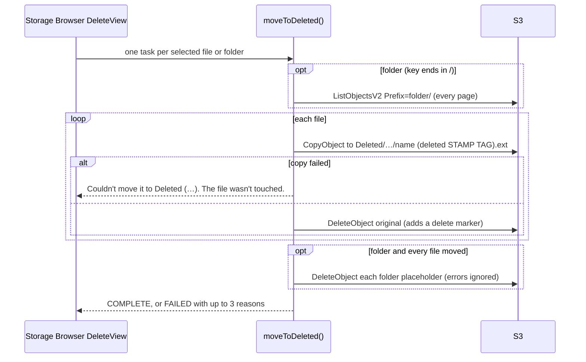
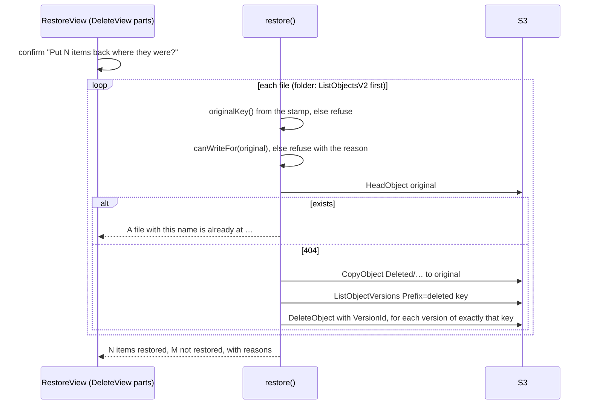
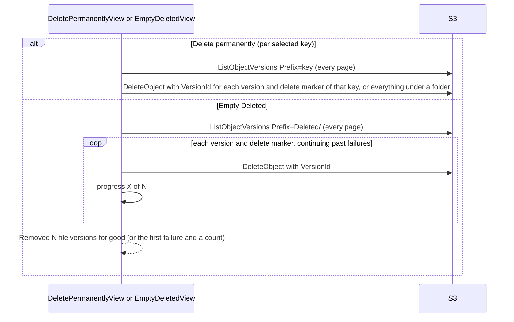
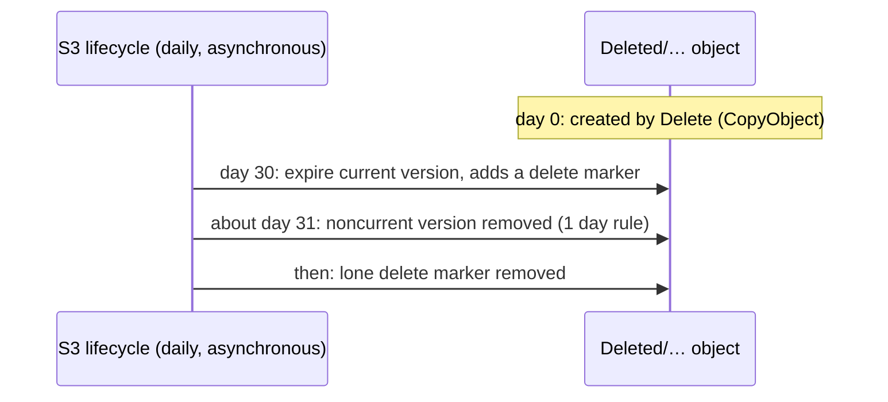

# Deleted folder (trash)

Delete in Family Drive never removes a file straight away: it moves it into `Deleted/`, where
people who manage the trash can restore it or remove it for good, and where S3 removes it by
itself after 30 days. This is the technical reference for someone changing this code or
infrastructure. The decisions are [ADR 0011](../adr/0011-delete-moves-to-a-deleted-folder.md)
(the folder) and [ADR 0012](../adr/0012-deleted-folder-auto-empties-after-30-days.md) (auto-empty).

Keep this file in step with the code: change it in the same PR as any change to the Deleted folder.

## 1. Purpose and user-facing behaviour

**Everyone who can delete** (writers in `Global/`, owners in their personal folder):
- **Delete** in the ⋮ menu asks to confirm for folders ("Move folders to Deleted?"), then moves the
  selected files, or every file under a selected folder, into `Deleted/`. The view is titled
  "Move to Deleted" and ends with "N items moved to Deleted." or the reasons some weren't.
- There is no other delete in `Global/` or personal folders.
- They can't see `Deleted/`.

**Trash managers** (`"trash": true` in their access level) also see **Deleted** on Home:
- The list mirrors where files came from (`Deleted/Global/photos/…`, `Deleted/Personal/<email>/…`),
  each file name stamped: `a (deleted 2026-11-10 14-03-12 7f2c).jpg`.
- A note above the list: "Files here are removed for good 30 days after they were deleted."
- The ⋮ menu offers only **Download**, **Restore**, **Delete permanently** and **Empty Deleted**.
  Preview works as anywhere else.
- **Restore** puts each selected file (or every file in a selected folder) back where it was,
  never over a file that's there now. It always asks first.
- **Delete permanently** removes the selected items with every saved version. It always asks
  first: "N items will be gone for good. This can't be undone."
- **Empty Deleted** removes everything in `Deleted/`, every version, after confirming, with a
  "Removing… X of N" progress line.
- Trash managers see files deleted from everyone's personal folders, but can't restore those
  into someone else's folder.

Files nobody restores are removed by S3 30 days after they were deleted.

## 2. S3 layout

Bucket `family-drive-files-<account>` (retained foundation stack, `infra/foundation/files.tf`).

### Keys

`deletedKey()` in `web/src/trash/paths.ts` keeps the original path under `Deleted/` and stamps
the name before the extension:

```
Global/photos/a.jpg            → Deleted/Global/photos/a (deleted 2026-11-10 14-03-12 7f2c).jpg
Personal/b@x.com/notes         → Deleted/Personal/b@x.com/notes (deleted 2026-11-10 14-03-12 k9q0)
Global/.env                    → Deleted/Global/.env (deleted 2026-11-10 14-03-12 0a1b)
```

- **Stamp:** the deleter's **local** date and time to the second (`YYYY-MM-DD HH-MM-SS`, dashes
  because `:` is awkward in file names), plus four random characters from `[0-9a-z]`
  (`randomTag()`, `crypto.getRandomValues`).
- **Why a unique name instead of a check:** people without `trash` can write into `Deleted/` but
  can't read or list it, so they couldn't check for a clash. The stamp makes every deleted copy
  unique without one.
- **The original path lives in the name, not in object metadata.** Storage Browser's copy
  handler can't set metadata, and the name is visible to trash managers. `originalKey()` strips
  the stamp (`/ \(deleted \d{4}-\d{2}-\d{2} \d{2}-\d{2}-\d{2} [0-9a-z]{4}\)$/` on the base name)
  to find where Restore goes; a file without a stamp has no known original.
- **Folders:** folder placeholders (`…/name/`) aren't moved; they're removed once every file
  under them has moved. Empty folders therefore disappear on Delete.

### Versioning and lifecycle

| Rule (`infra/foundation/files.tf`) | Applies to | Effect |
|---|---|---|
| `expire-deleted-folder` | `Deleted/` | Current versions expire `deleted_retention_days` (30) days after creation, which is the deletion time (the copy creates a new object); noncurrent versions expire 1 day after becoming noncurrent |
| `remove-deleted-folder-delete-markers` | `Deleted/` | Removes the delete marker left once nothing is under it (`expired_object_delete_marker`; S3 won't combine it with `days` in one rule) |
| `expire-noncurrent-versions` | whole bucket | Noncurrent versions expire after 30 days; the shorter `Deleted/` rule wins there |
| `intelligent-tiering-global` / `-personal` | `Global/`, `Personal/` only | `Deleted/` stays in Standard: its files are gone before Intelligent-Tiering could save money ([ADR 0013](../adr/0013-files-in-intelligent-tiering-without-archive-tiers.md)) |
| `abort-incomplete-multipart-uploads` | whole bucket | 7 days |

### What "deleted", "restored" and "permanent" leave behind

| After | At the original key | Under `Deleted/` |
|---|---|---|
| **Delete** (move) | a delete marker; the file's last version is noncurrent for 30 days (console-recoverable) | the stamped copy, current, in Standard |
| **Restore** | a new current version (the copy back); the older noncurrent version still expires on its own | nothing: every version of the stamped copy is removed |
| **Delete permanently / Empty Deleted** | unchanged: the noncurrent version from the move stays up to 30 days, visible only in the console | nothing |
| **Auto-empty** (day 30) | unchanged (by then the noncurrent version has also expired) | delete marker at day 30, noncurrent version gone about a day later, then the marker; S3 runs lifecycle asynchronously, so allow a day or two |

Purging the original key's noncurrent version straight away would need `s3:DeleteObjectVersion` on
`Global/*`, which nobody has (ADR 0011).

## 3. Access control

### Session tags

`global_access` and `personal` decide who can **move files into** `Deleted/`; `trash` = `yes`
decides who can **see and manage** it. All three come from SSM `/family-drive/access` through the
pre token generation trigger and the Identity Pool's tag mapping
([auth-and-access.md](auth-and-access.md#id-token-claims-and-principal-tags)).

### IAM statements

From `aws_iam_role_policy.authenticated` in `infra/identity.tf`:

| Sid | Actions | Resource | Condition | Needed for |
|---|---|---|---|---|
| `WriteDriveObjects` | `s3:PutObject`, `s3:DeleteObject`, … | `Global/*` | `global_access` = `write` | Delete's removal of the original; Restore's copy back into `Global/` |
| `ManageOwnPersonalObjects` | `s3:GetObject`, `s3:PutObject`, `s3:DeleteObject`, … | `Personal/${aws:PrincipalTag/email}/*` | `personal` = `yes` | the same in your own folder |
| `ReadDriveObjects` | `s3:GetObject` | `Global/*` | none | the copy source when deleting from `Global/` |
| `MoveSharedFilesToDeleted` | `s3:PutObject` | `Deleted/Global/*` | `global_access` = `write` | Delete's copy into `Deleted/` from `Global/` |
| `MoveOwnPersonalFilesToDeleted` | `s3:PutObject` | `Deleted/Personal/${aws:PrincipalTag/email}/*` | `personal` = `yes` | Delete's copy from your own folder |
| `ListDeletedFolder` | `s3:ListBucket`, `s3:ListBucketVersions` | the bucket | `s3:prefix` like `Deleted/`, `Deleted/*`; `trash` = `yes` | showing `Deleted/`, finding every version to purge |
| `ManageDeletedObjects` | `s3:GetObject`, `s3:DeleteObject`, `s3:DeleteObjectVersion` | `Deleted/*` | `trash` = `yes` | preview and download there, Restore's existence check and copy source, Delete permanently, Empty |

Writes into `Deleted/` mirror write access: nobody can drop files into another person's part.
Nobody can list or read `Deleted/` without `trash`, not even what they deleted themselves.

### What the UI hides versus what IAM enforces

| UI | Source | Enforced by |
|---|---|---|
| Home lists `Deleted/` only with `trash` | `listDriveLocations()` (`web/src/config.ts`) | `ListDeletedFolder`, `ManageDeletedObjects` |
| `Deleted/` gets permissions `["delete", "get", "list"]` (no `write`), so Upload, Create folder, Copy, Move, Edit and the move-to-Deleted Delete are hidden there | `deletedLocation()` | no write statement covers `Deleted/` except the two move-in ones |
| Delete (move) shown where the location has `write` and `delete` | `makeTrashActions().delete.actionListItem.hide` | the write statements |
| Restore, Delete permanently, Empty Deleted shown only where the location has `delete` but not `write` (i.e. `Deleted/`) | `inDeleted()` in `trash/actions.ts` | `ManageDeletedObjects`, `ListDeletedFolder` |
| Restore refuses targets the person can't write, with a reason | `canWriteFor()`, `cantWriteMessage()` | the write statements |
| Delete permanently refuses keys outside `Deleted/` | `deletePermanently()` | no `DeleteObjectVersion` outside `Deleted/*` |
| The retention note only in `Deleted/`'s list | `isDeletedPrefix()` in `Drive.tsx` | (display only) |

With raw credentials a writer can still `DeleteObject` in `Global/` directly, skipping `Deleted/`;
versioning is the backstop for that (accepted in ADR 0011 and the security assessment).

## 4. Flows

All S3 calls in this feature use `@aws-sdk/client-s3`, loaded on first use (`trash/s3Ops.ts`),
because Amplify Storage has no version APIs. Credentials come from Amplify's `fetchAuthSession`
on every request.

### Delete (move to `Deleted/`)



### Restore



### Delete permanently and Empty Deleted



### Auto-empty (no app involved)



### The retention number

`deleted_retention_days` (foundation `main.tf`, default 30) → lifecycle rule and SSM
`/family-drive/deleted_retention_days` (Terraform-owned) → `data.aws_ssm_parameter` in
`infra/foundation_inputs.tf` → output `deleted_retention_days` → `scripts/write-config.sh` →
`config.json` `deletedRetentionDays` → `parseRetentionDays()` in `App.tsx` → `Drive` prop →
`retentionNote()`. One number feeds both the rule and the note.

## 5. Code map

| Area | Files | Tests |
|---|---|---|
| Rules: move, restore, purge, empty (injected `TrashOps`) | `web/src/trash/trash.ts` | `web/test/trash.test.ts` |
| Key mapping and stamp | `web/src/trash/paths.ts` | `trash.test.ts` (`deletedKey`/`originalKey`) |
| Storage Browser actions, Delete's wording and messages, `canWriteFor` | `web/src/trash/actions.ts` | `trash.test.ts` (messages, `canWriteFor`) |
| Views: Restore, Delete permanently (reuse DeleteView parts), Empty Deleted, `TrashContext` | `web/src/trash/TrashViews.tsx` | `trash.test.ts` (failure lines) |
| S3 operations (AWS SDK, lazy) | `web/src/trash/s3Ops.ts` | `trash.test.ts` (`copySource` encoding) |
| Retention note | `web/src/trash/retention.ts` | `web/test/retention.test.ts` |
| Location and Home | `web/src/config.ts` (`DELETED_PREFIX`, `deletedLocation`, `isDeletedPrefix`, `listDriveLocations`) | `web/test/driveLocation.test.ts` |
| Wiring | `web/src/pages/Drive.tsx` (`delete` handler, custom actions, views, `TrashContext`, the note, S3 target, `once()`), `useStableItems` in `web/src/stableItems.ts` | playground |
| CSS | `web/src/styles.css` (`.trash-view--restore` hides Delete's hard-coded "Deleted" progress column, `.folder-note`) | |
| `trash` flag | `functions/allowlist/src/access.ts`, `infra/foundation_inputs.tf`, `infra/identity.tf`, `web/src/access.ts` | `access.test.ts` (both packages) |
| Lifecycle and retention | `infra/foundation/files.tf`, `infra/foundation/main.tf`, `infra/foundation/ssm.tf` | `terraform validate` |
| Playground fake | `web/src/playground/mockDrive.ts` (`mockTrashOps`, one version per file) | |

Restore and Delete permanently run over Delete's selection, so they pass `useStableItems(tasks)` to
`useAction`; a fresh `tasks.map(...)` would reset `useAction` every render and loop.

## 6. Configuration

| Kind | Name | Used for |
|---|---|---|
| SSM | `/family-drive/access`, `"trash": true` per email | who manages `Deleted/`; set it for at least one person |
| Terraform (foundation) | `deleted_retention_days` (default 30, whole days ≥ 1) | the lifecycle rule and the SSM value |
| SSM (Terraform-owned) | `/family-drive/deleted_retention_days` (`String`) | read by the app stack; **change the variable, never the parameter** |
| `config.json` | `deletedRetentionDays` | the note; missing or invalid → no note |

Changing the retention: edit the variable, run the foundation pipeline, then the app pipeline
(which rewrites `config.json`). A shorter value also applies to files already in `Deleted/`.

## AWS

### Services and resources (all `ap-southeast-1`)

| Resource | Name | Terraform address | Stack |
|---|---|---|---|
| Files bucket, versioning, lifecycle rules `expire-deleted-folder`, `remove-deleted-folder-delete-markers` | `family-drive-files-<account>` | `aws_s3_bucket.files`, `aws_s3_bucket_versioning.files`, `aws_s3_bucket_lifecycle_configuration.files` | `infra/foundation/` (retained) |
| Retention parameter | `/family-drive/deleted_retention_days` | `aws_ssm_parameter.deleted_retention_days` | `infra/foundation/` |
| Its read and output | | `data.aws_ssm_parameter.deleted_retention_days`, `output.deleted_retention_days` | `infra/` |
| Access levels (`trash` flag) | `/family-drive/access` | `aws_ssm_parameter.access` | `infra/foundation/` |
| Tag mapping (`trash`) and role policy | Identity Pool `family-drive`, role `family-drive-authenticated` | `aws_cognito_identity_pool_provider_principal_tag.email`, `aws_iam_role_policy.authenticated` | `infra/` |

### API calls

| Operation | S3 API (via `@aws-sdk/client-s3`) |
|---|---|
| Delete a file | `CopyObject` (`CopySource` URL-encoded per path segment), `DeleteObject` |
| Delete a folder | `ListObjectsV2` (all pages), then the above per file, `DeleteObject` per placeholder |
| Restore | `HeadObject`, `CopyObject`, `ListObjectVersions`, `DeleteObject` with `VersionId` |
| Delete permanently | `ListObjectVersions`, `DeleteObject` with `VersionId` per version and marker |
| Empty Deleted | `ListObjectVersions` (all pages), `DeleteObject` with `VersionId` per version and marker |
| Browse, preview, download in `Deleted/` | Storage Browser's own handlers (`ListObjectsV2`, `HeadObject`, presigned `GetObject`) |

### IAM for the pipeline

Foundation pipeline: `FoundationBuckets` (`s3:PutLifecycleConfiguration`, versioning) and
`FoundationParameters` (writes `/family-drive/deleted_retention_days`). App pipeline:
`ReadFoundationParams` reads it; `AppRoles` and `Cognito` (principal tag map) for the `trash` tag.

### Service configuration as deployed

- Versioning `Enabled` on the files bucket.
- Lifecycle as in §2; `Deleted/` has no transition.
- Tag mapping includes `trash` = `trash`.
- CORS on the files bucket allows the SDK's requests (`GET`, `PUT`, `DELETE`, `HEAD`) from the site.

### Limits and quotas

| Limit | Value | Effect |
|---|---|---|
| Single `CopyObject` | 5 GB | files over 5 GB can't be deleted (or restored) from the app; remove them in the console |
| `ListObjectsV2` / `ListObjectVersions` page | 1,000 | every page is followed |
| Stamp uniqueness | per second + 36⁴ (≈1.7 million) tags | a clash would need two deletes of the same path in the same second with the same tag |
| Lifecycle timing | asynchronous, usually within a day or two of the due date | the note says when files become eligible |
| Empty Deleted | one `DeleteObject` per version, in sequence | slow for thousands of versions; runs in the tab |

### Observability

- **In the app:** Delete's completion message and Restore/Delete permanently summaries list
  failure reasons; Empty Deleted reports the first failure and a count.
- **Error codes:** `AccessDenied` (missing `trash`, a `Deleted/` statement or tag mapping missing,
  or Restore into a folder the person can't write); `NoSuchKey`/404 (already restored or purged);
  copy errors for files over 5 GB.
- **AWS:** S3 data events aren't in CloudTrail by default. `list-object-versions` (below) shows
  exactly what's left.

### Cost

- **Delete:** one `COPY` and one `DELETE` per file (about $0.005 per 1,000 COPY requests; DELETE
  is free), plus a `LIST` per 1,000 keys for a folder.
- **Storage while deleted:** each deleted file is stored **twice** for up to 30 days: the Standard
  copy under `Deleted/`, and the noncurrent version at its original key (in whatever class it was).
  Restoring or emptying doesn't remove the second one early.
- **Restore:** `HEAD` + `COPY` + `LIST` + one free `DELETE` per version.
- **Empty / Delete permanently / auto-empty:** `LIST` requests only; deletes and lifecycle
  expirations are free.

### Inspect and operate

```bash
aws s3api list-object-versions --bucket family-drive-files-<account> --prefix "Deleted/" --query "{versions: Versions[].[Key,VersionId,LastModified], markers: DeleteMarkers[].[Key,VersionId]}"
```

```bash
aws s3api get-bucket-lifecycle-configuration --bucket family-drive-files-<account> --query "Rules[?Filter.Prefix=='Deleted/']"
```

```bash
aws ssm get-parameter --region ap-southeast-1 --name /family-drive/deleted_retention_days --query Parameter.Value
```

**Restore by hand** (for example into someone else's personal folder, which Restore refuses):
copy the stamped object back to its original key without the ` (deleted …)` part, then delete
the stamped copy.

```bash
aws s3 cp "s3://family-drive-files-<account>/Deleted/Personal/<email>/<name> (deleted <stamp> <tag>).<ext>" "s3://family-drive-files-<account>/Personal/<email>/<name>.<ext>"
```

**Recover after Delete permanently or Empty:** not possible from `Deleted/`. Within 30 days, the
original key's noncurrent version may still exist:

```bash
aws s3api list-object-versions --bucket family-drive-files-<account> --prefix "Global/<path>"
```

Console: S3 → bucket → `Deleted/` with **Show versions**; Management → Lifecycle rules.

## 7. Limits and failure modes

| Situation | Message |
|---|---|
| Copy into `Deleted/` fails | "Couldn't move it to Deleted (…). The file wasn't touched." |
| Copy worked, original not removed | "Copied to Deleted, but the original couldn't be removed (…), so it's in both places." |
| Folder can't be listed | "Couldn't list the folder (…). Nothing was moved to Deleted." |
| Some files in a folder fail | "N of M files weren't moved to Deleted." with up to three reasons; placeholders kept |
| Restore: no stamp in the name | "Its original place is unknown (it wasn't put here by Delete)." |
| Restore into another person's folder | "It was in `<email>`'s personal folder, which only they can write to." |
| Restore into `Global/` without write | "You can't add files to the shared drive, so you can't restore it there." |
| Restore: a file is already there | "A file with this name is already at `<key>`." |
| Restore: can't check | "Couldn't check `<key>` (…). Nothing was restored." |
| Restore: copy back fails | "Couldn't restore it (…). It's still in Deleted." |
| Restore: copied, not purged | "Restored, but couldn't be removed from Deleted (…), so it's in both places." |
| Delete permanently outside `Deleted/` | "Only files in Deleted can be deleted permanently." |
| Delete permanently partly fails | "Couldn't delete it permanently (…). Some versions may be left." |
| Empty Deleted partly fails | "Removed N file versions for good. M couldn't be removed (…). Try again to finish." |
| Empty Deleted can't start | "Couldn't empty Deleted: …" |
| Nobody has `trash` | Nobody can see, restore or empty `Deleted/`; auto-empty still runs |
| Files over 5 GB | Delete and Restore fail with S3's copy error |
| Tab closed mid-operation | Each file is copy-then-remove, so a file is in one place or both, never lost; re-run |

## 8. Testing

- **Unit tests:** `npm test --prefix web`:
  - `trash.test.ts`: key mapping round trips, random tags, move (copy before remove, failures,
    folders and placeholders), restore (never overwrites, write check, unknown original, folders,
    purge of every version), delete permanently (only that key, folders, refuses outside
    `Deleted/`), empty (progress, continues past failures), `canWriteFor`, messages, `copySource`;
  - `retention.test.ts`: parsing and the note;
  - `driveLocation.test.ts`: `Deleted/` location permissions, listed last and only with `trash`.
- **Playground:** `/playground.html?view=drive` (everything, including `Deleted/`): Delete, Restore,
  Delete permanently and Empty Deleted work on the sample files; a reload resets them.
  `&access=write` hides `Deleted/` while Delete still works.
- **Manual:** the "Deleted folder" items in [deployment.md's end-to-end checklist](../deployment.md#end-to-end-test-checklist),
  including the lifecycle and `list-object-versions` checks.

## 9. Decisions and history

- [ADR 0011](../adr/0011-delete-moves-to-a-deleted-folder.md): Delete moves to `Deleted/`; the `trash` flag; names, not metadata.
- [ADR 0012](../adr/0012-deleted-folder-auto-empties-after-30-days.md): auto-empty through lifecycle.
- [ADR 0013](../adr/0013-files-in-intelligent-tiering-without-archive-tiers.md): `Deleted/` stays in Standard.
- [ADR 0010](../adr/0010-per-person-access-levels-in-ssm.md), [ADR 0006](../adr/0006-everyone-can-delete-versioning-is-the-safety-net.md): access levels; versioning as the backstop.
- Tickets: #24 (Delete rework), #25 (auto-empty), #18 (Intelligent-Tiering), #30 (this doc).
