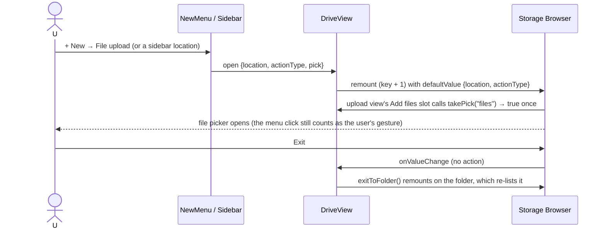

# Drive screen and shared plumbing

The screen every feature lives in, and the code they all share: the look (Material Design 3 in
Google Drive's layout), the top bar, sidebar and **+ New** menu, the file list, the page
layout, the drive host that plugs features into Storage Browser, and the drive storage that all
our own S3 calls go through. This is the technical reference for someone changing this code.
What each operation does to S3 is in [global-drive.md](global-drive.md) and the other feature
docs.

Keep this file in step with the code: change it in the same PR as any change to the drive
screen, the drive host or the drive storage.

## 1. Purpose and user-facing behaviour

- **Look** ([ADR 0015](../adr/0015-drive-look-material-3-with-google-fonts.md), #13): Google
  Drive's layout in Material Design 3, light only. Never Google's brand: no logos, product names
  or Google Sans. Roboto and Material Symbols come from Google Fonts.
- **Top bar:** the menu button (phones), the app's name, the search box for the open folder, the
  account menu (sign out). The app's name is as wide as the sidebar (`--sidebar-width`), so the
  search box starts where the file list does.
- **Left sidebar:** **+ New**, then the locations the person can read (Shared drive, My files,
  Deleted). On a phone the sidebar is a drawer opened from the top bar's menu button, and **+
  New** is a floating action button.
- **+ New:** New folder, File upload, Folder upload, Import from Google Drive. File and Folder
  upload open the picker straight away. Disabled where the open location lacks `write`; left out
  for people who can't write anywhere.
- **File list:** Material icons per file type, coloured by kind; folders are yellow so they stand
  apart from plain (grey) files. Row hover and selection. Clicking a row's empty space selects or
  deselects it; a folder's name opens it, a file's name opens it in the viewer
  ([file-preview.md](file-preview.md)). A file row's ⋮ also offers **View info**. There's no download column: Download is in
  the ⋮ menu, the selection toolbar and the viewer. While rows are selected, a toolbar replaces
  the column headers and offers the same actions as the ⋮ menu. Each row's ⋮ selects only that
  row first. The breadcrumb shows the location's name instead of Home plus the bucket path.
- **States:** placeholder rows while a folder loads; an empty folder shows Drive's empty state;
  a failed listing shows the error with **Try again**; other messages are banners.
- **Layout:** the page never scrolls. The file list and the info panel each scroll
  vertically; nothing scrolls sideways. The viewer covers the whole screen.
  - ≤ 1280px with the info panel open: Type and Last modified hidden.
  - ≤ 960px: Type hidden.
  - Phones: Type and Last modified hidden; the info panel takes the full width.
- **Pages outside the drive** (sign-in, access denied, App's loading and error): the app's icon
  and name over one Material card. The sign-in button is a plain filled button with no Google
  logo.
- While an action's view is open (Upload, Move, Edit, …), **+ New** and the sidebar are
  disabled: leaving the view that way would drop its work.

## 2. S3 layout

None of its own. The drive storage (§5) reads and writes whatever keys a feature gives it.

## 3. Access control

The screen only hides what IAM would refuse; it never grants. Every decision comes from
`locationPolicy()` in `web/src/locationPolicy.ts` (the Location policy,
[auth-and-access.md](auth-and-access.md#what-the-ui-hides-versus-what-iam-enforces)):

| UI | Reads |
|---|---|
| Sidebar locations, Home | `driveLocations()` / `listDriveLocations()` |
| **+ New** enabled / shown | `policy.write` for the open location, `canWriteSomewhere()` |
| Each action's `hide` | `hideUnless(...)` (Storage Browser's `hide` only gets permissions) |

Never re-derive access from permission strings or flags anywhere else.

## 4. Flows

### Opening a view from outside Storage Browser

Storage Browser is kept **uncontrolled**. With `value`/`onValueChange` it only reports changes
to its own internal state, so a view opened from outside would never report its Exit and would
get stuck.

### The ⋮ menu, the selection toolbar and a row's ⋮

On the folder list, `ActionsMenu` (Storage Browser's `ActionsList` slot) publishes its items to
`actionsStore.ts`. The selection toolbar and every row's ⋮ read the same store, so all three
offer the same actions, except the toolbar and rows leave out **+ New**'s folder actions. A
row's ⋮ selects only that row before showing them. A file row's ⋮ adds **View info** first, the
host's own item (`ExtraMenuItem`), which opens the file in the info panel through
`driveHost/openFile.ts`.

## 5. Code map

| Area | Files | Tests |
|---|---|---|
| Drive screen | `web/src/pages/Drive.tsx` (builds the drive storage, Google import deps and feature list), `web/src/driveHost/DriveView.tsx` (owns Storage Browser, top bar, sidebar, **+ New**, remount and exit) | `web/test/driveHost.test.tsx` |
| Features and composition | `web/src/features.ts` (menu order), `web/src/driveHost/feature.ts` (`DriveFeature`, `HostState`, `composeFeatures`), `hostContext.ts` (`useDriveHost`) | `driveHost.test.tsx` |
| Storage Browser internals | `web/src/driveHost/storageBrowser.ts` (`Task`, `ProcessState`, `CopyViewParts`, `DeleteViewParts`, `BrowserParts`, `createHostedBrowser`, `failureLines`) | |
| Stable selection for custom views | `web/src/driveHost/stableItems.ts` (`useStableItems`) | |
| Top bar, sidebar, New | `web/src/driveHost/TopBarSearch.tsx`, `Sidebar.tsx`, `NewMenu.tsx`, `AccountMenu.tsx`, `locationLabels.ts`, `uploadFeature.tsx` | `driveHost.test.tsx` |
| File list | `web/src/fileList/FileTable.tsx`, `icons.ts`, `ActionsMenu.tsx`, `actionsStore.ts`, `Breadcrumb.tsx`, `StatusMessage.tsx` | `web/test/fileList.test.tsx` |
| Opening a file: viewer or info panel | `web/src/driveHost/openFile.ts` (store, provided by `DriveView`), `web/src/preview/FileViewer.tsx` | `web/test/fileViewer.test.tsx` |
| Theme | `web/src/styles.css` (tokens and layout), `web/src/theme/Icon.tsx`, `useDismiss.ts` | playground `?view=drive` |
| Pages outside the drive | `web/src/pages/AuthCard.tsx`, `Landing.tsx`, `AccessDenied.tsx`, `web/src/App.tsx` | playground `?view=landing`, `?view=denied` |
| Drive storage | `web/src/storage/driveStorage.ts` (interface, `DriveStorageError`, `isNotFound`), `s3Storage.ts`, `memoryStorage.ts` | `driveStorage.test.ts`, `driveStorage.s3.test.ts`, `s3Storage.test.ts` (contract: `web/test/driveStorageContract.ts`) |

### Theme

- `web/src/styles.css` starts with the `--md-*` tokens our rules use and points Amplify UI's
  `--amplify-*` tokens at them. They're declared on `html:root, :root [class*="amplify"]`,
  because Amplify re-declares its tokens on every amplify element.
- Icons are `<Icon name="…">` (Material Symbols ligatures). Storage Browser's icon names map to
  Material Symbols in `fileList/icons.ts`.
- Amplify unsets `display` on anything with an `amplify*` class. The table keeps
  `amplify-storage-browser__table` (the phone and Restore column rules use it), so CSS restores
  its table display; cells carry no amplify classes.
- A screen of our own that isn't built from Storage Browser's parts (today Empty Deleted) uses the `drive-screen` classes, so it fills the space and scrolls like the list.
- The layout rules target Storage Browser's `amplify-storage-browser__*` classes: re-check
  `?view=drive` in the playground (desktop and phone width) after upgrading
  `@aws-amplify/ui-react-storage`.

### Storage Browser slots the host fills

| Slot | Ours | Notes |
|---|---|---|
| `SearchField` | `driveHost/TopBarSearch.tsx` | portalled into the top bar on the folder list and Home; inline inside action views (Copy's destination picker). Added under the features' slots |
| `DataTable` | `fileList/FileTable.tsx` | every view's table; placeholder rows while loading |
| `ActionsList` | `fileList/ActionsMenu.tsx` | the ⋮ menu; publishes to `actionsStore.ts` |
| `Navigation` | `fileList/Breadcrumb.tsx` | location name instead of Home + bucket path |
| `Title` | | hidden on the folder list |
| `Message` | `fileList/StatusMessage.tsx` | empty folder and failed listing (below) |
| `Pagination` | `pagination/Pager.tsx` (pager feature) | [global-drive.md](global-drive.md#opening-a-folder-and-counting-it) |

`StatusMessage` draws the folder list's empty folder (our `getListItemsResultMessage` text,
merged under the features' `LocationDetailView` text in `DriveView`) as Drive's empty state, and a
failed listing with **Try again** (`exitToFolder`, which re-lists). Storage Browser puts messages
in its footer, so CSS (`:has(.list-state)`) lets the footer take the list's space. The info
panel keeps Storage Browser's `__file-preview` class, so the list makes room for it as it did for
the preview panel (tonal, rounded, at most 45% / 420px); the viewer is portalled to `<body>`, so
the list keeps its full width under it.

### Drive host and features (#40)

- Every feature that plugs into Storage Browser (preview, pager, Upload, Move, Google import,
  Edit, the Deleted folder) is one `DriveFeature` value, built in the feature's own `feature.ts`:
  its default and custom actions, views, display text, list wrapper, component slots, New menu
  items and folder note.
- `web/src/features.ts` lists them in menu order. `pages/Drive.tsx` and the playground both pass
  that list to `DriveView`, which owns Storage Browser and has no feature-specific code.
- `composeFeatures` refuses two features that claim the same action, view, slot or New menu item
  (action type plus `pick`).
- Views get Storage Browser's parts from `views(parts)`, and where the person is (open location,
  action, policy, `exitToFolder`, `takePick`) from `useDriveHost()`. Their own dependencies
  (storage, Google) come from the feature factory's arguments, not React contexts.
- A view that runs a custom action over another view's selection (Move over Copy's, Restore and
  Delete permanently over Delete's) passes `useStableItems(tasks)` to `useAction`, never
  `tasks.map(...)`. The tasks array is new every render and `useAction` resets on new items, so
  it loops ("Maximum update depth exceeded").
- `storageBrowser.ts` is the only place that knows Storage Browser's internal shapes, and holds
  every cast against its typings. Re-check it after upgrading `@aws-amplify/ui-react-storage`.
- `DriveView` takes `createBrowser`, so `driveHost.test.tsx` (jsdom) renders it with a fake
  browser and checks the remount on opening and leaving a view.
- Create the browser after `Amplify.configure` (the auth adapter reads the storage config when
  built), never at module level.

### Drive storage (#39)

- Every S3 call our own features make (Move, the Deleted folder, Edit, the pager's count,
  Google import) goes through one `DriveStorage` interface. Storage Browser's own
  list/upload/download/copy handlers and the Amplify auth adapter are outside it; no code of ours
  calls Amplify Storage.
- `s3Storage.ts` is the app's adapter: `@aws-sdk/client-s3` for everything (owner's decision on
  #39), loaded on first call so it stays out of the main bundle, credentials from
  `fetchAuthSession`, multipart above 8 MB.
- `toStorageError` turns every SDK failure into one `DriveStorageError` (`kind` NotFound,
  AccessDenied, Aborted or Other), keeping S3's wording as the reason people see. `isNotFound` is
  the one not-found rule.
- `memoryStorage.ts` is a versioned in-memory bucket: the tests' fake and the playground's single
  source of state.
- `web/test/driveStorageContract.ts` is the contract both adapters pass: `driveStorage.test.ts`
  runs it in memory; `driveStorage.s3.test.ts` runs it against a real bucket when
  `DRIVE_STORAGE_S3_BUCKET` and AWS credentials are set (use a scratch bucket).
- A new S3 operation goes into the interface, both adapters and the contract. Its IAM is in
  `infra/identity.tf`.

## 6. Configuration

None of its own. The fonts' hosts (`fonts.googleapis.com` styles, `fonts.gstatic.com` fonts)
are in the Content Security Policy, `local.csp` in `infra/web.tf`.

## AWS

No resources of its own. The drive storage's calls and their IAM statements are listed per
feature: [global-drive.md](global-drive.md#api-calls),
[deleted-folder.md](deleted-folder.md#api-calls), [google-import.md](google-import.md#api-calls).

## 7. Limits and failure modes

| Situation | What happens |
|---|---|
| `@aws-amplify/ui-react-storage` upgraded | Class names, slots or internal shapes may change: re-check `storageBrowser.ts`, `styles.css`, `pagination/rows.ts` and the playground |
| Storage Browser controlled with `value` | A view opened from **+ New** never reports Exit and gets stuck |
| A custom view passes `tasks.map(...)` to `useAction` | "Maximum update depth exceeded" |
| Two features claim the same action, view, slot or New item | `composeFeatures` throws at start-up |
| Google Fonts blocked | Falls back to system fonts; icons show their ligature names as text |

## 8. Testing

- **Unit tests:** `npm test --prefix web`: `driveHost.test.tsx` (`composeFeatures`, remount on
  opening and leaving a view), `fileList.test.tsx` (icons, selection actions, row toggling), the
  drive storage contract.
- **Playground (no AWS):** `npm run dev --prefix web`, then
  `http://localhost:5173/playground.html?view=drive` (also `?view=landing`, `?view=denied`). Check
  desktop and phone widths, and `&access=read` for the read-only screen.

## 9. Decisions and history

- [ADR 0002](../adr/0002-storage-browser-without-amplify-backend.md): Storage Browser on
  Terraform-made Cognito.
- [ADR 0015](../adr/0015-drive-look-material-3-with-google-fonts.md): Drive's layout in Material 3
  with Google Fonts, no Google brand.
- Tickets: #13 (the look, in five slices), #38 (Location policy), #39 (drive storage), #40 (drive
  host).
