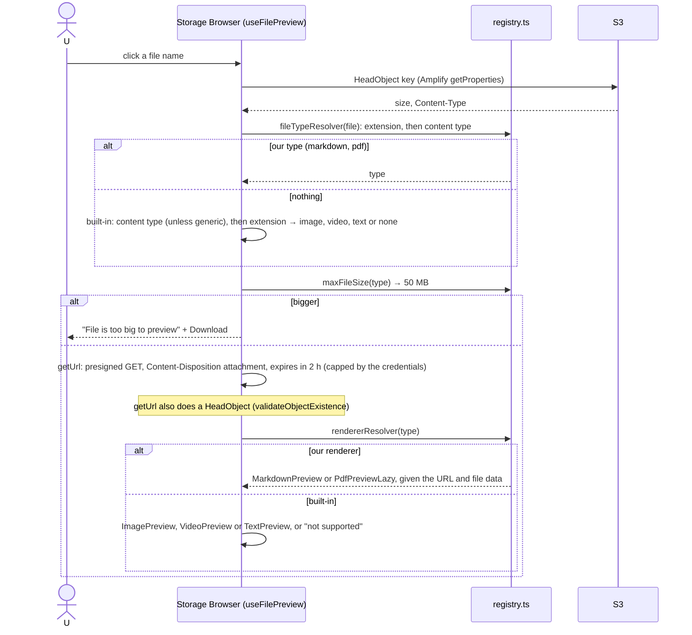
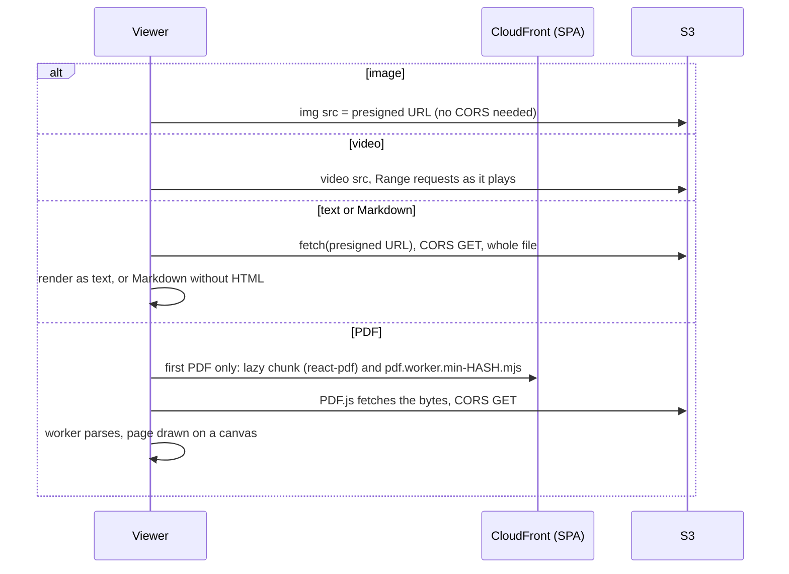

# File preview

Clicking a file name opens a preview panel beside the file list. This is the technical
reference for someone changing this code or infrastructure. It applies wherever the drive shows
files: `Global/`, personal folders and `Deleted/`.

Keep this file in step with the code: change it in the same PR as any change to preview.

## 1. Purpose and user-facing behaviour

| Kind | Recognised by | Viewer |
|---|---|---|
| Photos | `image/*`, or `.jpg .jpeg .png .gif .webp .svg .bmp .tif(f) .ico .heic .heif .avif` | Storage Browser's built-in image viewer (``) |
| Videos | `video/*`, or `.mp4 .mov .webm .m4v .mkv .avi .wmv .flv .mpg .mpeg .3gp .ogv` | built-in video viewer (`<video>`, streamed) |
| Text | `text/*`, JSON/XML/CSV/YAML/TOML types, or `.txt .csv .log .json .xml .yaml .yml .ini .conf .cfg` | built-in text viewer |
| Markdown | `.md`, `.markdown`, or `text/markdown`, `text/x-markdown` | ours: formatted, with tables, checklists and strikethrough; raw HTML ignored; images shown as links |
| PDF | `.pdf` or `application/pdf` | ours: one page at a time with **Previous** / **Next** and "Page X of N" |
| Anything else | | "File preview not supported for this file type" and a download button |

- **Size limit:** files over **50 MB** of any kind aren't previewed. The panel says "File is too
  big to preview" and "Previews are available for files up to 50 MB. Download the file to open
  it.", with a download button.
- The panel shows the file's details and has arrows to step to the previous or next file in the
  list. It scrolls on its own; on a phone it takes the whole width and **Close** returns to the
  list.
- The PDF viewer loads the first time a PDF is opened ("Loading PDF viewer…").
- Whether a format actually plays depends on the browser: HEIC photos show only in Safari, and
  `.mkv`, `.avi` and `.wmv` videos often don't play. Those fall back to the viewer's own error with
  a retry.

## 2. S3 layout

Preview reads files where they are; it writes nothing.

- **Which viewer** comes from the object's key and its stored `Content-Type` (§4). The content
  type is whatever the upload set: the browser's guess for the file in Storage Browser uploads,
  Drive's MIME type or the export type for Google imports, `text/plain; charset=utf-8` after Edit.
  Generic types (`application/octet-stream`, `binary/octet-stream` and similar) are ignored and
  the extension decides.
- **Size** for the limit comes from a `HeadObject` just before previewing (or the listed size).
- **Versioning, lifecycle:** not involved; the current version is previewed. Intelligent-Tiering
  only uses tiers that serve reads at once, so previews work on any file
  ([ADR 0013](../adr/0013-files-in-intelligent-tiering-without-archive-tiers.md)). An archive tier
  would make previews fail with `InvalidObjectState`.

## 3. Access control

Preview only reads, so it needs exactly what download needs. From
`aws_iam_role_policy.authenticated` in `infra/identity.tf`:

| Location | Statement | Grants |
|---|---|---|
| `Global/` | `ReadDriveObjects` | `s3:GetObject` on `Global/*`, everyone signed in |
| Own personal folder | `ManageOwnPersonalObjects` | `s3:GetObject` on `Personal/${aws:PrincipalTag/email}/*`, with `personal` = `yes` |
| `Deleted/` | `ManageDeletedObjects` | `s3:GetObject` on `Deleted/*`, with `trash` = `yes` |

`HeadObject` is authorised by `s3:GetObject`. A presigned URL carries the signer's permissions: it
works only for keys the signed-in person could read anyway, and only until it expires.

**What the UI hides versus what IAM enforces:** preview hides nothing by access level; a file that
is listed can be previewed. The 50 MB limit is a UI rule, not a permission.

### Safety rules for rendering

Files are uploaded by family members and rendered in every family member's browser, a page that
holds AWS credentials for the drive. So the viewers never run content from a file:

- **Markdown** (`MarkdownPreview.tsx`):
  - `skipHtml`: raw HTML in the file is dropped, never turned into elements;
  - react-markdown's default `urlTransform` removes `javascript:` and other unsafe link targets;
  - images become links (alt text, or "image") and are never loaded, so no tracking pixels;
  - links open in a new tab with `rel="noopener noreferrer"`;
  - `remark-gfm` only changes parsing (tables, checklists, strikethrough, autolinks) and adds no
    HTML pass-through.
  Keep all of these when touching the file; `web/test/markdownView.test.tsx` checks them.
- **PDF** (`PdfPreview.tsx`): PDF.js draws pages on a canvas. It doesn't run JavaScript embedded in
  PDFs; XFA forms (`enableXfa: false`), the text layer and the annotation layer (clickable links,
  form fields) are off.
- **Text:** shown as text by React, never as HTML.
- **Images:** an `` element, so an SVG's scripts don't run.
- The pages are served with `Managed-SecurityHeadersPolicy` (`X-Content-Type-Options: nosniff`,
  `X-Frame-Options: SAMEORIGIN`, HSTS). There is no Content Security Policy yet.

## 4. Flows

### Opening a preview



### What each viewer fetches



**Why PDF fetches the bytes:** the presigned URL is generated with
`Content-Disposition: attachment` (Storage Browser does that for every preview). An `` or
`<video>` ignores that header, but an `<iframe>` or `<embed>` would download the file instead of
showing it. So PDF.js fetches the bytes over CORS and draws the pages itself.

## 5. Code map

| Area | Files | Tests |
|---|---|---|
| Registry: extra types, resolver, size limit, wording | `web/src/preview/registry.ts` | `web/test/previewRegistry.test.ts` |
| Viewer props and entry shape | `web/src/preview/types.ts` | |
| Markdown viewer | `web/src/preview/MarkdownPreview.tsx` | `web/test/markdownView.test.tsx` |
| PDF viewer, lazy wrapper | `web/src/preview/PdfPreview.tsx`, `PdfPreviewLazy.tsx` | registry test checks the PDF library isn't loaded up front |
| Wiring | `web/src/pages/Drive.tsx`: `filePreview: filePreviewConfig`, `displayText` includes `previewDisplayText` | |
| Layout | `web/src/styles.css` (`__file-preview`, `.markdown-preview`, `.pdf-preview`, `.pdf-pager`, phone rules) | playground |
| Worker upload | `scripts/deploy.sh` (`.mjs` as `text/javascript`) | |
| Playground | `web/src/playground/Playground.tsx`, `samples.ts`, `sample.pdf` | |

### `filePreviewConfig`

| Option | Value | Notes |
|---|---|---|
| `fileTypeResolver` | `resolvePreviewType()` | our types by extension first, then content type; `undefined` lets Storage Browser decide |
| `rendererResolver` | the entry's `renderer` | `undefined` uses the built-in viewer |
| `maxFileSize` | `min(entry.maxBytes ?? 50 MB, 50 MB)` | in **bytes**, although the library docs say KB; replaces Storage Browser's defaults (image 200 MB, video 2 GB, text 10 MB, other 200 MB) for every type |
| `urlOptions` | not set | Storage Browser's default: `expiresIn: 7200`, `validateObjectExistence: true` |

### Adding a new viewer type

1. Write the viewer in `web/src/preview/`, taking `FilePreviewProps` (`{ fileData: { key, size, contentType }, url }`).
   `url` is a short-lived presigned GET with `Content-Disposition: attachment`: `fetch` it, or use
   it as an ``/`<video>` source, but don't put it in an `<iframe>`.
2. Render untrusted content safely: no raw HTML, no scripts, no remote loads (follow the Markdown
   rules above). Anything in an iframe must be sandboxed.
3. Add an entry to `PREVIEW_TYPES`: `type`, lower-case `extensions`, optional `contentTypes`, the
   `renderer`, and `maxBytes` if the viewer needs a lower limit (it can't raise the 50 MB cap).
4. If the viewer's library is big, load it with `React.lazy` like `PdfPreviewLazy.tsx`, and add a
   test like the registry's "doesn't load the PDF library" one.
5. If it needs a new kind of static file (as PDF.js needs `.mjs`), make sure `scripts/deploy.sh`
   uploads it with the right `Content-Type`.
6. If it fetches from anywhere but the files bucket, that origin will matter for a future CSP.
7. Add tests in `web/test/`, a sample to the playground, and a line to deployment.md's checklist.

## 6. Configuration

| Kind | Name | Used for |
|---|---|---|
| Code constant | `MAX_PREVIEW_BYTES` = 50 MB | every type's limit |
| Code | `previewDisplayText.LocationDetailView.filePreview` | the too-big wording (keep it in step with the constant) |
| `config.json` | `filesBucket`, `region` | where `getUrl` signs for |
| Terraform | `dev_origin` | CORS origin for local `fetch` previews |

There are no SSM parameters or Google settings for preview.

## AWS

### Services and resources (all `ap-southeast-1`)

| Resource | Name | Terraform address | Stack |
|---|---|---|---|
| Files bucket | `family-drive-files-<account>` | `aws_s3_bucket.files` | `infra/foundation/` (retained) |
| CORS rule (for `fetch` previews) | | `aws_s3_bucket_cors_configuration.files` | `infra/` |
| Authenticated role policy | `family-drive-authenticated` / `drive-access` | `aws_iam_role_policy.authenticated` | `infra/` |
| Web bucket and CloudFront (serve the PDF.js chunk and worker) | `family-drive-web-<account>`, distribution `family-drive web app` | `aws_s3_bucket.web`, `aws_cloudfront_distribution.web` | `infra/` |

### API calls

| Call | Issued by |
|---|---|
| `HeadObject` (size and content type) | `getProperties` in Storage Browser's `useFilePreview` (`safeGetProperties`; a failure there is ignored) |
| `HeadObject` (existence) | `getUrl` with `validateObjectExistence: true` |
| Presigned `GetObject` (signed locally, no request) | `getUrl` with `contentDisposition: "attachment"`, `expiresIn: 7200` |
| `GetObject` | the browser: ``, `<video>` (with `Range`), `fetch` (text, Markdown), PDF.js |
| `GET` on CloudFront | the PDF viewer chunk and worker, first time only |

### IAM for the pipeline

Nothing specific: the app pipeline's `WebBucket` and `CloudFront` statements deploy the SPA,
including the PDF.js files.

### Service configuration as deployed

- **CORS** (`infra/storage.tf`): `GET` from the site and `http://localhost:5173`. Needed by the
  text, Markdown and PDF viewers, which `fetch` the presigned URL. Images and videos load without
  CORS.
- **Presigned URLs:** `response-content-disposition=attachment` in the query string; S3 returns
  that header.
- **Content types:** S3 returns the stored `Content-Type`; the viewer choice uses it (§4).
- **PDF.js worker:** Vite emits `pdf.worker.min-<hash>.mjs`. `scripts/deploy.sh` uploads every
  `.mjs` with `Content-Type: text/javascript` and `public,max-age=31536000,immutable`, because the
  CLI's guess for `.mjs` isn't JavaScript and browsers refuse to start a worker served with
  another type. CloudFront serves it with the stored type.

### Limits and quotas

| Limit | Value | Effect |
|---|---|---|
| Preview size | 50 MB, every type | larger files show the too-big message |
| Presigned URL | 2 hours requested; Amplify caps it at the credentials' expiry (at most 1 hour) | a preview left open past that fails on reload or retry; click the file again |
| Text and Markdown | whole file in memory as a string | fine at 50 MB, slow on phones near the top |
| PDF | whole file fetched before the first page | big scans take a while on mobile data |
| Video | streamed with range requests | starts quickly at any size up to 50 MB |

### Observability

- **In the panel:** "Something went wrong" with Retry (HEAD or signing failed); the built-in
  viewers' load errors with Retry; ours: "Couldn't load this file. Try downloading it." (Markdown)
  and "Couldn't open this PDF. Try downloading it."
- **Browser devtools:**
  - `403 AccessDenied` on the presigned URL: no read permission, or the URL expired
    (`Request has expired`);
  - a CORS error on `fetch`: the site's origin isn't in the CORS rule (new CloudFront URL; re-run
    the app pipeline);
  - "Failed to load module script" or a MIME-type error for `pdf.worker…mjs`: it was uploaded
    without `text/javascript`.
- **S3 error codes:** `NoSuchKey` (deleted since listing), `InvalidObjectState` (archived; can't
  happen without archive tiers).

### Cost

Each preview is two `HEAD`s and one `GET` (about $0.0004 per 1,000 each in Singapore), plus S3
internet transfer for the bytes read (up to 50 MB; about $0.12/GB after the free tier). A video
reads only what's played. The PDF viewer adds roughly 1–2 MB of CloudFront transfer the first time
per browser, then it's cached.

### Inspect and operate

What viewer a file will get, from its stored type:

```bash
aws s3api head-object --bucket family-drive-files-<account> --key "Global/<path>" --query "{type: ContentType, size: ContentLength, class: StorageClass}"
```

Fix a wrong content type (e.g. a Markdown file stored as `application/octet-stream` with no
`.md` extension) by copying it onto itself:

```bash
aws s3 cp "s3://family-drive-files-<account>/Global/<path>" "s3://family-drive-files-<account>/Global/<path>" --content-type "text/markdown" --metadata-directive REPLACE
```

Check the worker's content type on the site:

```bash
aws s3api list-objects-v2 --bucket family-drive-web-<account> --query "Contents[?ends_with(Key, '.mjs')].Key"
```

```bash
curl -sI "https://<cloudfront domain>/<worker key from above>" | grep -i content-type
```

## 7. Limits and failure modes

| Situation | What the panel shows |
|---|---|
| File over 50 MB | "File is too big to preview" / "Previews are available for files up to 50 MB. Download the file to open it." + Download |
| Type with no viewer (`.docx`, `.zip`, …) | "File preview not supported for this file type" + Download |
| HEAD or signing fails (offline, credentials) | "Something went wrong" + Retry |
| Image the browser can't decode (HEIC outside Safari, corrupt) | built-in image error + Retry |
| Video codec not supported | built-in video error + Retry |
| Text file can't be fetched | built-in text error + Retry; empty file: "File is empty" |
| Markdown can't be fetched | "Couldn't load this file. Try downloading it." |
| PDF corrupt, encrypted or can't be fetched | "Couldn't open this PDF. Try downloading it." |
| PDF viewer chunk fails to load (offline, old tab after a deploy) | React's lazy-load error; reload the page |
| Raw HTML or `javascript:` link in Markdown | dropped / link removed |
| Image in Markdown | shown as a link, not loaded |
| Wrong `Content-Type` stored | the wrong viewer, or none; fix as in "Inspect and operate" |

## 8. Testing

- **Unit tests:** `npm test --prefix web`:
  - `previewRegistry.test.ts`: Markdown and PDF by extension or content type, built-in types left
    to Storage Browser, the 50 MB limit in bytes for every type, the wording, PDF not loaded up front;
  - `markdownView.test.tsx`: formatting, GitHub tables and checklists, raw HTML never becomes
    elements, `javascript:` links dropped, images as links.
- **Playground:** `npm run dev --prefix web`, then `/playground.html` shows the Markdown and PDF
  viewers and the too-big message with sample files, no AWS needed. `?view=drive` shows the panel
  in the real layout, but previews there show an error because there is no real S3.
- **Manual:** the preview items in [deployment.md's end-to-end checklist](../deployment.md#end-to-end-test-checklist):
  a photo, a video, a `.txt`, a `.md`, a multi-page PDF, a `.docx` (no preview), a file over 50 MB.

## 9. Decisions and history

- [ADR 0002](../adr/0002-storage-browser-without-amplify-backend.md): Storage Browser, extended around its built-in parts.
- [ADR 0013](../adr/0013-files-in-intelligent-tiering-without-archive-tiers.md): no archive tiers, so previews always work.
- [ADR 0001](../adr/0001-no-backend-browser-talks-to-s3.md): no backend, so viewers run in the browser against presigned URLs.
- Tickets: #32 (this doc). Preview has no ADR of its own; its rules live in `registry.ts` and this doc.
