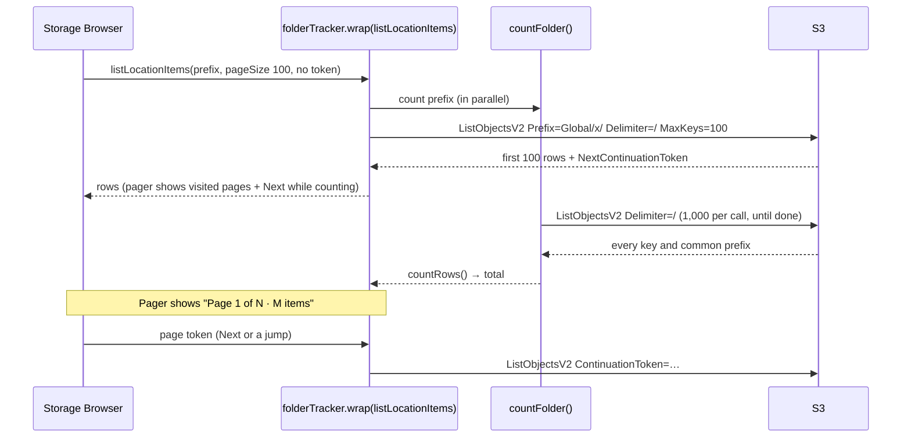
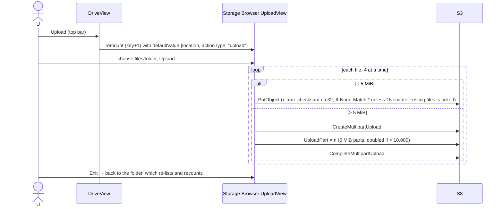
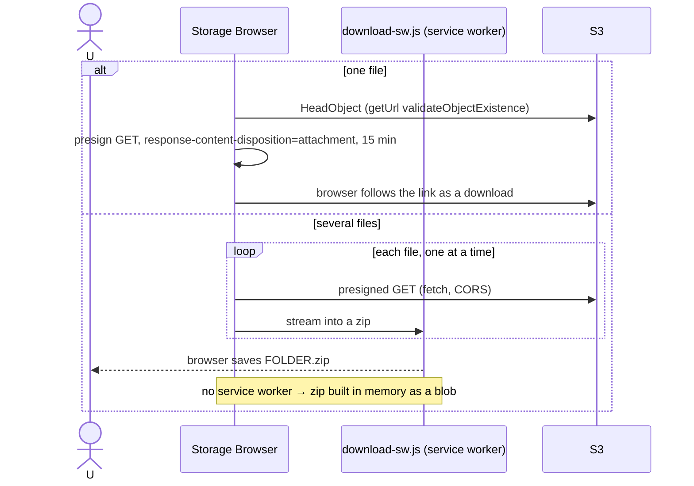
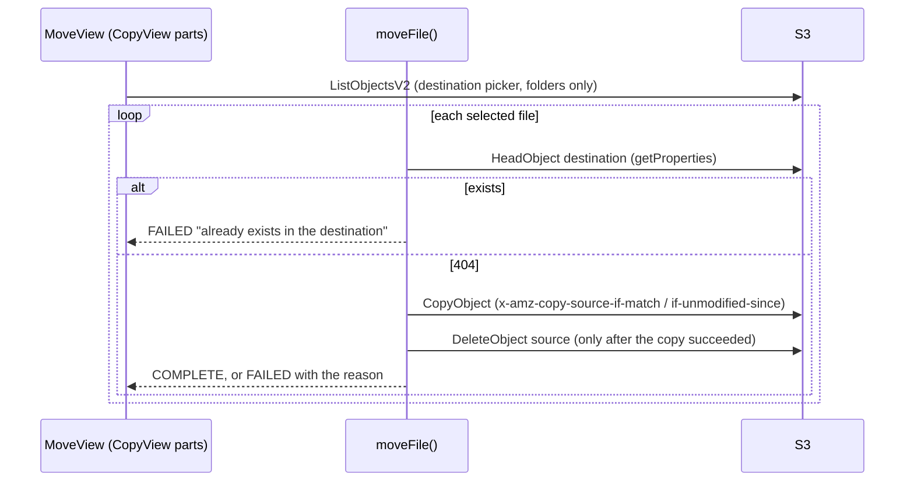
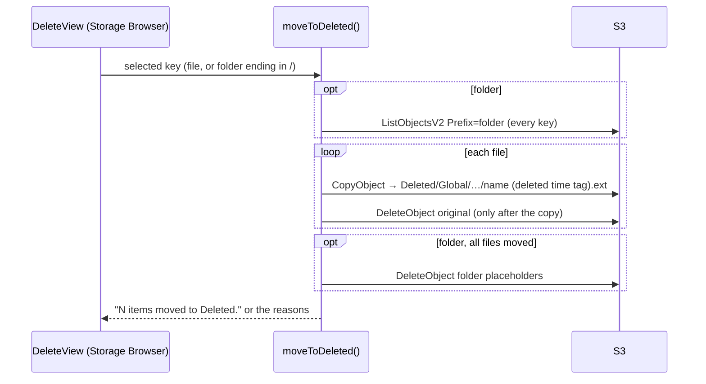
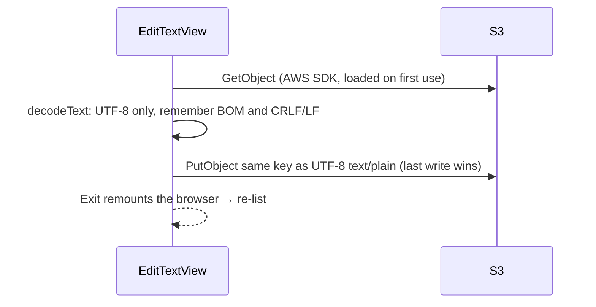

# Shared drive (Global)

The family's shared drive: everything under `Global/` in the files bucket, shown with AWS's
Storage Browser for S3. This is the technical reference for someone changing this code or
infrastructure. Sign-in and access levels are in [auth-and-access.md](auth-and-access.md); this
doc covers what happens once someone is in.

Keep this file in step with the code: change it in the same PR as any change to the shared drive.

## 1. Purpose and user-facing behaviour

After sign-in the drive opens straight on the shared drive, labelled `Global/`. **Home** in the
path lists the locations the person can open: `Global/`, their personal folder and `Deleted/`
(the last two depend on access level).

| Operation | Where | Needs `global` = `write` |
|---|---|---|
| Browse folders, search the current folder | file list, search box | no |
| Pager: `Page X of N · M items` | under the list | no |
| Preview (photos, video, text, Markdown, PDF) | click a file name: panel beside the list | no (see the preview doc) |
| Download one file, or several as a `.zip` | ⋮ menu | no |
| Upload files or folders | ⋮ menu, or **Upload** in the top bar | yes |
| Create folder | ⋮ menu | yes |
| Copy | ⋮ menu | yes |
| Move (files only; never overwrites) | ⋮ menu | yes |
| Edit a `.txt` file up to 1 MB | ⋮ menu, exactly one file selected | yes |
| Delete (moves to `Deleted/`) | ⋮ menu | yes |
| Import from Google Drive | ⋮ menu, or the top-bar button | yes (see the import doc) |

With `read`, the top bar has no Upload/Import buttons and the ⋮ menu offers only Download.

The page never scrolls; the file list and the preview panel scroll on their own. On a phone
the Type and Last modified columns are hidden and a preview takes the full width. The drive
can be added to a phone's home screen, where it opens without the browser bar.

## 2. S3 layout

Bucket `family-drive-files-<account>` (retained foundation stack, `infra/foundation/files.tf`).

- **Keys:** `Global/<folders>/<name>`. A folder is a common prefix; an empty folder made with
  Create folder is a zero-byte object whose key ends in `/` (`Global/Tết 2026/`).
- **Metadata:** none of the app's own. Upload sets `Content-Type` from the file and a CRC-32
  checksum; Edit saves as `text/plain; charset=utf-8`. Everything the list shows (name, size,
  last modified) is what S3 returns ([ADR 0001](../adr/0001-no-backend-browser-talks-to-s3.md)).
- **Encryption:** SSE-S3 (`AES256`) by default; public access blocked.
- **Versioning:** on. An overwrite or a delete outside the app leaves the old version
  noncurrent for 30 days (`expire-noncurrent-versions`).
- **Lifecycle rules that apply to `Global/`:**
  - `expire-noncurrent-versions`: noncurrent versions expire after 30 days (whole bucket);
  - `intelligent-tiering-global`: current versions move to `INTELLIGENT_TIERING` at day 0, no
    archive tiers ([ADR 0013](../adr/0013-files-in-intelligent-tiering-without-archive-tiers.md));
  - `abort-incomplete-multipart-uploads`: after 7 days (whole bucket).
- **Delete** writes to `Deleted/Global/<path>/<name> (deleted <time> <tag>)<ext>`; that folder
  has its own rules ([ADR 0011](../adr/0011-delete-moves-to-a-deleted-folder.md),
  [ADR 0012](../adr/0012-deleted-folder-auto-empties-after-30-days.md)).

## 3. Access control

### IAM statements used by the shared drive

From `aws_iam_role_policy.authenticated` in `infra/identity.tf` (full table and tag mapping in
[auth-and-access.md](auth-and-access.md#the-authenticated-roles-statements)):

| Sid | Grants | Condition | Operations that need it |
|---|---|---|---|
| `ListDriveFolder` | `s3:ListBucket` on the bucket | `s3:prefix` like `Global/`, `Global/*` | list, search, pager count, Copy/Move destination picker, Delete of a folder (lists its files) |
| `ReadDriveObjects` | `s3:GetObject` on `Global/*` | none | download, preview, Edit (open), `HeadObject` (Move's clash check, download's existence check), source of every copy |
| `WriteDriveObjects` | `s3:PutObject`, `s3:DeleteObject`, `s3:AbortMultipartUpload`, `s3:ListMultipartUploadParts` on `Global/*` | `aws:PrincipalTag/global_access` = `write` | upload (single and multipart), create folder, Copy/Move destination, Move's delete, Edit (save), Delete's removal of the original |
| `MoveSharedFilesToDeleted` | `s3:PutObject` on `Deleted/Global/*` | `global_access` = `write` | Delete's copy into `Deleted/` |

Nothing grants `s3:DeleteObjectVersion` on `Global/*`, so nobody can remove a version from the
app: versioning stays the backstop against raw-credential misuse.

### What the UI hides versus what IAM enforces

| UI | Source | Enforced by |
|---|---|---|
| `Global/` location has permissions `["get", "list"]` without write, `["delete", "get", "list", "write"]` with it | `driveLocation()` in `web/src/config.ts` | `WriteDriveObjects` |
| Storage Browser hides Upload, Create folder, Copy and Delete for a location without `write`/`delete` | Storage Browser's own action configs | same |
| Move, Edit and Delete hide without `write` (Move and Delete also need `delete`) | `hide` in `moveAction.ts`, `editAction.ts`, `trash/actions.ts` | same |
| Top-bar Upload/Import shown only where the open location has `write` | `canWrite()`, `showWriteButtons` in `Drive.tsx` | same |
| Home lists only `Global/` (plus own folder/`Deleted/`) | `listDriveLocations()` | `ListDriveFolder` only matches `Global/`; listing the bucket root is denied |

## 4. Flows

Every S3 call is signed in the browser with the Identity Pool credentials
([auth-and-access.md](auth-and-access.md#getting-aws-credentials-and-calling-s3)).

### Opening a folder and counting it



Search lists 1,000 at a time and filters on the client; the tracker sees the different page
size and shows the fallback pager. Copy/Move destination listings (`exclude: FILE`) pass through
uncounted.

### Upload



The ⋮ menu's Upload opens the same view without a remount.

### Download



### Copy and Move



Copy is Storage Browser's own action: the same `CopyObject` without the existence check or the
delete. Both stay inside the current location.

### Delete (move to `Deleted/`)



Restore, Delete permanently and Empty Deleted happen in `Deleted/` and belong to the Deleted
folder doc (#30).

### Edit a text file



## 5. Code map

| Area | Files | Tests |
|---|---|---|
| Drive screen, Storage Browser setup | `web/src/pages/Drive.tsx` (`Drive` builds the adapter and S3 targets; `DriveView` creates the browser and the top bar) | via the playground |
| Locations and permissions | `web/src/config.ts` (`driveLocation`, `canWrite`, `listDriveLocations`, `toAmplifyOutputs`) | `web/test/driveLocation.test.ts`, `web/test/config.test.ts` |
| App start and `Amplify.configure` | `web/src/App.tsx`, `web/src/main.tsx` | |
| Move | `web/src/move/moveFile.ts` (rules), `moveAction.ts` (wiring), `MoveView.tsx` (view) | `web/test/moveFile.test.ts`, `web/test/moveView.test.ts` |
| Delete → `Deleted/` | `web/src/trash/actions.ts`, `trash.ts`, `paths.ts`, `s3Ops.ts`, `TrashViews.tsx` | `web/test/trash.test.ts` |
| Edit | `web/src/edit/text.ts`, `textFile.ts`, `s3Ops.ts`, `editAction.ts`, `EditTextView.tsx` | `web/test/editText.test.ts` |
| Pager and count | `web/src/pagination/folderTracker.ts`, `countFolder.ts`, `rows.ts`, `Pager.tsx` | `web/test/pagination.test.ts` |
| Stable selection for custom views | `web/src/stableItems.ts` | |
| Layout | `web/src/styles.css` | playground `?view=drive` |
| PWA | `web/public/manifest.webmanifest`, `web/index.html`, `web/public/icons/`, `web/scripts/make-icons.mjs` | |
| Download service worker | copied by `npm run copy-sw` into `web/public/amplify-storage-download/` (git-ignored) | |
| Files bucket | `infra/foundation/files.tf` | |
| CORS | `infra/storage.tf` | |
| Hosting | `infra/web.tf`, `scripts/deploy.sh` | |
| Playground | `web/src/playground/main.tsx`, `mockDrive.ts` | |

### Storage Browser setup

- `Drive` reads the bucket from `Amplify.getConfig()` and builds the config from
  `createAmplifyAuthAdapter()` with `listLocations` replaced by `listDriveLocations()` (the
  adapter's own can only derive identity-ID paths). It runs inside `useMemo` in a component that
  only renders after `App` has called `Amplify.configure`: the adapter reads the storage
  config when it's built, so it can never be created at module level.
- `toAmplifyOutputs()` declares one storage bucket named `drive` with the path `Global/*`. The
  real per-location access comes from `listDriveLocations()` and IAM, not from that block.
- `DriveView` calls `createStorageBrowser()` once (memoised) with:
  - `listLocationItems` wrapped by the folder tracker;
  - `delete` replaced by "move to `Deleted/`";
  - custom actions `move`, Google import, `editText` and the Deleted folder's three;
  - `filePreview` from `web/src/preview/registry.ts`;
  - `components: { Pagination: Pager }`.
- Custom views reuse Storage Browser's parts: Move uses `CopyView`'s, Restore and Delete
  permanently use `DeleteView`'s. They must pass `useStableItems(tasks)` to `useAction`
  (a new array each render resets it and loops).
- The browser stays **uncontrolled** (`defaultValue`, never `value`). It reports where the
  person is through `onValueChange`. The top-bar buttons remount it (`key` + 1) straight into
  an action view, and `exitToFolder()` remounts it on the folder, which also re-lists it. A
  controlled browser never reports the Exit of a view opened from outside, so the view would
  get stuck.

## 6. Configuration

| Kind | Name | Used for |
|---|---|---|
| `config.json` | `filesBucket`, `region` | Amplify storage config → Storage Browser and the SDK clients |
| `config.json` | `userPoolId`, `userPoolClientId`, `identityPoolId`, `cognitoDomain` | credentials (see auth doc) |
| Terraform (`infra/`) | `dev_origin` (`http://localhost:5173`) | second CORS origin |
| Terraform (foundation) | `deleted_retention_days` (30) | `Deleted/` lifecycle (not `Global/`) |
| SSM | `/family-drive/access` | who gets `global_access` = `write` |

There are no shared-drive-specific SSM parameters or Google Cloud settings.

## AWS

### Services and resources (all `ap-southeast-1`)

| Resource | Name | Terraform address | Stack |
|---|---|---|---|
| Files bucket | `family-drive-files-<account>` | `aws_s3_bucket.files` (+ `_public_access_block`, `_server_side_encryption_configuration`, `_versioning`, `_lifecycle_configuration`) | `infra/foundation/` (retained) |
| Files bucket CORS | | `aws_s3_bucket_cors_configuration.files` | `infra/` |
| Files bucket lookup | | `data.aws_s3_bucket.files` | `infra/` |
| Authenticated role policy | `family-drive-authenticated` / `drive-access` | `aws_iam_role_policy.authenticated` | `infra/` |
| Web bucket (built SPA) | `family-drive-web-<account>` | `aws_s3_bucket.web` (+ public access block, SSE, `aws_s3_bucket_policy.web`) | `infra/` |
| CloudFront distribution | `family-drive web app` | `aws_cloudfront_distribution.web` | `infra/` |
| Origin Access Control | `family-drive-web` | `aws_cloudfront_origin_access_control.web` | `infra/` |

### API calls

| Operation | S3 API | Issued by |
|---|---|---|
| List a page | `ListObjectsV2` (`Delimiter=/`, `MaxKeys=100`) | Storage Browser `listLocationItems` → Amplify `list` |
| Search | `ListObjectsV2` (1,000 per call) | same, with a search query |
| Count for the pager | `ListObjectsV2` (`Delimiter=/`, all pages) | `countFolder()` → Amplify `list` (`listAll`) |
| Upload ≤ 5 MiB | `PutObject` | Storage Browser upload → Amplify `uploadData` |
| Upload > 5 MiB | `CreateMultipartUpload`, `UploadPart`, `CompleteMultipartUpload` (`AbortMultipartUpload` on cancel) | same |
| Create folder | `PutObject` of an empty `name/` key | Storage Browser createFolder → `uploadData` |
| Download one | `HeadObject`, then a presigned `GetObject` | Storage Browser download → Amplify `getUrl` |
| Download several | presigned `GetObject` per file | Storage Browser zip download + service worker |
| Copy | `CopyObject` | Storage Browser copy → Amplify `copy` |
| Move | `HeadObject`, `CopyObject`, `DeleteObject` | `moveAction.ts`: Amplify `getProperties` + Storage Browser's copy/delete handlers |
| Delete | (`ListObjectsV2`), `CopyObject`, `DeleteObject` | `trash/s3Ops.ts` (`@aws-sdk/client-s3`) |
| Edit | `GetObject`, `PutObject` | `edit/s3Ops.ts` (`@aws-sdk/client-s3`) |
| Preview | `GetObject` (presigned URL) | Storage Browser `filePreview` |
| Deploy | `s3 sync`/`cp` to the web bucket, `CreateInvalidation` | `scripts/deploy.sh` (AWS CLI) |

### IAM for the pipeline

App pipeline (`ci/iam/app-pipeline-policy.json`): `FilesBucketCorsOnly` (the app stack only
reads the files bucket and manages its CORS), `WebBucket`, `CloudFront`, and `AppRoles` /
`PassIdentityPoolRole` for the authenticated role. Foundation pipeline
(`ci/iam/foundation-pipeline-policy.json`): `FoundationBuckets` (bucket settings, versioning,
lifecycle).

### Service configuration as deployed

- **CORS** (`infra/storage.tf`): origins `https://<cloudfront domain>` and
  `http://localhost:5173`; methods `GET PUT POST DELETE HEAD`; all request headers (Amplify sends
  checksum and `If-None-Match` headers); exposes `ETag` (multipart completion needs it),
  `x-amz-server-side-encryption`, `x-amz-request-id`, `x-amz-id-2`, `x-amz-version-id`;
  `max_age_seconds = 3000`. These follow Storage Browser's CORS requirements.
- **Files bucket:** versioning `Enabled`, SSE-S3, all public access blocked, lifecycle as in §2.
- **Web hosting:** private web bucket readable only by CloudFront through OAC (`sigv4`, always
  sign; bucket policy conditioned on the distribution ARN). Default behaviour: HTTPS redirect,
  `GET`/`HEAD`, compression, `Managed-CachingOptimized`, `Managed-SecurityHeadersPolicy`
  (HSTS, `X-Frame-Options SAMEORIGIN`, `nosniff`, referrer policy). 403 and 404 from the origin
  become `/index.html` with 200 (SPA routing). `PriceClass_200`, default certificate.
- **Cache headers** (`scripts/deploy.sh`):
  - hashed assets `public,max-age=31536000,immutable` (`.mjs` uploaded as `text/javascript`);
  - `index.html`, `config.json`, `amplify-storage-download/download-sw.js`,
    `manifest.webmanifest` (as `application/manifest+json`) and `icons/*`: `no-cache`;
  - old assets are deleted only after the new entry points are up; then `/*` is invalidated.

### Limits and quotas

| Limit | Value | Effect |
|---|---|---|
| `ListObjectsV2` page | 1,000 keys | the count takes one LIST per 1,000 objects; Storage Browser asks for 100 per page |
| Single `CopyObject` | 5 GB | files over 5 GB can't be copied, moved or deleted from the app |
| Single `PutObject` | 5 GB | irrelevant: uploads over 5 MiB are multipart |
| Multipart | 10,000 parts, 5 MiB min part, 5 TB object | Amplify doubles the part size as needed |
| Storage Browser upload | 160 GB per file | larger files are refused in the upload view |
| Presigned URL | 15 minutes (Amplify default) | a download link opened later fails with `AccessDenied`/expired |
| Credentials | 1 hour, refreshed by Amplify | a multipart upload outlives them without trouble |
| Edit | 1 MB, UTF-8, `.txt` | larger or non-UTF-8 files stay read-only |
| Lifecycle | runs asynchronously | Intelligent-Tiering transitions happen a day or two after upload |

### Observability

- **In the app:** each action view shows a status per file; Move, Delete and Restore list
  failure reasons in their summaries.
- **S3 error codes the app shows:**
  - `AccessDenied`: wrong access level, tag mapping missing, or a key outside `Global/`;
  - `PreconditionFailed`: upload onto an existing key without **Overwrite existing files**
    (shown as "Overwrite prevented");
  - `NoSuchKey`/`NotFound`: file gone since the list loaded;
  - `InvalidRequest` on copy: file over 5 GB;
  - `InvalidObjectState`: archived object, which can't happen while there are no archive tiers.
- **CORS errors** in the browser console (no response headers at all) mean the origin isn't in
  the CORS rule: a new CloudFront URL needs the app pipeline to re-apply `infra/`.
- **CloudTrail:** S3 data events aren't enabled by default, so per-object calls aren't logged
  unless you turn them on for the bucket (paid).
- **CloudWatch:** S3 storage metrics (`BucketSizeBytes` by storage class, `NumberOfObjects`)
  are free and daily; CloudFront's standard metrics show 4xx/5xx for the SPA.

### Cost

- **Storage:** Intelligent-Tiering, about $0.025/GB-month in Frequent Access, down to about
  $0.005/GB-month after 90 days unread, plus $0.0025 per 1,000 objects over 128 KB per month for
  monitoring. Noncurrent versions (30 days) add to it.
- **Requests** (Singapore, roughly): PUT/COPY/LIST $0.005 per 1,000; GET/HEAD $0.0004 per 1,000.
  Opening a 2,000-item folder costs 3 LISTs (one page plus a two-call count); a Move costs a
  HEAD, a COPY and a DELETE (free).
- **Transfer:** downloads and previews go straight from S3 to the browser at S3's internet
  egress rate (about $0.12/GB in Singapore after the first 100 GB/month free across services).
- **SPA hosting:** CloudFront requests and transfer for a few MB per visit; the web bucket is
  tiny.

### Inspect and operate

```bash
aws s3api list-objects-v2 --bucket family-drive-files-<account> --prefix "Global/" --delimiter / --query "{folders: CommonPrefixes[].Prefix, files: Contents[].Key}"
```

```bash
aws s3api list-object-versions --bucket family-drive-files-<account> --prefix "Global/<path>"
```

```bash
aws s3api get-bucket-cors --bucket family-drive-files-<account>
```

```bash
aws s3api get-bucket-lifecycle-configuration --bucket family-drive-files-<account>
```

```bash
aws s3api list-multipart-uploads --bucket family-drive-files-<account> --prefix "Global/"
```

```bash
aws s3api head-object --bucket family-drive-files-<account> --key "Global/<path>" --query "{class: StorageClass, size: ContentLength, type: ContentType}"
```

Recovering an overwritten or console-deleted file is in [deployment.md Day-to-day](../deployment.md#day-to-day).

Console: S3 → `family-drive-files-<account>` → Objects → `Global/` ("Show versions" for old
versions); Permissions → CORS; Management → Lifecycle rules. CloudFront → the `family-drive web
app` distribution → Invalidations.

## 7. Limits and failure modes

| Situation | What happens | Message |
|---|---|---|
| Upload onto an existing name, **Overwrite existing files** not ticked (the default) | S3 refuses (`If-None-Match: *`) | "Overwrite prevented for …" |
| Tab closed or credentials lost mid-upload | Parts stay in S3 | Lifecycle aborts the incomplete upload after 7 days |
| Move onto an existing name | Refused before copying | "A file with this name already exists in the destination." |
| Move: copy fails | Original untouched | "Couldn't copy it (…). The original wasn't touched." |
| Move: delete of the original fails | File in both folders | "Copied, but the original couldn't be deleted (…), so it's now in both folders." |
| Move to the same folder | Nothing done | "It's already in this folder." |
| Move a folder | Not offered | |
| Delete: copy into `Deleted/` fails | File untouched | "Couldn't move it to Deleted (…). The file wasn't touched." |
| Delete of a folder, some files fail | Moved files stay moved, placeholders kept | "N items moved to Deleted, M not moved." with up to three reasons |
| File over 5 GB | Copy, Move and Delete fail | S3's copy error in the status |
| Edit: file over 1 MB or not UTF-8 | Not opened | "This file is too big to edit here (over 1 MB). Download it to edit it." / "This file isn't UTF-8 text, so it can't be edited here. Download it to edit it." |
| Two people save the same text file | Last save wins | none; the earlier save is a noncurrent version for 30 days |
| Pager count fails | Fallback pager (visited pages + Next) | none |
| Service worker missing | Multi-file download zips in memory | none (large zips may run out of memory) |
| A presigned download link opened after 15 minutes | S3 refuses | XML error page from S3 |

## 8. Testing

- **Unit tests:** `npm test --prefix web`: `moveFile`, `moveView`, `trash`, `editText`,
  `pagination` (`countRows`, page links, jumps, the folder tracker), `driveLocation`, `config`.
- **Playground (no AWS):** `npm run dev --prefix web`, then
  `http://localhost:5173/playground.html?view=drive`. It's the real `DriveView` with sample data:
  - `&access=read` / `read%2Bpersonal` / `write` / `write%2Bpersonal%2Btrash`;
  - `&count=fail` for the fallback pager; `Global/photos` has 250 files for paging;
  - `Global/linh/shopping list.txt` (BOM + CRLF) for Edit.
  Re-check the layout there (desktop and phone width) after upgrading
  `@aws-amplify/ui-react-storage`, since `styles.css` targets its `amplify-storage-browser__*`
  classes and `rows.ts` mirrors its `parseResult`.
- **Manual:** the upload, create folder, download, preview, Copy, Move, Delete, access-level
  and phone items in [deployment.md's end-to-end checklist](../deployment.md#end-to-end-test-checklist).

## 9. Decisions and history

- [ADR 0001](../adr/0001-no-backend-browser-talks-to-s3.md): no backend; the browser calls S3.
- [ADR 0002](../adr/0002-storage-browser-without-amplify-backend.md): Storage Browser on Terraform-made Cognito.
- [ADR 0006](../adr/0006-everyone-can-delete-versioning-is-the-safety-net.md): versioning as the safety net (superseded by 0010).
- [ADR 0007](../adr/0007-pwa-without-offline-cache.md): installable, no offline cache.
- [ADR 0010](../adr/0010-per-person-access-levels-in-ssm.md): read or write on `Global/`.
- [ADR 0011](../adr/0011-delete-moves-to-a-deleted-folder.md), [ADR 0012](../adr/0012-deleted-folder-auto-empties-after-30-days.md): Delete moves to `Deleted/`, which empties itself.
- [ADR 0013](../adr/0013-files-in-intelligent-tiering-without-archive-tiers.md): Intelligent-Tiering without archive tiers.
- Tickets: #11 (pager total), #18 (Intelligent-Tiering), #24 (Delete rework), #45 (Edit text files), #27 (this doc).
