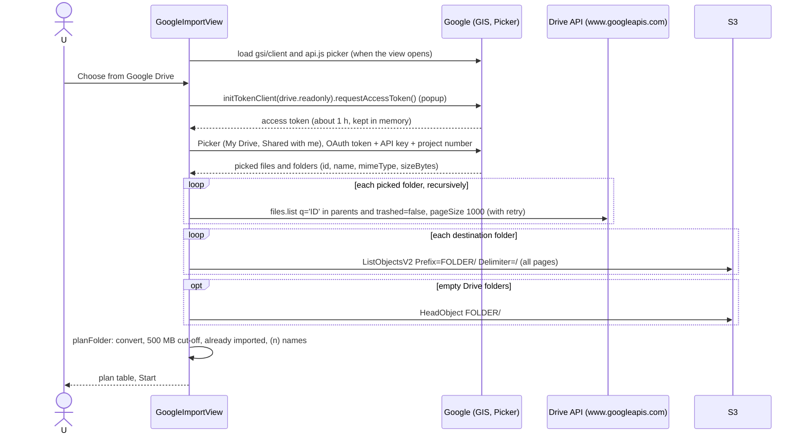
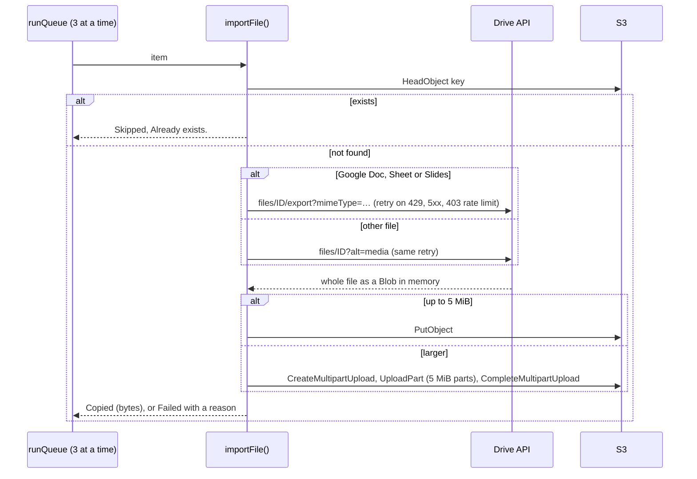
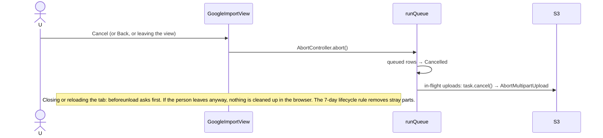

# Import from Google Drive

Copies files and folders from a family member's Google Drive into the folder open in Family
Drive. It runs entirely in the browser tab, with no backend ([ADR 0001](../adr/0001-no-backend-browser-talks-to-s3.md)).
This is the technical reference for someone changing this code or infrastructure. Setting it up
on a deployment is [deployment.md step 4b](../deployment.md#4b-google-drive-import-setup-optional).

Keep this file in step with the code: change it in the same PR as any change to the import.

## 1. Purpose and user-facing behaviour

- **Where:** **Import from Google Drive** in the top bar, or in the ⋮ menu. It's offered only
  where the open location allows writing: `Global/` for people with `global` = `write`, and the
  person's own folder. Files land in the open folder ("Family Drive" or "My files" in the view).
- **Choosing:** **Choose from Google Drive** asks Google for access (a popup, the first time and
  when the token is about to expire), then opens Google Picker with two tabs, **My Drive** and
  **Shared with me**. Files and whole folders can be picked, several at once.
- **Preview of the plan:** "N files, M folders selected → into X · K files to copy", with a row
  per file (path, size, status). **Choose again** or **Start**.
- **Running:** three files at a time, each row going Waiting → Copying… → Copied / Skipped /
  Failed / Cancelled, with a summary line such as "3 copied, 1 skipped · 12 MB". **Cancel**
  stops it. Leaving or reloading the page asks first, because the import runs in the tab.
  **Done** returns to the folder, which re-lists.
- **Folders** are copied recursively, keeping their structure; a picked folder's own name is
  the top folder. Empty folders are recreated.
- **Google Docs and Slides** become PDF, **Sheets** become `.xlsx`. Forms, Sites, Drawings,
  shortcuts and other Google-native types are skipped as not supported.
- **Nothing is ever overwritten.** A file already imported (same name, or a `name (n).ext`
  sibling, with the same size) is skipped as "Already imported.", so re-running an import picks
  up where it stopped. A different file with a taken name gets the next free `name (n).ext`.
- **Files over 500 MB** are skipped: "Too large to import in the browser; download it from Google."
- **Not set up:** while the Google values are placeholders, the view only says "Import from
  Google Drive isn't set up yet." The rest of the drive works normally.
- Nothing changes in Google Drive.

## 2. S3 layout

Imported files go wherever the open folder is, under the same rules as uploads:

- `Global/<open folder>/<picked folder path>/<name>`, or `Personal/<email>/…`.
- Names are cleaned (`sanitiseName()`): `/`, `\` and control characters become `_`, surrounding
  whitespace is trimmed, an empty name becomes `untitled`, and `.`/`..` become `_`/`__`.
- An empty Drive folder becomes a zero-byte `…/name/` placeholder (`application/x-directory`),
  the same shape Storage Browser's Create folder makes.
- **Metadata:** `Content-Type` is Drive's MIME type, or the export type for converted files
  (`application/pdf`, `application/vnd.openxmlformats-officedocument.spreadsheetml.sheet`).
  Nothing records the Google file ID: re-runs recognise files by name and size.
- **Versioning and lifecycle:** as for the destination prefix (Intelligent-Tiering, 30-day
  noncurrent versions). Abandoned multipart parts from a cancelled or closed import are removed
  by `abort-incomplete-multipart-uploads` after 7 days.

## 3. Access control

### AWS side

The import uses the signed-in person's Identity Pool credentials, so it can only write where an
ordinary upload can. From `aws_iam_role_policy.authenticated` in `infra/identity.tf`:

| Sid | Used for | Condition |
|---|---|---|
| `ListDriveFolder` / `ListOwnPersonalFolder` | listing each destination folder before planning | `s3:prefix` within `Global/` or own folder (`personal` = `yes`) |
| `ReadDriveObjects` / `ManageOwnPersonalObjects` (`GetObject`) | `HeadObject` before each file and empty folder | |
| `WriteDriveObjects` / `ManageOwnPersonalObjects` | `PutObject`, multipart upload, `AbortMultipartUpload` on Cancel, `ListMultipartUploadParts` | `global_access` = `write` in `Global/`; `personal` = `yes` in own folder |

| UI | Source | Enforced by |
|---|---|---|
| Action and top-bar button hidden without `write` on the location | `googleImportActionConfig.hide`, `canWrite()` in `Drive.tsx` | the write statements above |
| Destination is always the open folder | `GoogleImportContext.prefix` from `DriveView` | the same; a forged key outside the allowed prefixes gets `AccessDenied` |

### Google side

- **Scope:** `https://www.googleapis.com/auth/drive.readonly` (`DRIVE_SCOPE` in `google.ts`).
  `drive.file` can't see inside picked folders ([ADR 0008](../adr/0008-google-drive-import-scope.md)).
  It's a restricted scope, so the OAuth consent screen stays in **Testing** and every family
  member must be a test user.
- **Token:** from Google Identity Services' token client (implicit grant, popup), about 1 hour,
  held only in `google.ts` module memory, never stored, and sent only to `www.googleapis.com`
  (Drive API) and to Picker. It is unrelated to the Cognito tokens.
- **Same OAuth client** as Google sign-in through Cognito (SSM `/family-drive/google_client_id`).
  The import needs the site as an **Authorized JavaScript origin** on it.
- **API key:** public (it's in `config.json`); protected by its restrictions (Websites: the site
  and `localhost:5173`; APIs: Google Picker API only).

## 4. Flows

### Choosing and planning



### Copying one file



### Cancel and leaving



## 5. Code map

All under `web/src/googleImport/`; tests in `web/test/googleImport.test.ts`.

| File | Role | Pure / tested |
|---|---|---|
| `importAction.ts` | Custom Storage Browser action (⋮ menu), hidden without `write`; no-op handler | |
| `GoogleImportView.tsx` | The screen: phases choose → preparing → ready → running → finished; concurrency 3 | playground |
| `google.ts` | Loads GIS and Picker lazily, gets and caches the token, opens Picker | |
| `driveClient.ts` | The only code calling the Drive API (`files.list`, `alt=media`, `export`); `DriveError` | yes |
| `deps.ts` | Injected sides: `googleApis` + `amplifyStorage` (production), fakes in the playground | |
| `prepare.ts` | Picked items → full plan; lists each destination folder once | yes |
| `listing.ts` | Recursive folder walk, every page, empty folders | yes |
| `plan.ts` | Keys, `(n)` names, re-run skips, conversion targets, 500 MB cut-off | yes |
| `conversion.ts` | Google-native type → export type and extension | yes |
| `names.ts` | `sanitiseName`, `withSuffix`, `isSameOrSibling` | yes |
| `importFile.ts` | One file: check, download/export with retry, upload; empty-folder placeholders | yes |
| `retry.ts` | Which Drive errors to retry; exponential backoff (1 s, 2 s, 4 s; 4 tries) | yes |
| `queue.ts` | Runs N at a time, never stops on a failure, cancel | yes |
| `summary.ts` | Status labels, "3 copied, 1 skipped · 12 MB" | yes |
| `leaveWarning.ts` | `beforeunload` prompt while running | yes |

Wiring elsewhere: `web/src/pages/Drive.tsx` (custom action, top-bar button, `GoogleImportContext`
with the destination prefix, label and `exitToFolder`), `web/src/config.ts`
(`googleImportConfig()`), `web/src/playground/mockGoogleImport.ts`.

The top-bar button uses the same remount trick as Upload: `openAction(GOOGLE_IMPORT_ACTION)`
remounts Storage Browser into the view, and `onExit` remounts it on the folder, which re-lists it.

## 6. Configuration

| Value | SSM parameter (foundation) | Terraform output | `config.json` key |
|---|---|---|---|
| OAuth client ID | `/family-drive/google_client_id` (String; also Cognito's Google IdP) | `google_client_id` | `googleClientId` |
| Browser API key | `/family-drive/google_api_key` (String) | `google_api_key` | `googleApiKey` |
| Project number (Picker's app ID) | `/family-drive/google_project_number` (String) | `google_project_number` | `googleProjectNumber` |

- The path is SSM → `data.aws_ssm_parameter.*` in `infra/foundation_inputs.tf` → outputs in
  `infra/outputs.tf` (`nonsensitive`) → `scripts/write-config.sh` → `config.json` → `loadConfig()`
  → `googleImportConfig()`. The client secret never leaves Terraform and Cognito.
- `googleImportConfig()` returns `null` unless all three are present and not `CHANGE_ME`; the view
  then says it isn't set up. The API key and project number are deliberately **not** in the deploy
  precondition, so the app deploys without them.
- **Google Cloud** (same project as sign-in, [deployment.md 4b](../deployment.md#4b-google-drive-import-setup-optional)):
  Google Drive API and Google Picker API enabled; the site and `http://localhost:5173` as
  Authorized JavaScript origins; the API key restricted to those websites and the Picker API;
  `drive.readonly` on the consent screen; every family member a test user.
- A new CloudFront URL (app stack rebuilt) needs the JavaScript origin and the key's website
  restriction updated.
- A Content Security Policy, if one is ever added, must allow `accounts.google.com`,
  `apis.google.com`, `docs.google.com` and `www.googleapis.com`.

## AWS

### Services and resources (all `ap-southeast-1`)

| Resource | Name | Terraform address | Stack |
|---|---|---|---|
| SSM parameters | `/family-drive/google_api_key`, `/family-drive/google_project_number`, `/family-drive/google_client_id` | `aws_ssm_parameter.google_api_key`, `.google_project_number`, `.google_client_id` | `infra/foundation/` (retained) |
| Their reads and outputs | | `data.aws_ssm_parameter.google_*`, `output.google_*` | `infra/` |
| Files bucket (destination), lifecycle rule `abort-incomplete-multipart-uploads` | `family-drive-files-<account>` | `aws_s3_bucket.files`, `aws_s3_bucket_lifecycle_configuration.files` | `infra/foundation/` |
| CORS (browser uploads) | | `aws_s3_bucket_cors_configuration.files` | `infra/` |
| Authenticated role policy | `family-drive-authenticated` / `drive-access` | `aws_iam_role_policy.authenticated` | `infra/` |

### API calls

| Step | Call | Issued by |
|---|---|---|
| List a destination folder | `ListObjectsV2` (`Delimiter=/`, all pages) | Amplify `list` (`listAll`, `subpathStrategy: exclude`) in `deps.ts` |
| Existence check (each file and empty folder) | `HeadObject` | Amplify `getProperties` |
| Upload ≤ 5 MiB | `PutObject` | Amplify `uploadData` |
| Upload > 5 MiB | `CreateMultipartUpload`, `UploadPart`, `CompleteMultipartUpload` | Amplify `uploadData` |
| Cancel | `AbortMultipartUpload` | `uploadData` task `cancel()` |
| Credentials | `GetId`, `GetCredentialsForIdentity` | Amplify, through the default storage config (not Storage Browser's location credentials) |

Amplify `uploadData` splits uploads over 5 MiB into 5 MiB parts (doubled if more than 10,000
would be needed) and retries failed S3 requests itself; the import adds no S3 retries of its own.
Uploads don't use `If-None-Match`: the `HeadObject` just before is the overwrite check (see §7).

### IAM for the pipeline

Nothing beyond the app stack's usual entries: `ReadFoundationParams` (`ssm:GetParameter(s)` on
`/family-drive/*`) reads the Google values. The foundation pipeline's `FoundationParameters`
creates the parameters.

### Service configuration as deployed

- SSM: the three values are `String` with `CHANGE_ME` placeholders and `ignore_changes` on the
  value: set by hand, never overwritten by Terraform.
- CORS on the files bucket allows `PUT`/`POST` from the site and exposes `ETag`, which multipart
  completion needs.
- Lifecycle: `abort-incomplete-multipart-uploads`, 7 days, whole bucket.

### Limits and quotas

| Limit | Value | Effect |
|---|---|---|
| Import cut-off | 500 MB per file (`MAX_IMPORT_BYTES`), from Drive's size before downloading | the whole file sits in browser memory; bigger ones are skipped |
| Drive export | about 10 MB per exported file | larger Docs/Sheets/Slides fail with "Too large to convert; download it from Google." |
| Drive listing | 1,000 items per `files.list` page | every page is followed |
| Google token | about 1 hour, not refreshed mid-run | a very long import fails part-way; run it again |
| Concurrency | 3 files at a time | |
| Retries | 4 tries, 1 s / 2 s / 4 s backoff, Drive 429, 5xx and 403 rate limits only | |
| Multipart | 5 MiB parts, 10,000 parts | far above the 500 MB cut-off |
| AWS credentials | 1 hour, refreshed by Amplify | not a limit for long imports |
| Google test users | 100 | the family must fit |

### Observability

- **In the view:** each failed row has a reason (§7); Google sign-in problems show under the
  Choose button.
- **Browser devtools:** network calls to `www.googleapis.com` show the Drive HTTP status and
  error `reason`; S3 calls show `AccessDenied` or CORS failures.
- **Google Cloud console:** APIs & Services → Google Drive API / Google Picker API → Metrics
  (errors, quota use).
- **AWS:** `list-multipart-uploads` (below) shows parts left by abandoned imports. S3 data events
  aren't in CloudTrail unless enabled.

### Cost

- **AWS:** data into S3 is free. Each file costs a `HEAD`, then one `PUT` (small files) or
  `CreateMultipartUpload` + one `UploadPart` per 5 MiB + `Complete` (about $0.005 per 1,000
  requests); a 100 MB video is about 22 requests. Each destination folder is listed once. Then
  ordinary storage (Intelligent-Tiering).
- **Google:** the Drive and Picker APIs have no charge, only per-user quotas.
- **Transfer:** the bytes travel Google → the person's browser → S3, using their internet
  connection twice.

### Inspect and operate

Check the values the SPA got:

```bash
curl -s https://<cloudfront domain>/config.json
```

```bash
aws ssm get-parameters --region ap-southeast-1 --names /family-drive/google_api_key /family-drive/google_project_number --query "Parameters[].[Name,Value]"
```

Stray parts from abandoned imports, and removing one by hand (the lifecycle rule does it after 7
days anyway):

```bash
aws s3api list-multipart-uploads --bucket family-drive-files-<account>
```

```bash
aws s3api abort-multipart-upload --bucket family-drive-files-<account> --key "<Key>" --upload-id "<UploadId>"
```

Google Cloud console: **APIs & Services → Credentials** (API key restrictions, OAuth client
origins); **Google Auth Platform → Audience** (test users) and **Data access** (scopes).

## 7. Limits and failure modes

| Situation | Row status and message |
|---|---|
| Key already in Family Drive when its turn comes | Skipped: "Already exists." |
| Same name/size (or `(n)` sibling) already there when planning | Skipped: "Already imported." |
| File over 500 MB | Skipped: "Too large to import in the browser; download it from Google." |
| Google Form, Site, shortcut, … | Skipped: "This kind of Google file can't be imported (only Docs, Sheets and Slides)." |
| Converted file over Drive's export limit | Failed: "Too large to convert; download it from Google." |
| File deleted in Drive since picking, or no access | Failed: "Not found in Google Drive (deleted, or no access)." |
| Drive keeps refusing (rate limit after 4 tries, or 403) | Failed: "Google Drive is busy or refused access; try again later." |
| Other Drive error | Failed: "Couldn't download it from Google Drive (HTTP n)." |
| S3 check fails | Failed: "Couldn't check Family Drive (…)." |
| Upload fails (`AccessDenied`, network) | Failed: "Couldn't save it to Family Drive (…)." |
| Empty folder placeholder fails | Failed: "Couldn't create the folder (…)." |
| Cancel | Waiting and in-flight rows: Cancelled. Finished rows stay copied. |
| Tab closed or reloaded | The browser asks first; if left anyway the import stops. Re-running skips what's done. |
| Popup closed or blocked | "Google sign-in didn't finish (its window was closed). If Google showed an error there, tell whoever set up Family Drive." |
| Google scripts don't load (offline, blocked) | "Couldn't load accounts.google.com" (or `apis.google.com`), and Choose is disabled. |
| Not set up | "Import from Google Drive isn't set up yet." |
| `origin_mismatch`, "The API developer key is invalid", not a test user | Shown by Google in the popup or Picker; fixes in [deployment.md Troubleshooting](../deployment.md#troubleshooting). |

Known gaps:

- **Race between check and upload:** the `HeadObject` check and the upload are separate, so a file
  someone uploads to the same key in between would be overwritten (versioning keeps the old one
  for 30 days).
- **Re-runs match by name and size**, so a Drive file edited without changing size is "Already
  imported". Converted files have no size, so any same-name file counts.
- **Memory:** each file is held whole in memory, up to three at a time (up to about 1.5 GB).

## 8. Testing

- **Unit tests:** `npm test --prefix web -- test/googleImport.test.ts`: names, `decideNames`
  (re-runs, `(n)` names, batch collisions), conversion, `planFolder` (500 MB, unsupported types),
  `listFolderTree` (pages, nesting, empty folders), `prepareImport` (second run all skipped),
  placeholders, retry rules and backoff, the queue (concurrency, failures, cancel), `importFile`
  (never overwrites, retries, export, error messages), `createDriveClient` (token only to Drive,
  `DriveError` reason), `warnOnLeave`.
- **Playground:** `/playground.html?view=drive` runs the real view with fake Google and S3
  (`mockGoogleImport.ts`); `&google=off` shows the not-set-up message.
- **Manual:** the "Import from Google Drive" items in
  [deployment.md's end-to-end checklist](../deployment.md#end-to-end-test-checklist): first
  consent, nested folder, Docs/Sheets conversion, re-run skips and `(n)` names, Cancel and the
  leave prompt, a phone import.

## 9. Decisions and history

- [ADR 0001](../adr/0001-no-backend-browser-talks-to-s3.md): no backend, so the import runs in the tab.
- [ADR 0008](../adr/0008-google-drive-import-scope.md): `drive.readonly`, Testing mode, test users.
- [ADR 0009](../adr/0009-personal-folders-keyed-by-email.md): imports into personal folders.
- Tickets: #1 (import), #2 (scope spike), #6 (re-runs and names), #7 (folders), #8 (conversion),
  #9 (500 MB and leave warning), #10 (checklist), #31 (this doc).
