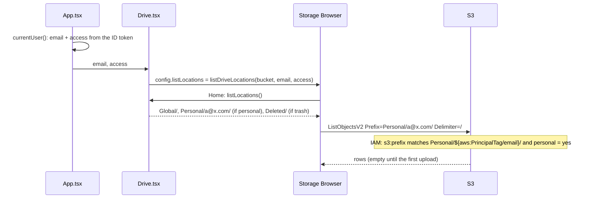
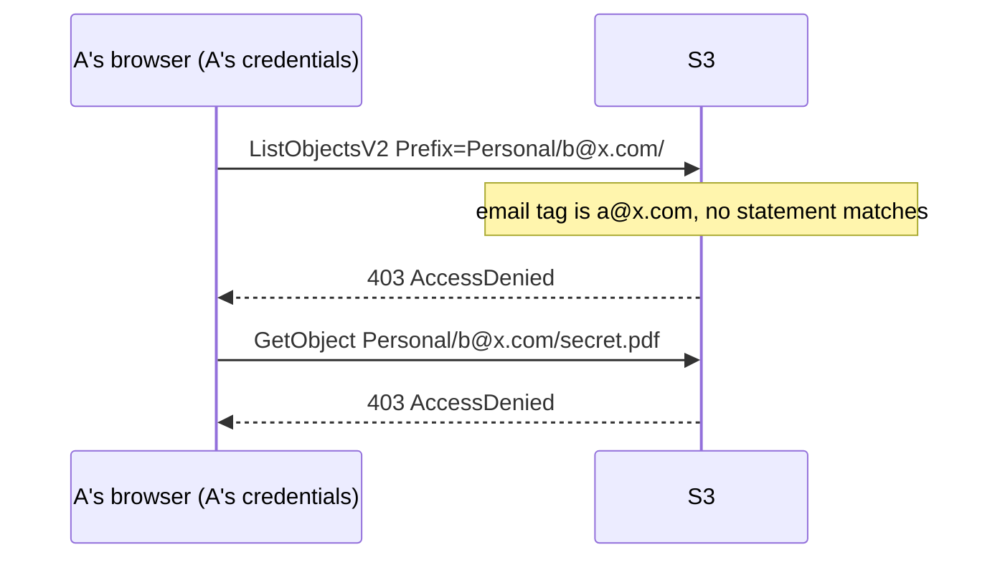
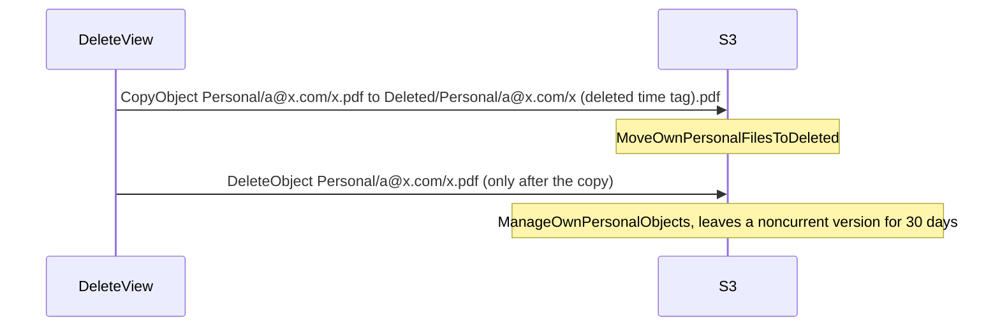

# Personal folders

Each family member can have a private folder, `Personal/<email>/`, next to the shared drive.
This is the technical reference for someone changing this code or infrastructure. It builds on
[auth-and-access.md](auth-and-access.md) (claims, principal tags, the whole IAM policy) and
[global-drive.md](global-drive.md) (how each Storage Browser operation calls S3); this doc covers
only what is specific to personal folders.

Keep this file in step with the code: change it in the same PR as any change to personal folders.

## 1. Purpose and user-facing behaviour

- A person whose access level has `"personal": true` sees their own folder on **Home**, next to
  `Global/` (and `Deleted/` if they manage it). Its prefix is `Personal/<their email>/`.
- In their folder they can do everything the shared drive offers a writer, whatever their
  `global` level: upload, create folders, download, preview, Copy, Move, Edit, Delete (to
  `Deleted/`) and Import from Google Drive (the import calls it "My files").
- Nobody else can open it from the app, and Home never lists other people's folders.
- Copy and Move stay inside the folder: there is no moving files between a personal folder and
  the shared drive.
- The AWS account owner can still see every folder in the S3 console; the privacy is an app
  boundary, not encryption.
- Without `personal`, the folder isn't listed and IAM refuses it. Files already there stay in S3.

## 2. S3 layout

Bucket `family-drive-files-<account>` (retained foundation stack, `infra/foundation/files.tf`).

- **Keys:** `Personal/<email>/<folders>/<name>`, where `<email>` is the person's email in lower
  case, e.g. `Personal/linh.hua@gmail.com/Tax 2026/receipt.pdf`. Folders and placeholders work
  as in `Global/`.
- **Nothing is created up front.** The folder appears in S3 with its first file; until then Home
  still lists it and it opens empty.
- **Metadata:** none of the app's own, as in `Global/`.
- **Versioning:** on; noncurrent versions expire after 30 days (`expire-noncurrent-versions`).
- **Lifecycle:** `intelligent-tiering-personal` moves current versions to `INTELLIGENT_TIERING` at
  day 0 with no archive tiers ([ADR 0013](../adr/0013-files-in-intelligent-tiering-without-archive-tiers.md));
  `abort-incomplete-multipart-uploads` after 7 days.
- **Delete** moves files to `Deleted/Personal/<email>/<path>/<name> (deleted <time> <tag>)<ext>`.
  That part of `Deleted/` follows the Deleted folder's rules (30-day auto-empty,
  [ADR 0011](../adr/0011-delete-moves-to-a-deleted-folder.md), [ADR 0012](../adr/0012-deleted-folder-auto-empties-after-30-days.md)).

### Why the key is the email

The folder name is the `email` principal tag rather than the Identity Pool identity ID (Amplify's
usual `{entity_id}` paths). The Identity Pool lives in the disposable app stack, so identity IDs
change whenever the stack is recreated and ID-keyed folders would be orphaned. The email
survives that, matches the allowlist and is readable in the console
([ADR 0009](../adr/0009-personal-folders-keyed-by-email.md)).

## 3. Access control

### The tags involved

| Tag | From | Role here |
|---|---|---|
| `email` | ID-token `email` claim (Google's, via the IdP attribute mapping) | names the only folder the caller may touch |
| `personal` | ID-token claim added by pre token generation from `"personal": true` in SSM `/family-drive/access` | turns the folder on (`yes`) or off (`no`/missing) |

Both are mapped by `aws_cognito_identity_pool_provider_principal_tag.email` in
`infra/identity.tf`, with `use_defaults = false`. The trust policy allows `sts:TagSession`, without
which the tags would be refused.

### IAM statements

From `aws_iam_role_policy.authenticated` (`infra/identity.tf`). In Terraform the policy variable is
written `$${aws:PrincipalTag/email}` so Terraform leaves it for IAM to resolve per request.

| Sid | Actions | Resource | Conditions | Needed for |
|---|---|---|---|---|
| `ListOwnPersonalFolder` | `s3:ListBucket` | the bucket | `s3:prefix` like `Personal/${aws:PrincipalTag/email}/` or `…/*`; `aws:PrincipalTag/personal` = `yes` | list, search, pager count, Copy/Move destination picker, Delete of a folder |
| `ManageOwnPersonalObjects` | `s3:GetObject`, `s3:PutObject`, `s3:DeleteObject`, `s3:AbortMultipartUpload`, `s3:ListMultipartUploadParts` | `Personal/${aws:PrincipalTag/email}/*` | `personal` = `yes` | everything on files: download, preview, upload (incl. multipart), create folder, Copy, Move, Edit, the original's removal on Delete, Google import |
| `MoveOwnPersonalFilesToDeleted` | `s3:PutObject` | `Deleted/Personal/${aws:PrincipalTag/email}/*` | `personal` = `yes` | Delete's copy into `Deleted/` |

There is no statement for `Personal/*` in general, so a request for another person's folder, or
for `Personal/` itself, matches nothing and S3 returns `AccessDenied`, whatever the browser sends.

People with `trash` = `yes` can list, read and purge `Deleted/Personal/<anyone>/` through the
`Deleted/` statements, so trash managers see files deleted from everyone's folders (accepted by
the owner in ADR 0011). They can't restore into someone else's folder: they have no write there.

### What the UI hides versus what IAM enforces

| UI | Source | Enforced by |
|---|---|---|
| Home lists `Personal/<own email>/` only when `personal` is `yes` and the email is known | `listDriveLocations()` in `web/src/config.ts` | `ListOwnPersonalFolder`, `ManageOwnPersonalObjects` need `personal` = `yes` |
| Home never lists anyone else's folder | `listDriveLocations()` (replaces the Amplify adapter's `listLocations`; listing everyone's would mean shipping the allowlist to the browser) | no statement matches another email |
| The personal location always has `["delete", "get", "list", "write"]` | `personalLocation()` | same statements, independent of `global_access` |
| Top-bar Upload/Import shown on Home when the person can write somewhere | `showWriteButtons` in `web/src/pages/Drive.tsx` | |
| Restore refuses targets in another person's folder with a clear message | `canWriteFor()` in `web/src/trash/actions.ts`, `cantWriteMessage()` in `trash.ts` | no write on that folder |

### Lower-casing the email

`personalPrefix()` trims and lower-cases the email. IAM compares the prefix with the raw `email`
tag case-sensitively, so the two agree only because Google sends emails in lower case. An email
claim with capitals would get `AccessDenied` in that person's own folder.

### No Copy or Move between the shared drive and a personal folder

Storage Browser's Copy (and Move, which reuses Copy's destination picker) only offers folders
inside the location that is open, and each location is one prefix. So the limit comes from the
UI, not from IAM: a person with `personal` could copy `Global/` → own folder with their
credentials (read on `Global/*`, write on their folder), and a writer the other way. Adding
cross-location moves would mean a destination picker that spans locations; it isn't built.

## 4. Flows

### Home and opening the folder



### A request for someone else's folder



### Delete in a personal folder



Upload, download, Copy, Move, Edit and import call S3 exactly as in `Global/`
([global-drive.md](global-drive.md#4-flows)), with the personal prefix.

## 5. Code map

| Area | Files | Tests |
|---|---|---|
| Prefix, location, Home list | `web/src/config.ts` (`PERSONAL_PREFIX`, `personalPrefix`, `personalLocation`, `isPersonalPrefix`, `listDriveLocations`) | `web/test/driveLocation.test.ts` |
| `personal` claim in the SPA | `web/src/access.ts` | `web/test/access.test.ts` |
| Email from the ID token | `web/src/session.ts` (`currentUser`, `emailFromIdTokenPayload`) | `web/test/session.test.ts` |
| Drive wiring, top bar, import label | `web/src/pages/Drive.tsx` | playground |
| Restore's write check | `web/src/trash/actions.ts` (`canWriteFor`), `trash.ts` (`cantWriteMessage`) | `web/test/trash.test.ts` |
| `personal` flag → claim | `functions/allowlist/src/access.ts`, `preTokenGeneration.ts` | `functions/allowlist/test/access.test.ts`, `handlers.test.ts` |
| Tag mapping and IAM statements | `infra/identity.tf` | `terraform validate` |
| SSM `access` validation | `infra/foundation_inputs.tf` | `terraform plan` |
| Lifecycle | `infra/foundation/files.tf` | |
| Playground | `web/src/playground/main.tsx`, `mockDrive.ts` (signed in as `you@example.com`) | |

## 6. Configuration

| Kind | Name | Used for |
|---|---|---|
| SSM | `/family-drive/access`, key `"personal": true` per email | turns the folder on; default `false` |
| SSM | `/family-drive/allowed_emails` | the person must be allowlisted at all |
| `config.json` | `filesBucket`, `region` | bucket for the location |

No Terraform variables or Google Cloud settings are specific to personal folders. A change to
`access` takes effect after the app pipeline runs and the person's next token refresh or sign-in
([auth-and-access.md](auth-and-access.md#6-configuration)).

## AWS

### Services and resources (all `ap-southeast-1`)

| Resource | Name | Terraform address | Stack |
|---|---|---|---|
| Files bucket and lifecycle rule `intelligent-tiering-personal` | `family-drive-files-<account>` | `aws_s3_bucket.files`, `aws_s3_bucket_lifecycle_configuration.files` | `infra/foundation/` (retained) |
| Principal tag mapping (`email`, `personal`) | Identity Pool `family-drive` | `aws_cognito_identity_pool_provider_principal_tag.email` | `infra/` |
| Authenticated role policy | `family-drive-authenticated` / `drive-access` | `aws_iam_role_policy.authenticated` | `infra/` |
| Pre token generation Lambda (adds `personal`) | `family-drive-pre-token-generation` | `aws_lambda_function.pre_token_generation` | `infra/` |
| Access levels | `/family-drive/access` | `aws_ssm_parameter.access` | `infra/foundation/` |

### API calls

The same S3 operations as the shared drive (`ListObjectsV2`, `PutObject`, multipart, `HeadObject`,
presigned `GetObject`, `CopyObject`, `DeleteObject`), with keys under `Personal/<email>/`. The
tags are set once per credential exchange (`GetCredentialsForIdentity` →
`AssumeRoleWithWebIdentity` + `TagSession`), not per request.

### IAM for the pipeline

`ci/iam/app-pipeline-policy.json`: `Cognito` with `cognito-identity:SetPrincipalTagAttributeMap`
and `GetPrincipalTagAttributeMap` (the tag mapping), `AppRoles` (the role policy). A policy from
before personal folders lacks the two tag-map actions and fails with `AccessDenied`.

### Service configuration as deployed

- Tag mapping `email` = `email`, `personal` = `personal` (with `global_access`, `trash`), for the
  user pool provider `cognito-idp.ap-southeast-1.amazonaws.com/<pool id>`, `use_defaults = false`.
- Trust policy allows `sts:AssumeRoleWithWebIdentity` and `sts:TagSession`.
- `ListBucket` statements use `StringLike` on `s3:prefix`; object statements use the policy
  variable in the resource ARN.

### Limits and quotas

- **Session tag values:** up to 256 characters, letters, digits, spaces and `_.:/=+-@` only.
  Ordinary emails fit; one with other characters (e.g. `+` is fine, `'` isn't) would fail the
  credential exchange for that person.
- **Case:** `s3:prefix` and resource ARNs compare case-sensitively; see "Lower-casing the email".
- **Everything else** (5 GB copy, multipart, 15-minute presigned URLs, 1-hour credentials) is as in
  [global-drive.md](global-drive.md#limits-and-quotas).

### Observability

- `AccessDenied` in your own folder: the tag mapping is missing (app stack not re-applied), the
  `personal` claim isn't `yes` yet (no token refresh since the change), or the email claim has
  capitals.
- `AccessDenied` on someone else's folder: expected.
- To see the tags a session got, enable CloudTrail and look at `AssumeRoleWithWebIdentity` events
  for `family-drive-authenticated` (`principalTags` in the request).
- S3 storage metrics per prefix aren't available by default; use the CLI below or S3 Storage Lens.

### Cost

The same as the shared drive per GB and per request (Intelligent-Tiering, request and transfer
prices in [global-drive.md](global-drive.md#cost)). There is no per-folder charge, and empty
folders cost nothing because nothing exists in S3 until the first upload.

### Inspect and operate

Who has a folder in S3, and how big each is:

```bash
aws s3api list-objects-v2 --bucket family-drive-files-<account> --prefix "Personal/" --delimiter / --query "CommonPrefixes[].Prefix"
```

```bash
aws s3 ls --summarize --human-readable --recursive "s3://family-drive-files-<account>/Personal/<email>/"
```

Check the tag mapping:

```bash
aws cognito-identity get-principal-tag-attribute-map --identity-pool-id <identity pool id> --identity-provider-name cognito-idp.ap-southeast-1.amazonaws.com/<pool id>
```

The commands assume `AWS_REGION=ap-southeast-1`.

**Prove isolation with one person's credentials.** Signed in as A, copy A's ID token from the
browser's localStorage (key `CognitoIdentityServiceProvider.<client id>.<username>.idToken`), then
run these (the two Cognito Identity calls need no AWS credentials of your own; add
`--no-sign-request` if none are configured):

```bash
LOGINS="cognito-idp.ap-southeast-1.amazonaws.com/<pool id>=<A's ID token>"
```

```bash
ID=$(aws cognito-identity get-id --identity-pool-id <identity pool id> --logins "$LOGINS" --query IdentityId --output text)
```

```bash
aws cognito-identity get-credentials-for-identity --identity-id "$ID" --logins "$LOGINS"
```

Put the returned `AccessKeyId`, `SecretKey` and `SessionToken` into `AWS_ACCESS_KEY_ID`,
`AWS_SECRET_ACCESS_KEY` and `AWS_SESSION_TOKEN` in a fresh shell, then:

```bash
aws s3api list-objects-v2 --bucket family-drive-files-<account> --prefix "Personal/<A's email>/" --max-items 5
```

```bash
aws s3api list-objects-v2 --bucket family-drive-files-<account> --prefix "Personal/<B's email>/" --max-items 5
```

The first succeeds (if A has `personal`); the second fails with `AccessDenied`. Close that shell
afterwards: the credentials are valid for an hour. Without signing in, the IAM policy simulator
does the same check:

```bash
aws iam simulate-principal-policy --policy-source-arn arn:aws:iam::<account>:role/family-drive-authenticated --action-names s3:GetObject --resource-arns "arn:aws:s3:::family-drive-files-<account>/Personal/b@x.com/file.txt" --context-entries ContextKeyName=aws:PrincipalTag/email,ContextKeyValues=a@x.com,ContextKeyType=string ContextKeyName=aws:PrincipalTag/personal,ContextKeyValues=yes,ContextKeyType=string
```

It should report `implicitDeny`; with `ContextKeyValues=b@x.com` for `email`, `allowed`.

**Give someone files privately:** upload them to `Personal/<their email>/` in the S3 console.

**Remove a departed person's folder** (after they're off the allowlist):

```bash
aws s3 rm --recursive "s3://family-drive-files-<account>/Personal/<email>/"
```

Versioning keeps the removed files as noncurrent versions for 30 days.

## 7. Limits and failure modes

| Situation | What happens |
|---|---|
| Person removed from the allowlist | Their folder stays in S3, unreachable from the app. Re-adding the same email brings it back as it was. Their files in `Deleted/Personal/<email>/` are auto-emptied after 30 days. |
| `personal` turned off | Folder hidden on Home and refused by IAM after their next token refresh; files stay. Turning it back on restores access. |
| App stack destroyed and rebuilt | New Identity Pool and user pool, same emails, so every folder is still there. |
| Email changes (new Google account) | It's a different folder; move the files in the console. |
| Email claim with capitals | `AccessDenied` in their own folder. |
| Tag mapping missing (app stack not re-applied) | No `email`/`personal` tags: folder refused. |
| Trash manager restores a file from another person's folder | Refused before trying: "It was in `<email>`'s personal folder, which only they can write to." |
| Copy or Move to the shared drive | Not offered; download and upload instead (a writer only). |

Failure messages for upload, Move, Delete and Edit are the shared drive's
([global-drive.md](global-drive.md#7-limits-and-failure-modes)).

## 8. Testing

- **Unit tests:** `npm test --prefix web` (`driveLocation`: lower-cased prefix, full-access
  location, Home lists only the signed-in person's folder and none when the email is unknown;
  `access`; `trash`: `canWriteFor` allows only the person's own folder) and
  `npm test --prefix functions/allowlist` (the `personal` flag and claim).
- **Playground:** `/playground.html?view=drive` (signed in as `you@example.com`, with a personal
  folder); `&access=read` hides it, `&access=read%2Bpersonal` shows a read-only `Global/` with a
  writable personal folder.
- **Manual:** the Home, personal folder, cross-folder denial and access-level items in
  [deployment.md's end-to-end checklist](../deployment.md#end-to-end-test-checklist), plus the
  credential check above.

## 9. Decisions and history

- [ADR 0009](../adr/0009-personal-folders-keyed-by-email.md): personal folders keyed by email, enforced with principal tags.
- [ADR 0010](../adr/0010-per-person-access-levels-in-ssm.md): the `personal` flag.
- [ADR 0011](../adr/0011-delete-moves-to-a-deleted-folder.md): Delete into `Deleted/Personal/<email>/`, trash managers see it.
- [ADR 0001](../adr/0001-no-backend-browser-talks-to-s3.md), [ADR 0004](../adr/0004-retained-foundation-and-disposable-app-stack.md): no backend; disposable app stack (why not identity IDs).
- Tickets: #14 (personal folders), #15 (access levels), #24 (Deleted folder), #28 (this doc).
