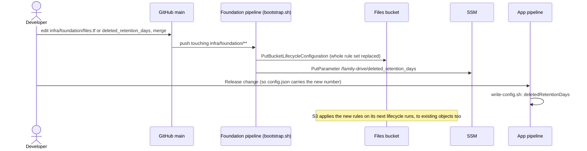
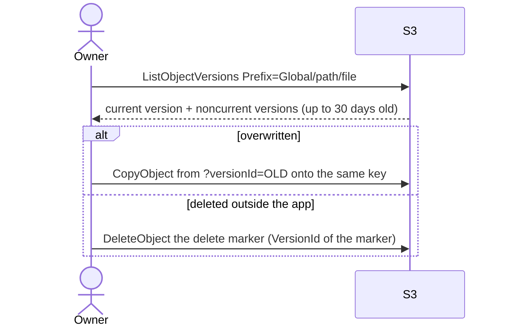

# Storage, retention and cost

What happens to the bytes in the files bucket over time: where they live, how long old versions
and deleted files are kept, which storage class they sit in, and what all of that costs. This is
the technical reference for someone changing the bucket's rules. The individual features are in
[global-drive.md](global-drive.md), [personal-folders.md](personal-folders.md) and
[deleted-folder.md](deleted-folder.md); this doc is the one place that lists every rule together.

Keep this file in step with `infra/foundation/files.tf` and `state.tf`: change it in the same PR.

## 1. Purpose and user-facing behaviour

Family members see none of this directly. What they experience:

- **Nothing is lost by accident for 30 days.** An overwritten file's previous version, and a file
  deleted outside the app, can be recovered from the AWS console for 30 days. A file deleted in
  the app sits in `Deleted/` for 30 days, where a trash manager can restore it.
- **Deleted means gone after about 31 days.** S3 removes files from `Deleted/` with every version.
- **Old files get cheaper by themselves.** Files nobody opens move to cheaper tiers, and come back
  to the normal tier the moment someone opens them, with no wait and no retrieval fee.
- **Every file is always instantly readable.** Nothing is archived where a download, preview, Move
  or Delete would have to wait for a restore.

## 2. S3 layout

### Buckets

| Bucket | Holds | Stack | Protection |
|---|---|---|---|
| `family-drive-files-<account>` | The family's files | `infra/foundation/` (retained) | `prevent_destroy`, versioning, SSE-S3, public access blocked, TLS-only policy |
| `family-drive-tfstate-<account>` | Terraform state for both stacks (`foundation/`, `family-drive/`) | `infra/foundation/` (retained) | Same as above |
| `family-drive-web-<account>` | The built SPA | `infra/` (disposable) | Private, CloudFront OAC only, `force_destroy` (rebuilt on every deploy) |

The rest of this doc is about the files bucket unless it says otherwise.

### Prefixes in the files bucket

| Prefix | What | Doc |
|---|---|---|
| `Global/` | The shared drive | [global-drive.md](global-drive.md) |
| `Personal/<email>/` | Each person's private folder (email in lower case) | [personal-folders.md](personal-folders.md) |
| `Deleted/Global/…`, `Deleted/Personal/<email>/…` | Files moved there by Delete, with a stamped name | [deleted-folder.md](deleted-folder.md) |
| anything else | Not reachable from the app (IAM allows only the three prefixes) | |

Folders are prefixes; an empty folder is a zero-byte key ending in `/`.

### Versioning

`aws_s3_bucket_versioning.files` is `Enabled`. Every overwrite or delete keeps the previous version
as **noncurrent**; a delete adds a **delete marker** as the current version. Nothing in the app
deletes a version outside `Deleted/` (nobody has `s3:DeleteObjectVersion` there), so versioning is
the recovery path for overwrites, edits, Move's source and deletes made with raw credentials
([ADR 0006](../adr/0006-everyone-can-delete-versioning-is-the-safety-net.md), superseded by 0010
for permissions but still the safety net).

### Every lifecycle rule

From `aws_s3_bucket_lifecycle_configuration.files` (`infra/foundation/files.tf`):

| Rule ID | Prefix | Action | Why |
|---|---|---|---|
| `expire-noncurrent-versions` | whole bucket | Noncurrent versions expire **30 days** after becoming noncurrent | The recovery window for overwrites and console deletes |
| `expire-deleted-folder` | `Deleted/` | Current versions expire **`deleted_retention_days` (30)** days after creation; noncurrent versions expire **1 day** after becoming noncurrent | Auto-empty the trash ([ADR 0012](../adr/0012-deleted-folder-auto-empties-after-30-days.md)); the shorter noncurrent rule wins over the bucket-wide one |
| `remove-deleted-folder-delete-markers` | `Deleted/` | Remove expired delete markers | Leaves nothing behind once a file is gone; S3 won't combine this with `days` in one rule |
| `intelligent-tiering-global` | `Global/` | Current versions transition to `INTELLIGENT_TIERING` at **day 0** | Cheaper storage for rarely opened files ([ADR 0013](../adr/0013-files-in-intelligent-tiering-without-archive-tiers.md)) |
| `intelligent-tiering-personal` | `Personal/` | Same | Same |
| `abort-incomplete-multipart-uploads` | whole bucket | Abort uploads not completed within **7 days** | Cleans up parts from cancelled or abandoned uploads and Google imports |

The same rules as `aws s3api get-bucket-lifecycle-configuration` returns them (shape, abridged):

```json
{
  "Rules": [
    { "ID": "expire-noncurrent-versions", "Status": "Enabled", "Filter": {},
      "NoncurrentVersionExpiration": { "NoncurrentDays": 30 } },
    { "ID": "expire-deleted-folder", "Status": "Enabled", "Filter": { "Prefix": "Deleted/" },
      "Expiration": { "Days": 30 }, "NoncurrentVersionExpiration": { "NoncurrentDays": 1 } },
    { "ID": "remove-deleted-folder-delete-markers", "Status": "Enabled", "Filter": { "Prefix": "Deleted/" },
      "Expiration": { "ExpiredObjectDeleteMarker": true } },
    { "ID": "intelligent-tiering-global", "Status": "Enabled", "Filter": { "Prefix": "Global/" },
      "Transitions": [{ "Days": 0, "StorageClass": "INTELLIGENT_TIERING" }] },
    { "ID": "intelligent-tiering-personal", "Status": "Enabled", "Filter": { "Prefix": "Personal/" },
      "Transitions": [{ "Days": 0, "StorageClass": "INTELLIGENT_TIERING" }] },
    { "ID": "abort-incomplete-multipart-uploads", "Status": "Enabled", "Filter": {},
      "AbortIncompleteMultipartUpload": { "DaysAfterInitiation": 7 } }
  ]
}
```

### Storage classes

| Where | Class | How it gets there |
|---|---|---|
| `Global/`, `Personal/` current versions ≥ 128 KB | `INTELLIGENT_TIERING` | Uploaded or copied as `STANDARD`, moved by the day-0 rule on the next lifecycle run (usually within a day or two) |
| `Global/`, `Personal/` objects < 128 KB | `STANDARD` | S3 lifecycle doesn't transition objects under 128 KB by default |
| Noncurrent versions | the class they had | Transitions only apply to current versions |
| `Deleted/` | `STANDARD` | No transition: files there are gone before Intelligent-Tiering would save money |

**Intelligent-Tiering tiers in use:** Frequent Access (new and recently read), Infrequent Access
(after 30 days without a read), Archive Instant Access (after 90 days). All three serve a `GET`
immediately; a read moves the object back to Frequent Access. **The optional Archive Access and
Deep Archive Access tiers are off**, because there is no `aws_s3_bucket_intelligent_tiering_configuration`.
Never add one, and never use a Glacier class: archived objects make downloads, previews, Move and
Delete fail with `InvalidObjectState` until restored, and the app has no restore flow.

### Lifetime of a file

```
upload ──► STANDARD ──(next lifecycle run)──► INTELLIGENT_TIERING (Frequent)
                       ──30 days unread──► Infrequent ──90 days unread──► Archive Instant
                       ◄────────────── any read moves it back to Frequent ──────────────

overwrite / Edit ──► old version noncurrent ──30 days──► gone
Delete in the app ──► copy in Deleted/ (STANDARD) + delete marker at the original
                       ├─ original's last version noncurrent ──30 days──► gone
                       └─ Deleted/ copy ──30 days──► delete marker ──1 day──► gone, marker removed
```

### The state bucket

`family-drive-tfstate-<account>`: versioning `Enabled`, SSE-S3, TLS-only, public access blocked,
`prevent_destroy`, **no lifecycle rule**. Every apply keeps the previous state as a noncurrent
version forever. State files are small (tens of KB), so the cost is negligible, and the history
helps recover from a bad apply. The app state holds the Google client secret in plain text
(accepted in the [security assessment](../security/assessment-2026-11.md)).

## 3. Access control

Retention is enforced by S3 itself; no person or app role changes it at run time.

| Who | Can affect retention by | Statement |
|---|---|---|
| Family members with write access | Overwriting or deleting, which creates noncurrent versions (kept 30 days) | `WriteDriveObjects`, `ManageOwnPersonalObjects` in `infra/identity.tf` |
| Trash managers (`trash` = `yes`) | Removing versions under `Deleted/` before the 30 days | `ManageDeletedObjects` (`s3:DeleteObjectVersion` on `Deleted/*`) |
| Nobody in the app | Removing a version under `Global/` or `Personal/` | (no statement grants it) |
| The foundation pipeline | Changing lifecycle and versioning | `FoundationBuckets` in `ci/iam/foundation-pipeline-policy.json` (`s3:PutLifecycleConfiguration`, `s3:PutBucket*`) |

The UI hides nothing here. The foundation pipeline's power to rewrite the rules is finding S3 in
the security assessment (accepted: no independent backup, #54).

## 4. Flows

### How a change to the rules reaches S3



### Recovering an overwritten file (console or CLI)



Files deleted in the app are restored from `Deleted/` instead ([deleted-folder.md](deleted-folder.md#restore)).

## 5. Code map

| Area | Files |
|---|---|
| Files bucket, versioning, lifecycle, encryption, public access block | `infra/foundation/files.tf` |
| TLS-only bucket policies | `infra/foundation/tls.tf` |
| State bucket | `infra/foundation/state.tf` |
| Retention variable and its validation | `infra/foundation/main.tf` (`deleted_retention_days`) |
| Retention parameter for the app | `infra/foundation/ssm.tf` (`aws_ssm_parameter.deleted_retention_days`) |
| App reads it, passes it to the SPA | `infra/foundation_inputs.tf`, `infra/outputs.tf`, `scripts/write-config.sh` |
| The note in `Deleted/` | `web/src/trash/retention.ts` (tested in `web/test/retention.test.ts`) |
| Web bucket | `infra/web.tf` |
| Applying the foundation | `infra/foundation/bootstrap.sh` |

There is no application code for versioning, tiering or expiry: S3 does all of it.

## 6. Configuration

| Kind | Name | Value | Notes |
|---|---|---|---|
| Terraform (foundation) | `deleted_retention_days` | 30 | Whole days ≥ 1; feeds the `Deleted/` rule and the SSM value |
| Terraform (code) | noncurrent expiry | 30 days | Literal in `files.tf`; the recovery window. Change it there |
| Terraform (code) | multipart abort | 7 days | Literal in `files.tf` |
| SSM (Terraform-owned) | `/family-drive/deleted_retention_days` | `String` | Change the variable, never the parameter |
| `config.json` | `deletedRetentionDays` | string | Shown as the note in `Deleted/` |

Changing a rule: edit `files.tf` (or the variable), merge, let the foundation pipeline run, then run
the app pipeline if the retention changed. A shorter period applies to objects already in the
bucket on S3's next runs.

## AWS

### Services and resources (all `ap-southeast-1`)

| Resource | Terraform address | Stack |
|---|---|---|
| `family-drive-files-<account>` | `aws_s3_bucket.files`, `_versioning.files`, `_lifecycle_configuration.files`, `_server_side_encryption_configuration.files`, `_public_access_block.files`, `aws_s3_bucket_policy.files` | `infra/foundation/` |
| `family-drive-tfstate-<account>` | `aws_s3_bucket.tfstate` and its versioning, encryption, public access block, policy | `infra/foundation/` |
| `/family-drive/deleted_retention_days` | `aws_ssm_parameter.deleted_retention_days` | `infra/foundation/` |
| `family-drive-web-<account>` | `aws_s3_bucket.web` | `infra/` |

### API calls

| Who | Call |
|---|---|
| Foundation pipeline | `PutBucketVersioning`, `PutBucketLifecycleConfiguration`, `PutBucketEncryption`, `PutPublicAccessBlock`, `PutBucketPolicy`, `PutParameter` (and the `Get…` reads Terraform does) |
| S3 itself | lifecycle expirations and transitions (no API calls billed as requests, except transitions) |
| Owner, when recovering | `ListObjectVersions`, `CopyObject` with a `versionId` source, `DeleteObject` of a delete marker |

### IAM for the pipeline

`ci/iam/foundation-pipeline-policy.json`: `FoundationBuckets` (bucket settings, versioning,
lifecycle on the two retained buckets), `FoundationStateObjects` (its own state), `FoundationParameters`.
The app pipeline only reads the retention parameter (`ReadFoundationParams`).

### Limits and quotas

| Limit | Value | Effect |
|---|---|---|
| Lifecycle timing | asynchronous; objects become eligible at midnight UTC after the due day, and S3 may act a day or two later | numbers in this doc are "at least" |
| Lifecycle rules per bucket | 1,000 | not a concern |
| Intelligent-Tiering minimum object size | 128 KB monitored | smaller objects stay `STANDARD` |
| Intelligent-Tiering minimum duration | none | |
| Glacier minimum durations | 90 / 180 days | irrelevant while no Glacier class is used |
| Single `CopyObject` | 5 GB | affects Move/Delete/Restore of very large files, not retention |

### Observability

- **Storage by class:** CloudWatch → S3 → `BucketSizeBytes` by `StorageType`
  (`StandardStorage`, `IntelligentTieringFAStorage`, `IntelligentTieringIAStorage`,
  `IntelligentTieringAIAStorage`) and `NumberOfObjects`. Free, daily.
- **Cost:** Cost Explorer filtered by service S3 and the `Project = family-drive` tag (the app stack's
  default tag; the foundation adds `Stack = foundation`), grouped by usage type
  (`TimedStorage-INT-FA-ByteHrs`, `-INT-IA-`, `-INT-AIA-`, `Requests-Tier1`, `DataTransfer-Out-Bytes`).
- **Optional:** S3 Storage Lens' free dashboard shows noncurrent bytes and incomplete multipart
  uploads, the two things that grow quietly.
- **Error codes tied to storage class:** `InvalidObjectState` would mean an archived object, which
  can't happen with the current rules.

### Cost

Rough Singapore (`ap-southeast-1`) list prices, November 2026; check the S3 pricing page before relying on them.

| Driver | Price | What drives it here |
|---|---|---|
| Intelligent-Tiering Frequent / Infrequent / Archive Instant | about $0.025 / $0.0138 / $0.005 per GB-month | most of the bill; files nobody opens drift to the cheaper tiers |
| Intelligent-Tiering monitoring | $0.0025 per 1,000 objects ≥ 128 KB per month | photos and videos: 100,000 objects ≈ $0.25/month |
| Lifecycle transition to Intelligent-Tiering | about $0.01 per 1,000 objects, once per object | every upload and every copy (Move, Restore) |
| Standard | about $0.025 per GB-month | `Deleted/` (up to 30 days), small files, noncurrent versions of small files |
| Noncurrent versions | the class they were in | each overwrite or delete keeps the old bytes 30 days; a deleted file is stored twice for that time (`Deleted/` copy + the noncurrent original) |
| PUT, COPY, POST, LIST | about $0.005 per 1,000 | uploads, Move/Delete/Restore copies, the pager's count (one LIST per 1,000 objects per folder open) |
| GET, HEAD | about $0.0004 per 1,000 | downloads, previews, existence checks |
| Data transfer out | about $0.12 per GB after the free allowance | downloads and previews go **straight from S3** to the browser, not through CloudFront |
| CloudFront | per GB and per request | only the SPA (a few MB per visit), never the files |
| Deletes and expirations | free | Delete permanently, Empty Deleted, lifecycle expiry |

**Example:** 100 GB of family photos (40,000 objects), mostly unopened after a few months, costs
roughly $0.6–1.5 per month in storage plus $0.10 in monitoring, plus whatever is downloaded.

## 7. Limits and failure modes

| Situation | What happens |
|---|---|
| A file overwritten more than 30 days ago | The old version is gone for good |
| A file deleted in the app more than about 31 days ago | Gone for good, unless a trash manager restored it first |
| Delete permanently / Empty Deleted | The `Deleted/` copy is gone at once; the original's noncurrent version lingers up to 30 days, visible only in the console |
| Someone adds an Intelligent-Tiering configuration or a Glacier transition | Files that get archived can't be downloaded, previewed, moved or deleted from the app (`InvalidObjectState`) |
| `deleted_retention_days` lowered | Files already in `Deleted/` older than the new value are removed on S3's next runs |
| The foundation pipeline replaces the lifecycle configuration | All rules are replaced as a set; a missing rule stops applying at once |
| Versioning suspended | New overwrites and deletes keep no previous version; existing versions stay. Never suspend it |
| No independent backup | Accepted for cost (#54): a destroyed bucket or a lifecycle rule that expires everything can't be undone |

## 8. Testing

- **Offline:** `terraform -chdir=infra/foundation init -backend=false && terraform -chdir=infra/foundation validate`;
  `terraform fmt -check -recursive infra`.
- **Unit:** `npm test --prefix web -- test/retention.test.ts` (the note and its parsing).
- **Manual:** the lifecycle and Intelligent-Tiering items in
  [deployment.md's end-to-end checklist](../deployment.md#end-to-end-test-checklist):

```bash
aws s3api get-bucket-lifecycle-configuration --bucket family-drive-files-<account>
```

```bash
aws s3api get-bucket-versioning --bucket family-drive-files-<account>
```

```bash
aws s3api list-bucket-intelligent-tiering-configurations --bucket family-drive-files-<account>
```

The last one must list none.

```bash
aws s3api head-object --bucket family-drive-files-<account> --key "Global/<a file over 128 KB>" --query StorageClass
```

A day or two after upload it reads `INTELLIGENT_TIERING`.

## 9. Decisions and history

- [ADR 0004](../adr/0004-retained-foundation-and-disposable-app-stack.md): the files bucket lives in the retained foundation stack.
- [ADR 0006](../adr/0006-everyone-can-delete-versioning-is-the-safety-net.md): versioning as the safety net.
- [ADR 0011](../adr/0011-delete-moves-to-a-deleted-folder.md): Delete moves to `Deleted/`.
- [ADR 0012](../adr/0012-deleted-folder-auto-empties-after-30-days.md): `Deleted/` auto-empties.
- [ADR 0013](../adr/0013-files-in-intelligent-tiering-without-archive-tiers.md): Intelligent-Tiering without archive tiers.
- Tickets: #18 (Intelligent-Tiering), #25 (auto-empty), #11 (pager count, a LIST cost), #54 (no independent backup, won't fix), #33 (this doc).
