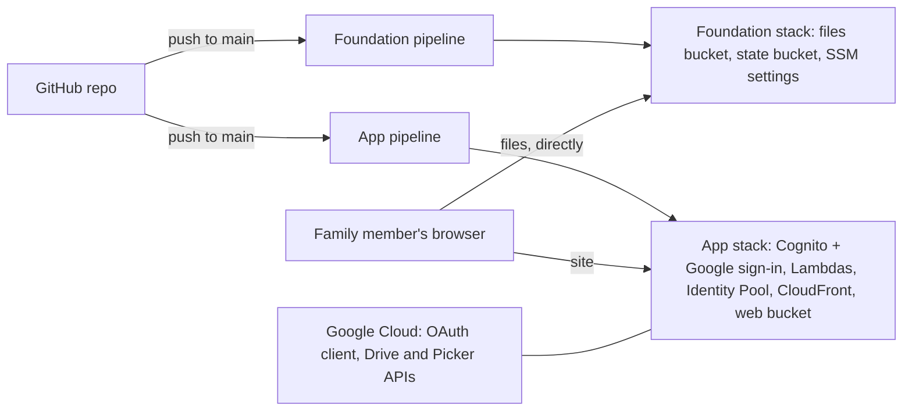

# Set up Family Drive from scratch

A step-by-step guide for a developer: from nothing (no AWS resources, no Google project, a fresh
clone) to a working Family Drive you can sign in to, plus local development. Follow the steps in
order; each ends with **Check** (what you should see) and points to the fix if it doesn't.

Once it's running, day-to-day operations, the end-to-end test checklist and troubleshooting are in
[deployment.md](../deployment.md). How it all works is in [system design](../architecture/system-design.md)
and [`docs/features/`](../features/).

Placeholders used throughout: `<account-id>` (your 12-digit AWS account ID), `you@gmail.com`,
`https://<id>.cloudfront.net` (your site, known after step 7). Never paste real secrets into chats,
tickets or commits.

## Step 0. What you'll end up with



- **Foundation** (`infra/foundation/`): kept forever; holds the family's files and the settings.
- **App** (`infra/`): can be destroyed and rebuilt at any time.
- Three pipelines in AWS CodePipeline: foundation, app deploy, and an optional manual destroy.

About an hour end to end, most of it waiting for pipelines and CloudFront.

## Step 1. Accounts and tools

**Accounts:**
- An **AWS account** where you can act as an administrator (for this setup only; the pipelines get
  narrow roles). Region: `ap-southeast-1` (Singapore).
- A **Google account** with access to [Google Cloud Console](https://console.cloud.google.com/), and
  a **Google Cloud project** for Family Drive (create one: top bar → project picker → **New project**).
- A **GitHub account** with the repository (`hualinh1012/personal-storage`, or your fork), deploying
  from `main`.

**Tools on your machine**, with the version each needs:

| Tool | Version | Check |
|---|---|---|
| git | any recent | `git --version` |
| Node.js | ≥ 22.12 (Vite 8, Vitest 5) | `node --version` |
| AWS CLI | v2 | `aws --version` |
| Terraform | ≥ 1.10 (the pipelines use 1.16.6) | `terraform version` |
| jq (optional) | any | `jq --version`; used only to check JSON |

Sign the AWS CLI in to the account as an administrator (`aws configure sso` or access keys), then:

```bash
aws sts get-caller-identity --query Account --output text
```

**Check:** it prints your `<account-id>`. Keep it: bucket names and the Cognito domain include it.

## Step 2. Clone and run locally, without AWS

Proves the toolchain before anything touches AWS.

```bash
git clone https://github.com/hualinh1012/personal-storage.git && cd personal-storage
```

```bash
npm ci --prefix functions/allowlist && npm test --prefix functions/allowlist
```

```bash
npm ci --prefix web && npm test --prefix web
```

```bash
npm run dev --prefix web
```

Open `http://localhost:5173/playground.html`, then `http://localhost:5173/playground.html?view=drive`.

**Check:** both test runs pass; the playground shows the Markdown and PDF viewers, and `?view=drive`
shows the real drive screen with sample files (Upload, Move, Delete and Restore work on them). The app
itself at `/` needs `web/public/config.json`, which step 11 creates.

**If it fails:** `Node >= 22.12 required` means upgrading Node.

## Step 3. Connect GitHub to AWS and protect `main`

1. AWS console → **Developer Tools → Settings → Connections → Create connection** → GitHub.
2. Install the **AWS Connector for GitHub** app, and give it access to **only this repository**.
3. Wait until the connection shows **Available**.
4. On GitHub: **Settings → Branches → Add branch ruleset** (or protection rule) for `main`: require a
   pull request before merging, block force pushes and deletion. Every push to `main` deploys to AWS,
   so this is the main control on who can change production (#52).

**Check:** the connection is **Available**; pushing straight to `main` is refused.

## Step 4. Foundation: buckets and settings

The foundation creates the files bucket, the Terraform state bucket and the SSM parameters (with a
`CHANGE_ME` placeholder). Every resource has `prevent_destroy`.

### 4.1 Create the foundation pipeline

1. **CodePipeline → Create pipeline**: a V2 pipeline built from scratch (or the Terraform starter template).
2. **Source stage:** GitHub (via GitHub App): the connection from step 3, the repository, branch `main`,
   default output artifact format.
3. **Trigger:** push, branch `main`, file path filter **including** `infra/foundation/**`.
4. **Approval stage:** add one with a **Manual approval** action. The foundation can change the bucket
   that holds the family's files, so it should never apply without you looking.
5. **Deploy stage:** an action of type **Commands**, input artifact = Source, commands:

   ```bash
   dnf install -y dnf-plugins-core
   dnf config-manager --add-repo https://rpm.releases.hashicorp.com/AmazonLinux/hashicorp.repo
   dnf install -y terraform-1.16.6
   terraform fmt -check -recursive infra/foundation
   AUTO_APPROVE=1 bash infra/foundation/bootstrap.sh
   ```

### 4.2 Give the pipeline its permissions

The Commands action runs as the pipeline's service role (shown under the pipeline's **Settings**).
Attach the repository's least-privilege policy to it:

```bash
aws iam put-role-policy --role-name <foundation-pipeline-role> --policy-name family-drive-foundation --policy-document file://ci/iam/foundation-pipeline-policy.json
```

The policy names the account, the artifact bucket and the region. If your account ID differs from the
one in the file, replace it first; if your artifact bucket isn't named `codepipeline-ap-southeast-1-*`
(Pipeline → **Settings → Artifact store**), edit the `PipelineArtifacts` statement.

### 4.3 Run it

**Release change**, then approve.

What `bootstrap.sh` does:
- **First run:** the state bucket doesn't exist yet, so it applies with local state inside the build
  container, then migrates the state to `s3://family-drive-tfstate-<account-id>/foundation/terraform.tfstate`.
- **Existing parameters or buckets** (created by hand, or left by a failed first run) are imported, not
  recreated; their values are kept.
- **Later runs** only apply changes and never overwrite the SSM values you set.

Alternatively, run it once from your machine as an administrator: `bash infra/foundation/bootstrap.sh`
(it asks before applying).

**Check:** the log ends with `Apply complete!` and the outputs
`files_bucket = "family-drive-files-<account-id>"` and `tfstate_bucket = "family-drive-tfstate-<account-id>"`.

**If it fails:** `AccessDenied …` means the policy isn't attached to the role the action runs as;
`Terraform initialized in an empty directory` means Terraform ran at the repo root instead of through the script.

## Step 5. Google OAuth client and consent screen

All in the Google Cloud project from step 1.

1. **APIs & Services → Credentials → Create credentials → OAuth client ID → Web application.**
   Name it "Family Drive". Leave **Authorized redirect URIs** empty for now (step 8 fills it in).
   Keep the **client ID** and **client secret** for step 6.
2. **Google Auth Platform → Branding** (or **OAuth consent screen**): app name "Family Drive", your
   support email.
3. **Audience:** user type **External**, publishing status **Testing**. Under **Test users**, add yourself
   and every family member. In Testing, only test users can sign in (limit 100).
   Publishing would skip the test-user list, but it isn't an option once Google Drive import is set up
   (step 10): its restricted scope would need Google's verification and a security assessment.
4. **Data access (scopes):** `openid`, `email`, `profile`. Google Drive import adds `drive.readonly` in step 10.

**Check:** the client ID ends in `.apps.googleusercontent.com`; your Google account is a test user.

## Step 6. Set the settings in SSM

The foundation created the parameters with `CHANGE_ME`. The app pipeline **refuses to run** until the
first four hold real values. Set them in **Systems Manager → Parameter Store**, or:

```bash
aws ssm put-parameter --region ap-southeast-1 --overwrite --name /family-drive/google_client_id --value '<client id>'
```

```bash
aws ssm put-parameter --region ap-southeast-1 --overwrite --name /family-drive/google_client_secret --value '<client secret>'
```

```bash
aws ssm put-parameter --region ap-southeast-1 --overwrite --name /family-drive/allowed_emails --value 'you@gmail.com,mom@gmail.com'
```

**Access levels** ([ADR 0010](../adr/0010-per-person-access-levels-in-ssm.md)) are JSON. Write them to
`access.json` (keep it out of the repo):

```json
{
  "you@gmail.com": { "global": "write", "personal": true, "trash": true },
  "mom@gmail.com": { "global": "read", "personal": true },
  "kid@gmail.com": { "global": "read" }
}
```

```bash
aws ssm put-parameter --region ap-southeast-1 --overwrite --name /family-drive/access --type String --value file://access.json
```

- `global` (required): `"write"` can upload, overwrite, delete, move, create folders and import in the
  shared drive; `"read"` can only browse, preview and download it.
- `personal` (optional, default `false`): the person gets a private folder.
- `trash` (optional, default `false`): the person sees the **Deleted** folder and can restore, delete
  permanently and empty it. Give it to at least one person.
- Emails match case-insensitively and must also be in `allowed_emails`. Anyone allowlisted with no entry
  gets read-only shared drive, no personal folder and no Deleted folder.

| Parameter | Type | Value |
|---|---|---|
| `/family-drive/google_client_id` | String | OAuth client ID |
| `/family-drive/google_client_secret` | SecureString | OAuth client secret |
| `/family-drive/allowed_emails` | StringList | Comma-separated Google emails allowed in |
| `/family-drive/access` | String | Access levels JSON |
| `/family-drive/google_api_key` | String | Leave `CHANGE_ME` until step 10 |
| `/family-drive/google_project_number` | String | Leave `CHANGE_ME` until step 10 |
| `/family-drive/deleted_retention_days` | String | **Set by Terraform; don't edit** |

**Check:**

```bash
aws ssm get-parameter --region ap-southeast-1 --name /family-drive/access --query Parameter.Value --output text | jq .
```

prints your JSON (`jq` reports a syntax error if it isn't valid).

## Step 7. App pipeline: deploy the app

### 7.1 Create the pipeline

1. **CodePipeline → Create pipeline** (V2), with the same GitHub source, repository and branch.
2. **Trigger:** push, branch `main`, file path filter **excluding** `infra/foundation/**`.
3. **Deploy stage:** a **Commands** action, input artifact = Source:

   ```bash
   dnf install -y dnf-plugins-core
   dnf config-manager --add-repo https://rpm.releases.hashicorp.com/AmazonLinux/hashicorp.repo
   dnf install -y terraform-1.16.6
   bash ci/pipeline.sh
   ```

**Never add a Destroy stage to this pipeline**, not even behind a disabled transition: a queued run would
destroy the app the moment someone enables it. Destroy is its own manual pipeline (step 12).

### 7.2 Give it its permissions

```bash
aws iam put-role-policy --role-name <app-pipeline-role> --policy-name family-drive-app --policy-document file://ci/iam/app-pipeline-policy.json
```

Adjust the account ID and `PipelineArtifacts` as in step 4.2. Whenever a file in `ci/iam/` changes later,
re-run the matching command **before** pushing the change that needs it: pipelines don't update their own roles.

### 7.3 Run it

**Release change** (or push to `main`). `ci/pipeline.sh`:
1. checks Terraform and Node; tests and builds the allowlist Lambdas; runs the web tests;
2. `terraform fmt -check`, `init` against the state bucket, `plan`, `apply` in `infra/`;
3. writes `web/public/config.json` from the outputs, builds the SPA, uploads it and invalidates CloudFront.

**Check:** the log ends with the Terraform outputs. Note two:
- `app_url`: your site, `https://<id>.cloudfront.net`;
- `cognito_domain`: `family-drive-<account-id>.auth.ap-southeast-1.amazoncognito.com` (fixed per account, [ADR 0005](../adr/0005-fixed-cognito-domain.md)).

**If it fails:** the plan **stops on purpose** while a required SSM value is `CHANGE_ME`, `allowed_emails`
has no valid email, or `access` is invalid (not JSON, unknown key, bad value, an email twice, or an email
not on the allowlist). The error names the parameter; fix it (step 6) and re-run. Other errors:
[Troubleshooting](../deployment.md#troubleshooting).

## Step 8. Finish Google sign-in

Google sends people back to **Cognito**, not to the site. Until Google knows Cognito's address, sign-in
fails with `Error 400: redirect_uri_mismatch`.

1. Google Cloud → **APIs & Services → Credentials** → your OAuth client.
2. Under **Authorized redirect URIs**, add exactly (from `cognito_domain`):

   ```
   https://family-drive-<account-id>.auth.ap-southeast-1.amazoncognito.com/oauth2/idpresponse
   ```

   It starts with `https://`, has no trailing slash, and is the Cognito domain, not the CloudFront URL.
3. **Save.** Google says it can take minutes to hours; usually about 5 minutes.

To double-check the domain:

```bash
aws cognito-idp describe-user-pool --region ap-southeast-1 --user-pool-id $(aws cognito-idp list-user-pools --region ap-southeast-1 --max-results 10 --query "UserPools[?Name=='family-drive'].Id | [0]" --output text) --query UserPool.Domain --output text
```

It prints the prefix; append `.auth.ap-southeast-1.amazoncognito.com`. Because the domain is fixed, this
URI keeps working when the app stack is rebuilt.

## Step 9. First sign-in check

In a private browser window, open `app_url`:

1. **Sign in with Google** as an allowlisted test user. **Check:** you land in the drive, with your
   email in the top bar and **Global/** open.
2. Upload a small file, preview it, then **Delete** it. If you have `trash`, open **Home → Deleted/**,
   select it and **Restore**. **Check:** it's back where it was.
3. Sign out, then sign in with a Google account that isn't on the allowlist (it must still be a Google
   test user). **Check:** "You don't have access to this drive."

**If it fails:**
- `redirect_uri_mismatch`: click **error details** on Google's page; it shows the exact `redirect_uri`
  sent. Add that value in step 8.
- Google says the account can't access the app: add it as a test user (step 5).
- Everything read-only, no personal folder: `access` misses you or was set after the deploy; fix step 6,
  re-run the app pipeline, sign out and in.

The full post-deploy checklist is [deployment.md → End-to-end test checklist](../deployment.md#end-to-end-test-checklist).

## Step 10. Optional: Google Drive import

Until this is done, the drive works normally and the import says "isn't set up yet". All in the same
Google Cloud project. Details and the reasons: [google-import.md](../features/google-import.md).

1. **APIs & Services → Library:** enable the **Google Drive API** and the **Google Picker API** (not the
   Google *Photos* Picker API).
2. **Credentials →** your OAuth client → **Authorized JavaScript origins:** add `https://<id>.cloudfront.net`
   (no trailing slash). Add `http://localhost:5173` only if you develop locally against this project (see #57). **Save.**
3. **Create credentials → API key**, then edit it:
   - **Application restrictions:** Websites, `https://<id>.cloudfront.net/*` (and `http://localhost:5173/*` for local development);
   - **API restrictions:** Restrict key → **Google Picker API** only.
   The key ends up in the public `config.json`; the restrictions are what protect it.
4. **Project number:** on the project's **Dashboard** (or **IAM & Admin → Settings**); also the digits
   before the first `-` in the OAuth client ID.
5. **Google Auth Platform → Data access:** add `https://www.googleapis.com/auth/drive.readonly`. It's a
   *restricted* scope ([ADR 0008](../adr/0008-google-drive-import-scope.md)), so the app stays in
   **Testing** with every family member as a test user. On their first import they see Google's
   "unverified app" warning.
6. Set the two values and re-run the app pipeline:

   ```bash
   aws ssm put-parameter --region ap-southeast-1 --overwrite --name /family-drive/google_api_key --value '<browser API key>'
   ```

   ```bash
   aws ssm put-parameter --region ap-southeast-1 --overwrite --name /family-drive/google_project_number --value '<project number>'
   ```

**Check:** `https://<id>.cloudfront.net/config.json` shows real `googleApiKey` and `googleProjectNumber`;
**Import from Google Drive** opens Google's consent, then the Picker.

**If it fails:** `Error 400: origin_mismatch` → item 2; Picker says "The API developer key is invalid" →
the key's website restriction (item 3).

If the CloudFront URL ever changes (app stack rebuilt), update the JavaScript origin and the key's website
restriction to the new `app_url`.

## Step 11. Local development against the real backend

Run the app on your machine against the deployed AWS resources. `http://localhost:5173` is allowed by the
Cognito callback URLs and the files bucket CORS rule (`dev_origin`; #57 plans to make this opt-in).

1. Sign the AWS CLI in to the account (read access to the app state is enough).
2. Build the config from the deployed outputs:

   ```bash
   bash ci/tf-init.sh && bash scripts/write-config.sh
   ```

3. Start the dev server:

   ```bash
   npm run dev --prefix web
   ```

4. Open `http://localhost:5173` and sign in with an allowlisted account.

**Check:** you reach the drive locally; `web/public/config.json` exists (it's git-ignored, never commit it).

Before changing code, read [CLAUDE.md](../../CLAUDE.md) (commands, conventions, gotchas) and the
[Architecture Contract](../architecture/architecture-contract.md) (the checklist every PR follows).

## Step 12. Optional: the destroy pipeline (manual only)

Takes the app down without touching the files, the settings or the state.

1. **Create pipeline** (V2), same source.
2. In the source action, **untick "Start the pipeline on source code change"** and remove any triggers.
3. Add an **Approval** stage (manual approval).
4. Add a **Destroy** stage with a **Commands** action:

   ```bash
   dnf install -y dnf-plugins-core
   dnf config-manager --add-repo https://rpm.releases.hashicorp.com/AmazonLinux/hashicorp.repo
   dnf install -y terraform-1.16.6
   bash ci/destroy-app.sh
   ```

5. Attach `ci/iam/app-pipeline-policy.json` to this pipeline's role, as in step 7.2.

**Running it:** **Release change**, then approve; about 5–15 minutes, mostly waiting for CloudFront.
**Bringing the app back:** run the app pipeline. The Cognito domain stays the same, so sign-in keeps
working, but the CloudFront URL changes: share the new `app_url` and update step 10's Google settings.

There is deliberately **no foundation destroy pipeline**: removing the foundation deletes the family's files
and all Terraform state. It takes manual steps (back up the files, destroy the app, remove
`prevent_destroy`, `terraform destroy` in `infra/foundation`).

## Step 13. Where to go next

- **Operating it:** [deployment.md](../deployment.md): add or remove people, change access levels, recover
  files, change retention, troubleshooting, the end-to-end checklist, known gaps.
- **How it works:** [system design](../architecture/system-design.md), the [feature docs](../features/),
  the [architecture documents](../architecture/architecture-definition.md) and the [ADRs](../adr/).
- **Security:** the [security assessment](../security/assessment-2026-11.md) and its open tickets.
- **Working on it:** [CLAUDE.md](../../CLAUDE.md), tickets in GitHub issues (`ready-for-agent` /
  `ready-for-human`), the [Architecture Contract](../architecture/architecture-contract.md).
